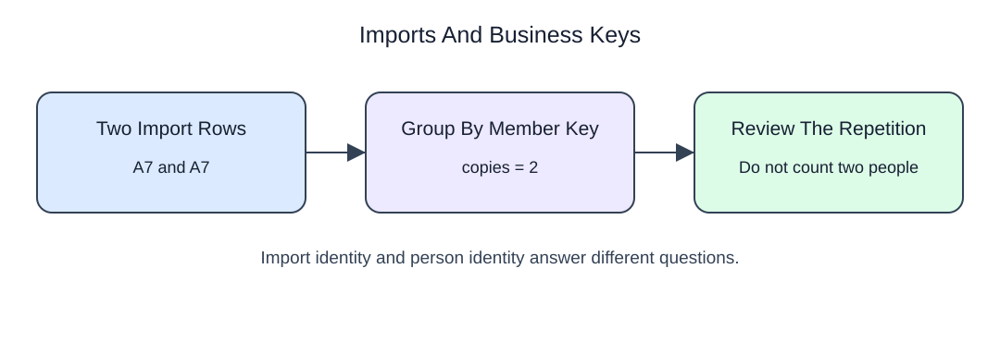

# Define the row before the metric

## Data model

### Example data

These objects are loaded at the start. Only the query inputs and their required lineage are listed; other tables in a shared seed are not part of this report.

#### `bookings`

One row represents one workshop booking, not one attendee.

| Field / SQL type | Meaning | Rules |
| --- | --- | --- |
| `booking_id` · `integer` | Booking record identifier. | Nullable; `NULL` means the identifier or reference is unrecorded. |
| `seats` · `integer` | Number of attendee seats reserved by this booking. | Nullable; `NULL` means the seats measure is unrecorded, not zero. |
| `state` · `text` | Booking status; confirmed and cancelled are sample labels, not an enforced list. | Nullable; `NULL` means no state value is recorded. |

No primary or unique key is declared; distinct sample identifiers are not a uniqueness guarantee.

This separate import example illustrates why a received-record ID is not the same as a person's identity. The booking query below applies the same question about row meaning.



The repair club wants a reliable quarter report. Begin by deciding what a row represents before counting or adding anything.

You should already recognize `SELECT`, `WHERE`, and a join. This short refresh makes the analysis contract explicit: population, row grain, measure, and output order. A ticket table can answer questions about tickets; it cannot directly tell you how many distinct people visited.

`SELECT` chooses columns, `WHERE` keeps rows, and `ORDER BY` makes display order deliberate. An alias after `AS` names a result column. Keep the record key in an inspection query so equal amounts do not look like duplicate records.

## Read and run

A pottery workshop has one row per booking, not per attendee.

```sql run
SELECT booking_id, seats AS reserved_seats
FROM bookings
WHERE state = 'confirmed'
ORDER BY booking_id;
```

The two returned bookings each reserve two seats. Two rows and four seats answer different questions. Filtering happens before the result is displayed; sorting changes neither population nor grain.

If booking 22 became confirmed, the report would gain a booking row. Its reserved seats would still be a separate measure.
