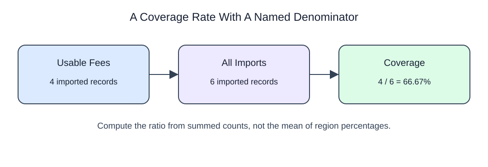

# Define both sides of a rate

A percentage needs a named numerator and denominator. Use the FILTER counts you just practiced to keep fulfilled requests and all submitted requests in the same population. Multiplying by 100.0 preserves fractional arithmetic.

NULLIF(denominator, 0), taught during cleaning, makes a zero denominator NULL instead of causing division by zero. No attempts is an undefined rate; zero successes out of several attempts is 0%. To combine groups, divide summed numerators by summed denominators rather than averaging percentages.

```sql run
SELECT desk,
       COUNT(*) AS requests,
       COUNT(*) FILTER (WHERE fulfilled) AS fulfilled,
       ROUND(100.0 * COUNT(*) FILTER (WHERE fulfilled) / NULLIF(COUNT(*),0),2) AS fulfilled_pct
FROM requests
GROUP BY desk
ORDER BY desk;
```

Here is the same denominator rule applied to intake coverage: four usable fee records out of six imports. These are illustrative import counts, not the request totals above.


