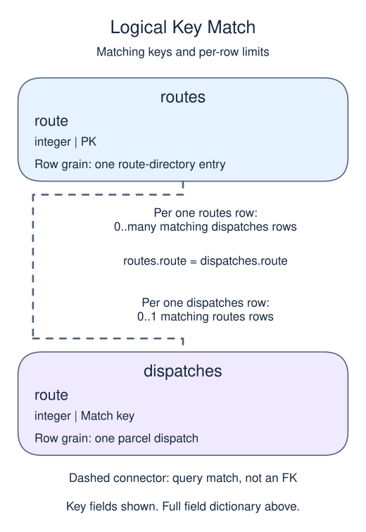

# Make unmatched records visible

## Data model

### Example data

These objects are loaded at the start. Only the query inputs and their required lineage are listed; other tables in a shared seed are not part of this report.

#### `dispatches`

One row represents one parcel dispatch.

| Field / SQL type | Meaning | Rules |
| --- | --- | --- |
| `parcel` · `integer` | Parcel identifier recorded by the desk. | Nullable; `NULL` means no parcel value is recorded. |
| `route` · `integer` | Route lookup key; no foreign key requires the route to exist. | Nullable; `NULL` means the identifier or reference is unrecorded. |

No primary or unique key is declared; distinct sample identifiers are not a uniqueness guarantee.

Route 9 is deliberately absent from the directory. A missing match is distinct from a matched route with a missing name.

#### `routes`

One row represents one route-directory entry.

| Field / SQL type | Meaning | Rules |
| --- | --- | --- |
| `route` · `integer` | Unique route identifier. | Primary key; unique. Required; cannot be `NULL`. |
| `name` · `text` | Route display name, not an identifier. | Nullable; `NULL` means no name value is recorded. |

### Relationship map

Aliases name query roles, not extra tables: `d` = `dispatches`, `r` = `routes`.



Each `routes` row can match zero or many `dispatches` rows; each `dispatches` row can match zero or one `routes` rows. The stated keys and grouped or deduplicated grain determine these match limits; a child matching column can repeat unless its constraints or query grain make that value unique. Column names alone do not guarantee uniqueness. This is a logical query match, not a declared foreign key between these inputs. Missing or unmatched references need not have a parent.

An inner join omits nonmatches. A left join retains its left population and a full join retains both populations, using NULLs only for the missing side. These outer-join NULLs differ from unknown values stored in a real row. A one-to-many detail match repeats the other side's fields; preaggregate before summing parent-level money. An EXISTS test only asks whether a match exists and does not copy all matching child rows.

A join can silently remove real activity. Decide whether unmatched orders should be excluded, retained, or investigated before reporting a regional total.

An inner join returns matching pairs. A left join retains every left row and fills right-side columns with null when no match exists. A right-side condition in `WHERE` can remove those null-extended rows and accidentally undo that retention. Put eligibility conditions in `ON` when they should limit matches without removing the left population.

Use aliases to distinguish keys, such as `o.member_id` and `m.member_id`. A null right-side primary key after a left join is a reliable missing-match signal because an actual primary key cannot be null. Displaying an unknown region is a reporting policy; it does not repair the missing member record.

## Read and run

A parcel desk has one row per dispatch in `dispatches`; `parcel` identifies the parcel and `route` is an integer lookup key. The separate `routes` directory has one row per route, enforced by its primary key, plus a text `name`. There is no declared foreign key from dispatches, so route 9 can be absent. Joining to the unique route key can add a label without multiplying dispatches.

```sql run
SELECT d.parcel, COALESCE(r.name, 'unmatched') AS route_name
FROM dispatches d
LEFT JOIN routes r ON r.route = d.route
ORDER BY d.parcel;
```

Both parcels remain. The unmatched label tells the reader why the second route is unavailable rather than making that dispatch disappear.

Adding route 9 to the directory would replace the unmatched label, not add another dispatch. The parcel keys should remain the same.
