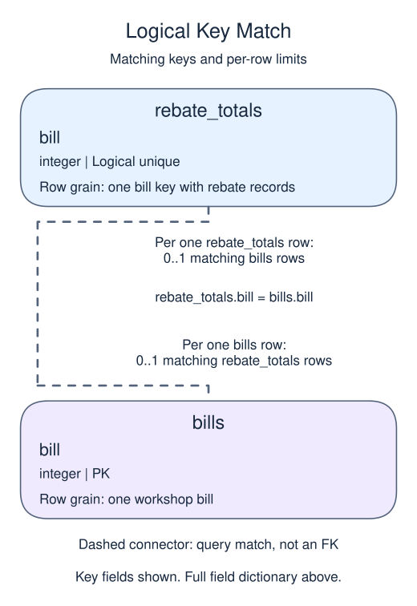
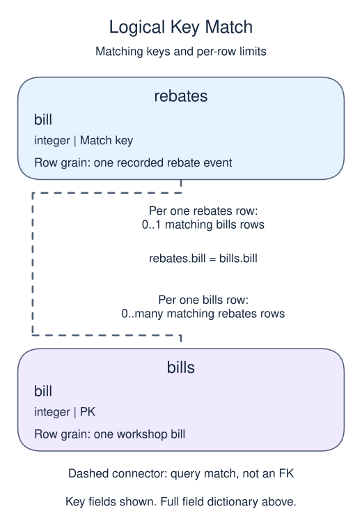
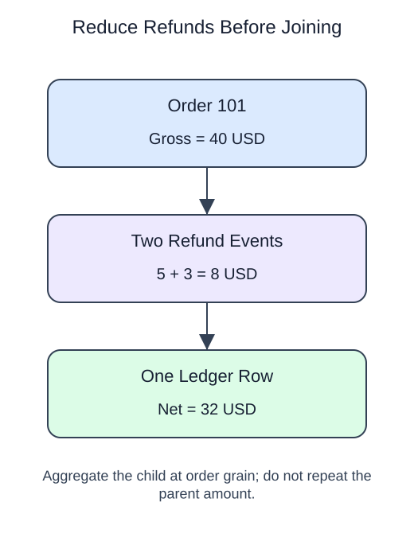

# Prevent join fanout with preaggregation

## Data model

### Example data

These objects are loaded at the start. Only the query inputs and their required lineage are listed; other tables in a shared seed are not part of this report.

#### `bills`

One row represents one workshop bill.

| Field / SQL type | Meaning | Rules |
| --- | --- | --- |
| `bill` · `integer` | Bill identifier. | Primary key; unique. Required; cannot be `NULL`. |
| `total` · `numeric` | Whole-bill gross amount in common currency units, before rebates; the demo does not declare a currency code. | Nullable; `NULL` means the total measure is unrecorded, not zero. |

#### `rebates`

One row represents one recorded rebate event.

| Field / SQL type | Meaning | Rules |
| --- | --- | --- |
| `bill` · `integer` | Logical bill reference; not a foreign key. | Nullable; `NULL` means the identifier or reference is unrecorded. |
| `value` · `numeric` | Amount of this rebate in the same currency units as bills.total. | Nullable; `NULL` means the value measure is unrecorded, not zero. |

No primary or unique key is declared; distinct sample identifiers are not a uniqueness guarantee.

Several rebates may belong to one bill; no rebate primary key is declared. Known sample rebates do not make value NOT NULL.

### Named intermediate results

These dictionaries describe the columns exposed by the named query steps. They are not extra preloaded tables or a complete answer query.

#### `rebate_totals`

One row represents one bill key with rebate records.

| Field / SQL type | Meaning | Rules |
| --- | --- | --- |
| `bill` · `integer` | Bill reference used as the logical group key; a NULL-key group is allowed. | May be `NULL` under its source or expression policy. |
| `rebate` · `numeric` | Sum of recorded rebate values in common bill currency units. | May be `NULL` under its source or expression policy. SUM ignores NULL values; all-unknown groups have NULL total. |

This CTE is statement-local; it has no independently declared primary key, foreign key or NOT NULL constraint.

One summary per bill key prevents bill totals repeating across separate rebate events.

### Relationship map

Aliases name query roles, not extra tables: `b` = `bills`, `r` = `rebate_totals`.



Each `rebate_totals` row can match zero or one `bills` rows; each `bills` row can match zero or one `rebate_totals` rows. The stated keys and grouped or deduplicated grain determine these match limits; a child matching column can repeat unless its constraints or query grain make that value unique. Column names alone do not guarantee uniqueness. This is a logical query match, not a declared foreign key between these inputs. Missing or unmatched references need not have a parent.



Each `rebates` row can match zero or one `bills` rows; each `bills` row can match zero or many `rebates` rows. The stated keys and grouped or deduplicated grain determine these match limits; a child matching column can repeat unless its constraints or query grain make that value unique. Column names alone do not guarantee uniqueness. This is a logical query match, not a declared foreign key between these inputs. Missing or unmatched references need not have a parent.

An inner join omits nonmatches. A left join retains its left population and a full join retains both populations, using NULLs only for the missing side. These outer-join NULLs differ from unknown values stored in a real row. A one-to-many detail match repeats the other side's fields; preaggregate before summing parent-level money. An EXISTS test only asks whether a match exists and does not copy all matching child rows.

In this separate order example, two refunds must become one order-level total before the join. The runnable bill example below uses different amounts.



Two child tables can multiply each other when joined through a parent. Put each source at the intended output grain before combining totals.

If one invoice has two items and three payments, joining both children produces six pairs. Summing an invoice amount across those pairs repeats it six times. `SUM(DISTINCT amount)` is not a repair: two legitimate invoices can have equal amounts.

Aggregate each child to one row per parent key first. Then join those summaries to the parent. A missing child summary can mean no recorded activity; use `COALESCE(total, 0)` only when that interpretation is justified. State each intermediate grain in a comment while building the query.

## Read and run

A workshop has two bills with equal totals; one bill has two separate rebates.

```sql run
WITH rebate_totals AS (
  SELECT bill, SUM(value) AS rebate
  FROM rebates GROUP BY bill
)
SELECT b.bill, b.total - COALESCE(r.rebate, 0) AS net
FROM bills b LEFT JOIN rebate_totals r ON r.bill = b.bill
ORDER BY b.bill;
```

Each bill appears once, including the bill with no rebates. The equal gross amounts remain separate. Reducing rebates to one row per bill prevents the parent total from being repeated.

Another rebate for bill 81 should change its net amount, not the number of bill rows. Check both when reviewing a join.
