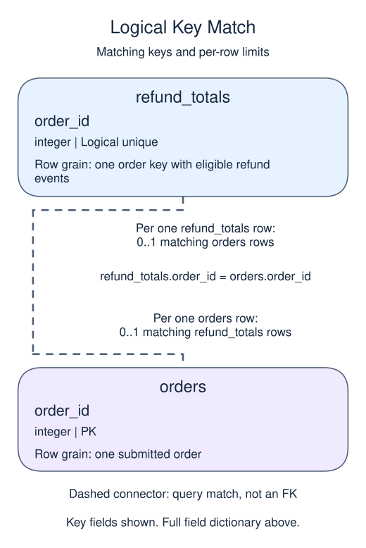
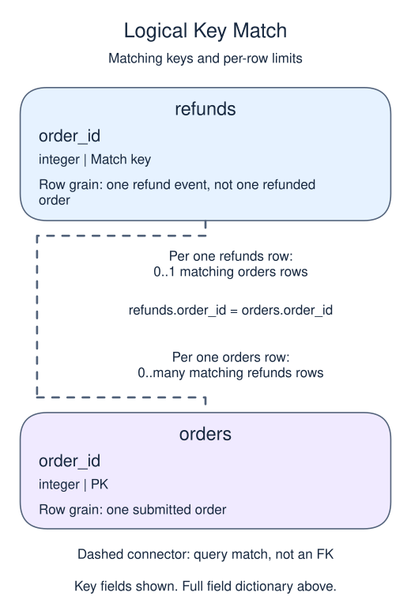

# Exercise: prevent join fanout with preaggregation

## Data model

### Exercise data

These objects are loaded at the start. Only the query inputs and their required lineage are listed; other tables in a shared seed are not part of this report.

#### `orders`

One row represents one submitted order.

| Field / SQL type | Meaning | Rules |
| --- | --- | --- |
| `order_id` · `integer` | Order identifier; equal order totals still belong to separate orders. | Primary key; unique. Required; cannot be `NULL`. |
| `member_id` · `integer` | Member key used to look up a registered member; no foreign key is declared. | Nullable; `NULL` means the identifier or reference is unrecorded. |
| `placed_at` · `timestamp with time zone` | Order occurrence instant, interpreted in UTC unless the query explicitly chooses a local reporting zone. | Required; cannot be `NULL`. |
| `status` · `text` | Order status: paid, pending and cancelled occur in the snapshot; paid defines revenue eligibility. | Required; cannot be `NULL`. |
| `amount` · `numeric(10,2)` | Whole-order gross amount in USD before refunds, not a unit price or an order-line amount. | Nullable; `NULL` means the order gross amount is unknown, not zero. |
| `coupon` · `text` | Optional coupon code recorded on the order. | Nullable; `NULL` means no coupon code is recorded. |

The status labels are observed values, not a CHECK constraint. Paid amounts are known in this supplied snapshot; the nullable column also contains an unknown pending amount. No nonnegative-amount rule or member foreign key is declared. An orphan member key is a real order, not a member registration. The supplied orphan key is 99.

#### `refunds`

One row represents one refund event, not one refunded order.

| Field / SQL type | Meaning | Rules |
| --- | --- | --- |
| `refund_id` · `integer` | Refund-event identifier; an order can have several different refund IDs. | Primary key; unique. Required; cannot be `NULL`. |
| `order_id` · `integer` | Logical parent order identifier; not a declared foreign key. | Nullable; `NULL` means the identifier or reference is unrecorded. |
| `refunded_at` · `timestamp with time zone` | Refund occurrence instant, interpreted in UTC for cutoff tests; no separate receipt time is stored. | Nullable; `NULL` means refund occurrence time is unrecorded. |
| `amount` · `numeric(10,2)` | USD amount returned by this one refund event, not the original order gross amount. | Nullable; `NULL` means the event refund amount is unknown, not zero. |

Supplied refund amounts are known and positive, but the schema permits NULL and does not enforce positivity. Sum events to order grain before attaching them to an order total. No receipt/version history exists to reconstruct late knowledge on a changing source.

### Named intermediate results

These dictionaries describe the columns exposed by the named query steps. They are not extra preloaded tables or a complete answer query.

#### `refund_totals`

One row represents one order key with eligible refund events.

| Field / SQL type | Meaning | Rules |
| --- | --- | --- |
| `order_id` · `integer` | Refund-source order key used for grouping. | May be `NULL` under its source or expression policy. Logical unique group key, including at most one NULL group; not a physical primary key. |
| `refunded` · `numeric` | Sum of refund-event amounts in USD for this order key. | May be `NULL` under its source or expression policy. SUM ignores unknown amounts and is NULL if all amounts in a group are unknown. No declared precision or scale. |

This CTE is statement-local; it has no independently declared primary key, foreign key or NOT NULL constraint.

This summary uses the full supplied refund snapshot. Grouped keys are logically unique, not physical primary keys; NULL grouping remains possible.

### Relationship map

Aliases name query roles, not extra tables: `o` = `orders`, `r` = `refund_totals`.

Each `refund_totals` row can match zero or one `orders` rows; each `orders` row can match zero or one `refund_totals` rows. The stated keys and grouped or deduplicated grain determine these match limits; a child matching column can repeat unless its constraints or query grain make that value unique. Column names alone do not guarantee uniqueness. This is a logical query match, not a declared foreign key between these inputs. Missing or unmatched references need not have a parent.

Each `refunds` row can match zero or one `orders` rows; each `orders` row can match zero or many `refunds` rows. The stated keys and grouped or deduplicated grain determine these match limits; a child matching column can repeat unless its constraints or query grain make that value unique. Column names alone do not guarantee uniqueness. This is a logical query match, not a declared foreign key between these inputs. Missing or unmatched references need not have a parent.

An inner join omits nonmatches. A left join retains its left population and a full join retains both populations, using NULLs only for the missing side. These outer-join NULLs differ from unknown values stored in a real row. A one-to-many detail match repeats the other side's fields; preaggregate before summing parent-level money. An EXISTS test only asks whether a match exists and does not copy all matching child rows.

Calculate net amount once per paid order.

For this full-snapshot exercise, subtract all recorded refunds from paid gross amounts. Aggregate refunds at order grain before joining. No recorded refund means zero refunded under this exercise's complete-snapshot policy; an unknown refund amount would require review rather than that fallback.

## Your Task

1. Return `order_id`, `gross`, `refunded`, and `net`, keeping paid orders with no refund as zero refunded; order by `order_id`.

Replace the preview in `script.sql`. Run your query, check the returned rows, then Submit.

Order 101 has two refunds. Its gross amount must appear once, and its refund total must include both events.
