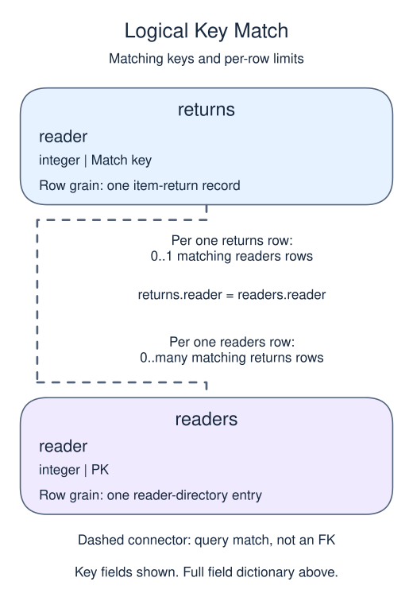

# Use existence when you do not need child rows

## Data model

### Example data

These objects are loaded at the start. Only the query inputs and their required lineage are listed; other tables in a shared seed are not part of this report.

#### `readers`

One row represents one reader-directory entry.

| Field / SQL type | Meaning | Rules |
| --- | --- | --- |
| `reader` · `integer` | Reader identifier used to match borrowing, return or purchase records. | Primary key; unique. Required; cannot be `NULL`. |

The primary key makes the reader match unique. A reader can still have no return records.

#### `returns`

One row represents one item-return record.

| Field / SQL type | Meaning | Rules |
| --- | --- | --- |
| `reader` · `integer` | Logical reader reference; may be missing or unmatched because no foreign key is declared. | Nullable; `NULL` means the identifier or reference is unrecorded. |
| `late` · `boolean` | Whether the return was late: true or false. | Nullable; `NULL` means no late value is recorded. |

No primary or unique key is declared; distinct sample identifiers are not a uniqueness guarantee.

A NULL reader cannot match a known reader using equality. An unknown late flag is not a demonstrated late return.

### Relationship map

Aliases name query roles, not extra tables: `r` = `readers`, `x` = `returns`.



Each `returns` row can match zero or one `readers` rows; each `readers` row can match zero or many `returns` rows. The stated keys and grouped or deduplicated grain determine these match limits; a child matching column can repeat unless its constraints or query grain make that value unique. Column names alone do not guarantee uniqueness. This is a logical query match, not a declared foreign key between these inputs. Missing or unmatched references need not have a parent.

An inner join omits nonmatches. A left join retains its left population and a full join retains both populations, using NULLs only for the missing side. These outer-join NULLs differ from unknown values stored in a real row. A one-to-many detail match repeats the other side's fields; preaggregate before summing parent-level money. An EXISTS test only asks whether a match exists and does not copy all matching child rows.

A question about whether activity exists does not need one output row per activity. Use a semi-join pattern to keep the member grain.

`EXISTS (SELECT 1 FROM ... WHERE ...)` is true if the subquery finds any row. The selected constant is irrelevant; existence is the question. A correlated subquery refers to the current outer row, so each member can receive their own test.

`NOT EXISTS` is especially useful for missing-activity reports. Unlike `NOT IN`, it does not become unknown because a subquery happens to contain a null key. Counting joined rows and adding DISTINCT afterward is unnecessary when existence is all you need.

## Read and run

A library wants readers who have never returned an item late.

```sql run
SELECT r.reader
FROM readers r
WHERE NOT EXISTS (
  SELECT 1 FROM returns x
  WHERE x.reader = r.reader AND x.late
)
ORDER BY r.reader;
```

Readers 2 and 3 remain exactly once. The null reader in the returns table does not invalidate the missing-activity check.

A late return by reader 3 would remove that reader from the result. It would not affect reader 2 because the subquery is correlated.
