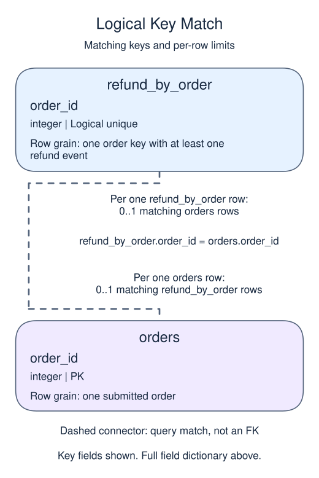
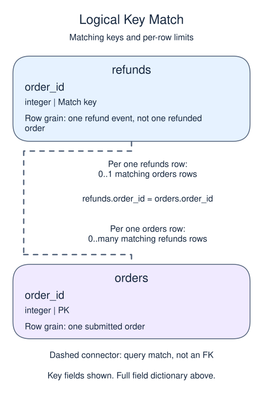

# Refund project 2: preserve the paid-order population

## Data model

### Exercise data

These objects are loaded at the start. Only the query inputs and their required lineage are listed; other tables in a shared seed are not part of this report.

#### `orders`

One row represents one submitted order.

| Field / SQL type | Meaning | Rules |
| --- | --- | --- |
| `order_id` · `integer` | Order identifier; equal order totals still belong to separate orders. | Primary key; unique. Required; cannot be `NULL`. |
| `member_id` · `integer` | Member key used to look up a registered member; no foreign key is declared. | Nullable; `NULL` means the identifier or reference is unrecorded. |
| `placed_at` · `timestamp with time zone` | Order occurrence instant, interpreted in UTC unless the query explicitly chooses a local reporting zone. | Required; cannot be `NULL`. |
| `status` · `text` | Order status: paid, pending and cancelled occur in the snapshot; paid defines revenue eligibility. | Required; cannot be `NULL`. |
| `amount` · `numeric(10,2)` | Whole-order gross amount in USD before refunds, not a unit price or an order-line amount. | Nullable; `NULL` means the order gross amount is unknown, not zero. |
| `coupon` · `text` | Optional coupon code recorded on the order. | Nullable; `NULL` means no coupon code is recorded. |

The status labels are observed values, not a CHECK constraint. Paid amounts are known in this supplied snapshot; the nullable column also contains an unknown pending amount. No nonnegative-amount rule or member foreign key is declared. An orphan member key is a real order, not a member registration. The supplied orphan key is 99.

#### `refund_by_order`

One row represents one order key with at least one refund event.

| Field / SQL type | Meaning | Rules |
| --- | --- | --- |
| `order_id` · `integer` | Refund-source order key used for grouping. | May be `NULL` under its source or expression policy. Logical unique group key, including at most one NULL group; not a physical primary key. |
| `refunded` · `numeric` | Sum of refund-event amounts in USD for this order key. | May be `NULL` under its source or expression policy. SUM ignores unknown amounts and is NULL if all amounts in a group are unknown. No declared precision or scale. |

This ordinary view stores a query definition, not frozen rows; it has no independently declared primary key, foreign key or NOT NULL constraint.

This full-snapshot summary has one row per order key, not one row per refund; orders with no refund events have no summary row.

#### `refunds`

One row represents one refund event, not one refunded order.

| Field / SQL type | Meaning | Rules |
| --- | --- | --- |
| `refund_id` · `integer` | Refund-event identifier; an order can have several different refund IDs. | Primary key; unique. Required; cannot be `NULL`. |
| `order_id` · `integer` | Logical parent order identifier; not a declared foreign key. | Nullable; `NULL` means the identifier or reference is unrecorded. |
| `refunded_at` · `timestamp with time zone` | Refund occurrence instant, interpreted in UTC for cutoff tests; no separate receipt time is stored. | Nullable; `NULL` means refund occurrence time is unrecorded. |
| `amount` · `numeric(10,2)` | USD amount returned by this one refund event, not the original order gross amount. | Nullable; `NULL` means the event refund amount is unknown, not zero. |

Supplied refund amounts are known and positive, but the schema permits NULL and does not enforce positivity. Sum events to order grain before attaching them to an order total. No receipt/version history exists to reconstruct late knowledge on a changing source.

### Tables and views to define

These objects do not exist in the starting database. Their fields describe the target definition, not additional columns already available to the starter.

#### `paid_ledger`

One row represents one paid order.

| Field / SQL type | Meaning | Rules |
| --- | --- | --- |
| `order_id` · `integer` | Order identity inherited unchanged from orders.order_id. | Non-NULL by query lineage, not a declared NOT NULL constraint. Logical unique non-NULL key inherited from the base primary key; no view primary key is declared. |
| `member_id` · `integer` | Member key inherited from the order; it may be missing or unmatched. | May be `NULL` under its source or expression policy. |
| `gross` · `numeric(10,2)` | Whole-order gross USD before refunds, inherited from orders.amount. | May be `NULL` under its source or expression policy. The base amount is nullable; known paid sample values do not make the view enforce NOT NULL. |
| `refunded` · `numeric` | Total recorded refund USD for this order after any stated cutoff, with absent summaries displayed as zero. | Non-NULL by query lineage, not a declared NOT NULL constraint. COALESCE makes the output non-NULL; it does not impose a physical constraint or prove source completeness. |
| `net` · `numeric` | Order gross USD minus its aggregated refunded USD. | May be `NULL` under its source or expression policy. A missing gross amount propagates to net; known sample net amounts do not create a NOT NULL constraint. |

This ordinary view stores a query definition, not frozen rows; it has no independently declared primary key, foreign key or NOT NULL constraint.

The preaggregated refund side cannot multiply a paid order. Zero for absent refunds relies on the complete supplied snapshot, not a guarantee that unknown refund amounts are zero.

### Relationship map

Aliases name query roles, not extra tables: `o` = `orders`, `r` = `refund_by_order`.

Each `refund_by_order` row can match zero or one `orders` rows; each `orders` row can match zero or one `refund_by_order` rows. The stated keys and grouped or deduplicated grain determine these match limits; a child matching column can repeat unless its constraints or query grain make that value unique. Column names alone do not guarantee uniqueness. This is a logical query match, not a declared foreign key between these inputs. Missing or unmatched references need not have a parent.

Each `refunds` row can match zero or one `orders` rows; each `orders` row can match zero or many `refunds` rows. The stated keys and grouped or deduplicated grain determine these match limits; a child matching column can repeat unless its constraints or query grain make that value unique. Column names alone do not guarantee uniqueness. This is a logical query match, not a declared foreign key between these inputs. Missing or unmatched references need not have a parent.

An inner join omits nonmatches. A left join retains its left population and a full join retains both populations, using NULLs only for the missing side. These outer-join NULLs differ from unknown values stored in a real row. A one-to-many detail match repeats the other side's fields; preaggregate before summing parent-level money. An EXISTS test only asks whether a match exists and does not copy all matching child rows.

Attach refunds to paid orders and retain the order key so the ledger can still be traced back to its source.

## Project continuity

This is stage 2 of the same report. The seed restores every earlier completed view, and the starter includes the previous stage's complete script. Keep that prefix and replace only the final preview query with this stage's work. You do not need a previous Run to make this lesson work.

Prerequisites: Refund project 1; left joins, COALESCE, arithmetic and views.

The right side is now unique by order ID. A left join keeps paid orders with no refund. Zero is justified here because the complete supplied refund snapshot has no recorded event for those orders.

## Your Task

1. Create or replace `paid_ledger` with `order_id`, `member_id`, `gross`, `refunded`, and `net`; return those columns ordered by `order_id`.

Edit `script.sql`, Run to inspect the final table, then Submit. The result checks cover column names, row count, and complete rows. They do not prove a particular view definition or transaction was used.

Before rolling this up, compare the ledger row count with the paid-order source count. A change in that count signals a join or filter problem.
