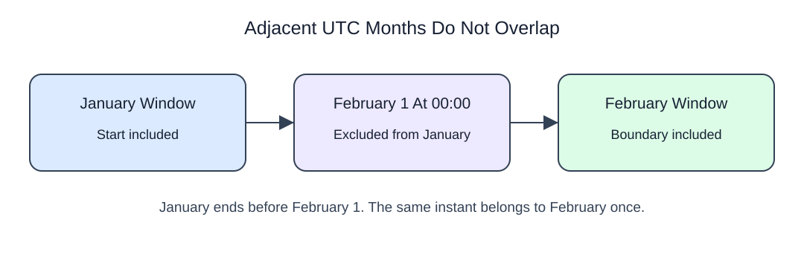

# Keep adjacent time periods separate

## Data model

### Example data

These objects are loaded at the start. Only the query inputs and their required lineage are listed; other tables in a shared seed are not part of this report.

#### `returns_clock`

One row represents one return record.

| Field / SQL type | Meaning | Rules |
| --- | --- | --- |
| `return_id` · `integer` | Return-record identifier. | Nullable; `NULL` means the identifier or reference is unrecorded. |
| `at` · `timestamp with time zone` | Return occurrence instant; UTC and New York date displays refer to this same instant. | Nullable; `NULL` means occurrence time is unrecorded. |

No primary or unique key is declared; distinct sample identifiers are not a uniqueness guarantee.

Use an inclusive start and exclusive end: timestamp >= start AND timestamp < end. The typed TIMESTAMPTZ literal includes an explicit offset so the boundary identifies an instant. Adjacent periods meet without sharing that instant.

BETWEEN includes both ends and can therefore double-count midnight across neighboring periods. The example selects UTC February dates while displaying local dates with the conversion you just learned. A local display date does not alter the UTC membership rule.

```sql run
SELECT return_id,
       (at AT TIME ZONE 'America/New_York')::date::text
         AS local_day
FROM returns_clock
WHERE at >= TIMESTAMPTZ '2025-02-01 00:00+00'
  AND at < TIMESTAMPTZ '2025-03-01 00:00+00'
ORDER BY return_id;
```


