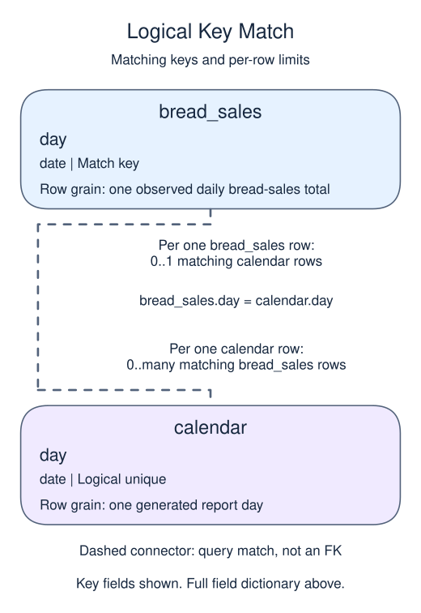

# Fill calendar gaps before measuring trends

## Data model

### Example data

These objects are loaded at the start. Only the query inputs and their required lineage are listed; other tables in a shared seed are not part of this report.

#### `bread_sales`

One row represents one observed daily bread-sales total.

| Field / SQL type | Meaning | Rules |
| --- | --- | --- |
| `day` · `date` | Sales calendar date; sample dates are unique, but no key enforces that. | Nullable; `NULL` means the calendar date is unrecorded. |
| `loaves` · `integer` | Number of loaves sold on this date. | Nullable; `NULL` means the loaves measure is unrecorded, not zero. |

No primary or unique key is declared; distinct sample identifiers are not a uniqueness guarantee.

The supplied feed is complete for the demonstrated three-day interval. An absent date can be displayed as zero under that assumption; a real feed outage would be unknown activity instead.

### Named intermediate results

These dictionaries describe the columns exposed by the named query steps. They are not extra preloaded tables or a complete answer query.

#### `calendar`

One row represents one generated report day.

| Field / SQL type | Meaning | Rules |
| --- | --- | --- |
| `day` · `date` | Calendar date for one complete report day; March briefing dates use UTC. | Non-NULL by query lineage, not a declared NOT NULL constraint. Logical unique date from the generated spine; not a declared primary key. |

This CTE is statement-local; it has no independently declared primary key, foreign key or NOT NULL constraint.

GENERATE_SERIES supplies each stated boundary once, including its end. These are generated dates, not rows loaded from a calendar table.

### Relationship map

Aliases name query roles, not extra tables: `c` = `calendar`, `s` = `bread_sales`.



Each `bread_sales` row can match zero or one `calendar` rows; each `calendar` row can match zero or many `bread_sales` rows. The stated keys and grouped or deduplicated grain determine these match limits; a child matching column can repeat unless its constraints or query grain make that value unique. Column names alone do not guarantee uniqueness. This is a logical query match, not a declared foreign key between these inputs. Missing or unmatched references need not have a parent.

An inner join omits nonmatches. A left join retains its left population and a full join retains both populations, using NULLs only for the missing side. These outer-join NULLs differ from unknown values stored in a real row. A one-to-many detail match repeats the other side's fields; preaggregate before summing parent-level money. An EXISTS test only asks whether a match exists and does not copy all matching child rows.

A missing day can mean zero activity or a broken feed. Once the feed is known to be complete, a date spine lets the report show zero-activity days explicitly.

`GENERATE_SERIES(start, stop, step)` produces a sequence, including the stop when it lands on the sequence. With timestamp boundaries and an interval it can generate calendar days. Alias its output with `AS g(day)` so later CTEs can refer to a clear name.

Aggregate activity to one row per day first, then left join it onto the date spine. The spine defines the report population. `COALESCE(total, 0)` is justified only because this fixture is a complete feed. For a real interrupted feed, keep a separate completeness flag rather than claiming zero sales.

## Read and run

A community oven records bread sales on two of three observed days.

```sql run
WITH calendar AS (
  SELECT day::date AS day
  FROM GENERATE_SERIES(TIMESTAMP '2025-02-10',
       TIMESTAMP '2025-02-12', INTERVAL '1 day') AS g(day)
)
SELECT c.day::text AS day, COALESCE(s.loaves, 0) AS loaves
FROM calendar c LEFT JOIN bread_sales s ON s.day = c.day
ORDER BY c.day;
```

February 11 is present with zero loaves. That row is a reporting assumption supported by the complete fixture, not something the left join can prove about a real source.

If the till were offline on February 11, this query would still display zero. Explain why the same output would no longer be a reliable activity report before trying the next exercise.
