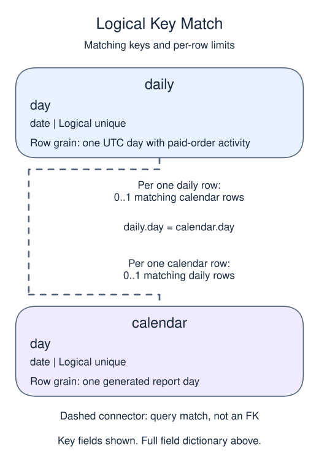

# Exercise: fill calendar gaps before measuring trends

## Data model

### Exercise data

These objects are loaded at the start. Only the query inputs and their required lineage are listed; other tables in a shared seed are not part of this report.

#### `orders`

One row represents one submitted order.

| Field / SQL type | Meaning | Rules |
| --- | --- | --- |
| `order_id` · `integer` | Order identifier; equal order totals still belong to separate orders. | Primary key; unique. Required; cannot be `NULL`. |
| `member_id` · `integer` | Member key used to look up a registered member; no foreign key is declared. | Nullable; `NULL` means the identifier or reference is unrecorded. |
| `placed_at` · `timestamp with time zone` | Order occurrence instant, interpreted in UTC unless the query explicitly chooses a local reporting zone. | Required; cannot be `NULL`. |
| `status` · `text` | Order status: paid, pending and cancelled occur in the snapshot; paid defines revenue eligibility. | Required; cannot be `NULL`. |
| `amount` · `numeric(10,2)` | Whole-order gross amount in USD before refunds, not a unit price or an order-line amount. | Nullable; `NULL` means the order gross amount is unknown, not zero. |
| `coupon` · `text` | Optional coupon code recorded on the order. | Nullable; `NULL` means no coupon code is recorded. |

The status labels are observed values, not a CHECK constraint. Paid amounts are known in this supplied snapshot; the nullable column also contains an unknown pending amount. No nonnegative-amount rule or member foreign key is declared. An orphan member key is a real order, not a member registration. The supplied orphan key is 99.

### Named intermediate results

These dictionaries describe the columns exposed by the named query steps. They are not extra preloaded tables or a complete answer query.

#### `calendar`

One row represents one generated report day.

| Field / SQL type | Meaning | Rules |
| --- | --- | --- |
| `day` · `date` | Calendar date for one complete report day; March briefing dates use UTC. | Non-NULL by query lineage, not a declared NOT NULL constraint. Logical unique date from the generated spine; not a declared primary key. |

This CTE is statement-local; it has no independently declared primary key, foreign key or NOT NULL constraint.

GENERATE_SERIES supplies each stated boundary once, including its end. These are generated dates, not rows loaded from a calendar table.

#### `daily`

One row represents one UTC day with paid-order activity.

| Field / SQL type | Meaning | Rules |
| --- | --- | --- |
| `day` · `date` | UTC occurrence date of paid orders. | Non-NULL by query lineage, not a declared NOT NULL constraint. Logical unique grouped date; source occurrence time is required. |
| `gross` · `numeric` | Sum of paid-order gross USD on this activity date. | May be `NULL` under its source or expression policy. SUM is NULL for an all-unknown amount group; absent dates have no row here. |

This CTE is statement-local; it has no independently declared primary key, foreign key or NOT NULL constraint.

This is the activity summary before calendar completion; no orders is a missing summary row, not a stored zero.

### Relationship map

Aliases name query roles, not extra tables: `c` = `calendar`, `d` = `daily`.

Each `daily` row can match zero or one `calendar` rows; each `calendar` row can match zero or one `daily` rows. The stated keys and grouped or deduplicated grain determine these match limits; a child matching column can repeat unless its constraints or query grain make that value unique. Column names alone do not guarantee uniqueness. This is a logical query match, not a declared foreign key between these inputs. Missing or unmatched references need not have a parent.

An inner join omits nonmatches. A left join retains its left population and a full join retains both populations, using NULLs only for the missing side. These outer-join NULLs differ from unknown values stored in a real row. A one-to-many detail match repeats the other side's fields; preaggregate before summing parent-level money. An EXISTS test only asks whether a match exists and does not copy all matching child rows.

Produce a complete five-day paid-revenue series.

The supplied order feed is complete for March 1–5, 2025 in UTC. Include unmatched member orders because this is an order-source total.

## Your Task

1. Return every `day` from March 1 through March 5 as ISO text and `gross` paid amount, filling days without paid orders with zero; order by `day`.

Replace the preview in `script.sql`. Run your query, check the returned rows, then Submit.

There are two paid orders on March 2. Reduce them to one daily total before joining the calendar, or the report will have more than one row for that day.
