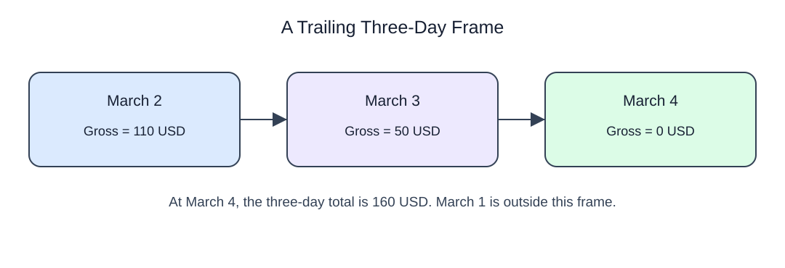

# Restrict a total to a trailing row window

ROWS BETWEEN 2 PRECEDING AND CURRENT ROW includes the current row and up to two predecessors. It uses fewer rows near the partition start. A three-row frame means three days only when the input has one row for every day. On purchases it means three purchases, regardless of time gaps.

On the final day, the frame no longer includes the earliest day. Here rows are days; in the exercise they are purchases.

```sql run
SELECT day::text AS day,refills,SUM(refills) OVER (ORDER BY day ROWS BETWEEN 2 PRECEDING AND CURRENT ROW) AS total
FROM daily_refills
ORDER BY day;
```

This separate revenue example shows the same frame at March 4: three complete daily rows contribute. Its dollars are not the refill counts in the demo.


