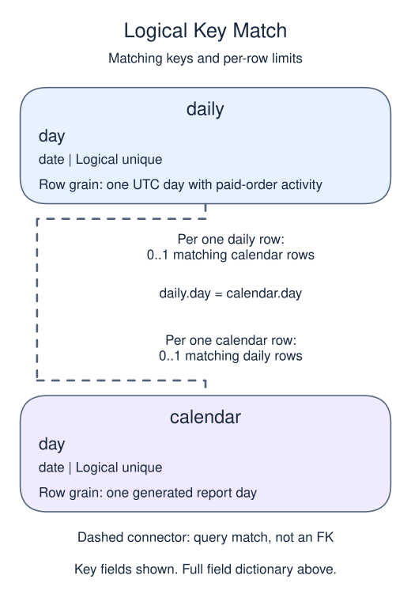

# Daily briefing 2: cumulative and trailing totals

## Data model

### Exercise data

These objects are loaded at the start. Only the query inputs and their required lineage are listed; other tables in a shared seed are not part of this report.

#### `march_daily`

One row represents one UTC day in the complete March 1–5, 2025 report.

| Field / SQL type | Meaning | Rules |
| --- | --- | --- |
| `day` · `date` | Calendar date for one complete report day; March briefing dates use UTC. | Non-NULL by query lineage, not a declared NOT NULL constraint. Logical unique date from the generated spine; not a declared primary key. |
| `gross` · `numeric` | Total paid-order gross USD for this date; no activity is displayed as zero. | Non-NULL by query lineage, not a declared NOT NULL constraint. COALESCE makes the result non-NULL, including an all-NULL sum; the sample has known paid amounts and a complete feed. |

This ordinary view stores a query definition, not frozen rows; it has no independently declared primary key, foreign key or NOT NULL constraint.

The generated calendar defines the five-day population. Missing feed coverage in another source would be unknown, not an automatic sales zero.

#### `orders`

One row represents one submitted order.

| Field / SQL type | Meaning | Rules |
| --- | --- | --- |
| `order_id` · `integer` | Order identifier; equal order totals still belong to separate orders. | Primary key; unique. Required; cannot be `NULL`. |
| `member_id` · `integer` | Member key used to look up a registered member; no foreign key is declared. | Nullable; `NULL` means the identifier or reference is unrecorded. |
| `placed_at` · `timestamp with time zone` | Order occurrence instant, interpreted in UTC unless the query explicitly chooses a local reporting zone. | Required; cannot be `NULL`. |
| `status` · `text` | Order status: paid, pending and cancelled occur in the snapshot; paid defines revenue eligibility. | Required; cannot be `NULL`. |
| `amount` · `numeric(10,2)` | Whole-order gross amount in USD before refunds, not a unit price or an order-line amount. | Nullable; `NULL` means the order gross amount is unknown, not zero. |
| `coupon` · `text` | Optional coupon code recorded on the order. | Nullable; `NULL` means no coupon code is recorded. |

The status labels are observed values, not a CHECK constraint. Paid amounts are known in this supplied snapshot; the nullable column also contains an unknown pending amount. No nonnegative-amount rule or member foreign key is declared. An orphan member key is a real order, not a member registration. The supplied orphan key is 99.

### Tables and views to define

These objects do not exist in the starting database. Their fields describe the target definition, not additional columns already available to the starter.

#### `march_trend`

One row represents one UTC day in the complete March 1–5, 2025 report.

| Field / SQL type | Meaning | Rules |
| --- | --- | --- |
| `day` · `date` | Calendar date for one complete report day; March briefing dates use UTC. | Non-NULL by query lineage, not a declared NOT NULL constraint. Logical unique date from the generated spine; not a declared primary key. |
| `gross` · `numeric` | Total paid-order gross USD for this date; no activity is displayed as zero. | Non-NULL by query lineage, not a declared NOT NULL constraint. COALESCE makes the result non-NULL, including an all-NULL sum; the sample has known paid amounts and a complete feed. |
| `running_gross` · `numeric` | Paid gross USD accumulated from the first report date through this day. | Non-NULL by query lineage, not a declared NOT NULL constraint. SUM over all preceding rows and this row; each input gross is non-NULL. |
| `trailing_three_days` · `numeric` | Paid gross USD over this calendar row and up to two predecessors. | Non-NULL by query lineage, not a declared NOT NULL constraint. The first two frames are partial; one row per date makes this a daily rather than purchase-row window. |

This ordinary view stores a query definition, not frozen rows; it has no independently declared primary key, foreign key or NOT NULL constraint.

A window projection preserves the logical unique day key; neither window column has a physical NOT NULL constraint.

### Named intermediate results

These dictionaries describe the columns exposed by the named query steps. They are not extra preloaded tables or a complete answer query.

#### `calendar`

One row represents one generated report day.

| Field / SQL type | Meaning | Rules |
| --- | --- | --- |
| `day` · `date` | Calendar date for one complete report day; March briefing dates use UTC. | Non-NULL by query lineage, not a declared NOT NULL constraint. Logical unique date from the generated spine; not a declared primary key. |

This CTE is statement-local; it has no independently declared primary key, foreign key or NOT NULL constraint.

GENERATE_SERIES supplies each stated boundary once, including its end. These are generated dates, not rows loaded from a calendar table.

#### `daily`

One row represents one UTC day with paid-order activity.

| Field / SQL type | Meaning | Rules |
| --- | --- | --- |
| `day` · `date` | UTC occurrence date of paid orders. | Non-NULL by query lineage, not a declared NOT NULL constraint. Logical unique grouped date; source occurrence time is required. |
| `gross` · `numeric` | Sum of paid-order gross USD on this activity date. | May be `NULL` under its source or expression policy. SUM is NULL for an all-unknown amount group; absent dates have no row here. |

This CTE is statement-local; it has no independently declared primary key, foreign key or NOT NULL constraint.

This is the activity summary before calendar completion; no orders is a missing summary row, not a stored zero.

### Relationship map

Aliases name query roles, not extra tables: `c` = `calendar`, `d` = `daily`.

Each `daily` row can match zero or one `calendar` rows; each `calendar` row can match zero or one `daily` rows. The stated keys and grouped or deduplicated grain determine these match limits; a child matching column can repeat unless its constraints or query grain make that value unique. Column names alone do not guarantee uniqueness. This is a logical query match, not a declared foreign key between these inputs. Missing or unmatched references need not have a parent.

An inner join omits nonmatches. A left join retains its left population and a full join retains both populations, using NULLs only for the missing side. These outer-join NULLs differ from unknown values stored in a real row. A one-to-many detail match repeats the other side's fields; preaggregate before summing parent-level money. An EXISTS test only asks whether a match exists and does not copy all matching child rows.

Extend the daily layer with two trend measures that answer different operations questions.

## Project continuity

This is stage 2 of the same report. The seed restores every earlier completed view, and the starter includes the previous stage's complete script. Keep that prefix and replace only the final preview query with this stage's work. You do not need a previous Run to make this lesson work.

Prerequisites: Daily briefing 1; running and rolling ROWS frames.

Running gross measures the total since the report start. Trailing-three-day gross measures only the current and two preceding calendar rows. The first two trailing windows are partial because the report starts March 1.

## Your Task

1. Create or replace `march_trend` with `day`, `gross`, `running_gross`, and `trailing_three_days`; return all columns with day as ISO text, ordered by day.

Edit `script.sql`, Run to inspect the final table, then Submit. The result checks cover column names, row count, and complete rows. They do not prove a particular view definition or transaction was used.

A manager can use running gross to track the five-day total and trailing gross to inspect recent activity. Neither measure by itself explains why orders changed.
