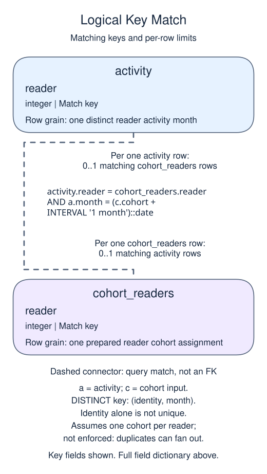

# Separate zero retention from an unobserved period

## Data model

### Example data

These objects are loaded at the start. Only the query inputs and their required lineage are listed; other tables in a shared seed are not part of this report.

#### `cohort_readers`

One row represents one prepared reader cohort assignment.

| Field / SQL type | Meaning | Rules |
| --- | --- | --- |
| `reader` · `integer` | Reader identity for the assignment; one assignment per reader in the sample, without a key constraint. | Nullable; `NULL` means the identifier or reference is unrecorded. |
| `cohort` · `date` | First-of-month acquisition-cohort date, not the date of a later visit. | Nullable; `NULL` means the calendar date is unrecorded. |

No primary or unique key is declared; distinct sample identifiers are not a uniqueness guarantee.

The fixture has one assignment per reader, but the schema does not enforce that logical key. Cohort maturity depends on the fixed follow-up cutoff, not the fact that a row exists.

#### `reading_visits`

One row represents one recorded reading-group visit.

| Field / SQL type | Meaning | Rules |
| --- | --- | --- |
| `reader` · `integer` | Logical reader identity matched to a cohort assignment. | Nullable; `NULL` means the identifier or reference is unrecorded. |
| `month` · `date` | First-of-month activity date; reader-month pairs can repeat. | Nullable; `NULL` means the calendar date is unrecorded. |

No primary or unique key is declared; distinct sample identifiers are not a uniqueness guarantee.

No foreign key or unique reader-month constraint is declared. DISTINCT is needed before counting monthly retention.

### Named intermediate results

These dictionaries describe the columns exposed by the named query steps. They are not extra preloaded tables or a complete answer query.

#### `activity`

One row represents one distinct reader activity month.

| Field / SQL type | Meaning | Rules |
| --- | --- | --- |
| `reader` · `integer` | Reader reference from reading_visits. | May be `NULL` under its source or expression policy. Part of a logical composite identity/month key. |
| `month` · `date` | First-of-month activity date, not the acquisition cohort. | May be `NULL` under its source or expression policy. Other part of the DISTINCT key; repeated visits or purchases in this month are collapsed. |

This CTE is statement-local; it has no independently declared primary key, foreign key or NOT NULL constraint.

DISTINCT compares the full pair. It does not declare a physical unique key or prove the reference has a parent.

### Relationship map

Aliases name query roles, not extra tables: `c` = `cohort_readers`, `a` = `activity`.



The identity equality is further limited to activity.month = (cohort + one calendar month). DISTINCT makes the activity identity/month pair unique. One cohort assignment has zero or one qualifying month-one match; one activity pair has zero or one assignment under the one-cohort-per-person contract. The cohort_readers physical schema does not enforce one assignment per reader, so duplicate assignments could multiply rows. This is a logical query match, not a declared foreign key between these inputs. Missing or unmatched references need not have a parent.

An inner join omits nonmatches. A left join retains its left population and a full join retains both populations, using NULLs only for the missing side. These outer-join NULLs differ from unknown values stored in a real row. A one-to-many detail match repeats the other side's fields; preaggregate before summing parent-level money. An EXISTS test only asks whether a match exists and does not copy all matching child rows.

A young cohort has not had the same chance to return as an older one. Compare only fully observed follow-up periods.

Month-one retention here means at least one paid purchase in the calendar month after acquisition. It does not mean within 30 days, nor any time on or after month one. The denominator remains the original purchaser cohort size. Use the distinct member-month result from the preceding practice so several purchases count as one retained member.

At the April 1, 2025 cutoff, January and February cohorts have complete next months; March does not. This lesson excludes immature cohorts from the month-one table rather than labeling them 0%. In a full retention grid, show their future cells as unobserved. A calendar month offset can be calculated as `12 * (activity_year - cohort_year) + activity_month - cohort_month`, using EXTRACT; subtracting only month numbers would fail across years.

## Read and run

A reading group follows a two-reader January cohort into February; one reader returns twice. In this separate demo, `cohort_readers` has one assignment per integer reader ID and a first-of-month `cohort` date. `reading_visits` has one visit record per row, with an integer reader ID and a first-of-month activity date; reader-month pairs may repeat. These are logical relationships, not declared constraints in the small demo.

The `activity` CTE makes reader-month pairs unique before the join. Matching `cohort + INTERVAL '1 month'` selects month one; requiring `cohort + INTERVAL '2 months' <= cutoff` ensures that entire next month has finished.

```sql run
WITH activity AS (
  SELECT DISTINCT reader, month FROM reading_visits
)
SELECT c.cohort::text AS cohort,
       COUNT(DISTINCT c.reader) AS cohort_size,
       COUNT(a.reader) AS retained
FROM cohort_readers c
LEFT JOIN activity a ON a.reader = c.reader
 AND a.month = (c.cohort + INTERVAL '1 month')::date
WHERE c.cohort + INTERVAL '2 months' <= DATE '2025-04-01'
GROUP BY c.cohort ORDER BY c.cohort;
```

The January denominator is two readers and the numerator is one reader, despite two visits. March is absent because its next month is not complete at the fixed cutoff.

A missing March row means its follow-up is incomplete, not that nobody returned. Keep that distinction in the report label.
