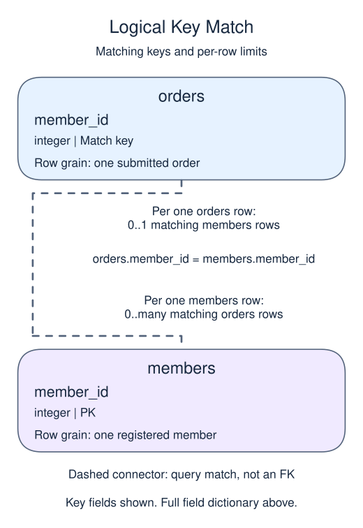
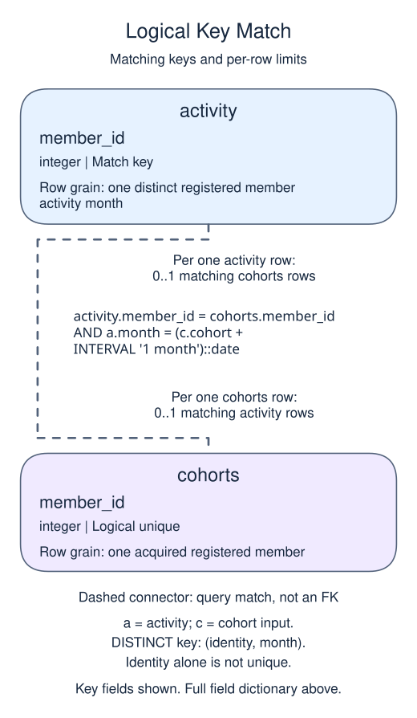

# Exercise: separate zero retention from an unobserved period

## Data model

### Exercise data

These objects are loaded at the start. Only the query inputs and their required lineage are listed; other tables in a shared seed are not part of this report.

#### `members`

One row represents one registered member.

| Field / SQL type | Meaning | Rules |
| --- | --- | --- |
| `member_id` · `integer` | Registered-member identifier, distinct from an import receipt or text member_key. | Primary key; unique. Required; cannot be `NULL`. |
| `region` · `text` | Current member region, not the region at the date of a past purchase. | Nullable; `NULL` means the current region is unrecorded. |
| `joined_on` · `date` | Registration calendar date, without a time of day or time zone. | Required; cannot be `NULL`. |
| `channel` · `text` | Recorded acquisition channel, such as search or referral; not a causal explanation of behavior. | Nullable; `NULL` means acquisition attribution is unknown. |

Region and channel labels are not enforced enumerations. This current-member dimension has no region-change history.

#### `orders`

One row represents one submitted order.

| Field / SQL type | Meaning | Rules |
| --- | --- | --- |
| `order_id` · `integer` | Order identifier; equal order totals still belong to separate orders. | Primary key; unique. Required; cannot be `NULL`. |
| `member_id` · `integer` | Member key used to look up a registered member; no foreign key is declared. | Nullable; `NULL` means the identifier or reference is unrecorded. |
| `placed_at` · `timestamp with time zone` | Order occurrence instant, interpreted in UTC unless the query explicitly chooses a local reporting zone. | Required; cannot be `NULL`. |
| `status` · `text` | Order status: paid, pending and cancelled occur in the snapshot; paid defines revenue eligibility. | Required; cannot be `NULL`. |
| `amount` · `numeric(10,2)` | Whole-order gross amount in USD before refunds, not a unit price or an order-line amount. | Nullable; `NULL` means the order gross amount is unknown, not zero. |
| `coupon` · `text` | Optional coupon code recorded on the order. | Nullable; `NULL` means no coupon code is recorded. |

The status labels are observed values, not a CHECK constraint. Paid amounts are known in this supplied snapshot; the nullable column also contains an unknown pending amount. No nonnegative-amount rule or member foreign key is declared. An orphan member key is a real order, not a member registration. The supplied orphan key is 99.

### Named intermediate results

These dictionaries describe the columns exposed by the named query steps. They are not extra preloaded tables or a complete answer query.

#### `activity`

One row represents one distinct registered member activity month.

| Field / SQL type | Meaning | Rules |
| --- | --- | --- |
| `member_id` · `integer` | Known registered-member identity. | Non-NULL by query lineage, not a declared NOT NULL constraint. Part of a logical composite identity/month key. |
| `month` · `date` | First-of-month activity date, not the acquisition cohort. | Non-NULL by query lineage, not a declared NOT NULL constraint. Other part of the DISTINCT key; repeated visits or purchases in this month are collapsed. |

This CTE is statement-local; it has no independently declared primary key, foreign key or NOT NULL constraint.

DISTINCT compares the full pair. It does not declare a physical unique key or prove the reference has a parent.

#### `cohorts`

One row represents one acquired registered member.

| Field / SQL type | Meaning | Rules |
| --- | --- | --- |
| `member_id` · `integer` | Registered-member identity inherited from activity. | Non-NULL by query lineage, not a declared NOT NULL constraint. Logical unique member key after grouping. |
| `cohort` · `date` | First paid activity month in the complete prior history, as a UTC first-of-month date. | Non-NULL by query lineage, not a declared NOT NULL constraint. A member remains in this original cohort even when later activity is absent. |

This CTE is statement-local; it has no independently declared primary key, foreign key or NOT NULL constraint.

Members without paid activity are absent. Cohort maturity is a follow-up observation rule, not a zero retention result.

### Relationship map

Aliases name query roles, not extra tables: `m` = `members`, `o` = `orders`, `c` = `cohorts`, `a` = `activity`.

Each `orders` row can match zero or one `members` rows; each `members` row can match zero or many `orders` rows. The stated keys and grouped or deduplicated grain determine these match limits; a child matching column can repeat unless its constraints or query grain make that value unique. Column names alone do not guarantee uniqueness. This is a logical query match, not a declared foreign key between these inputs. Missing or unmatched references need not have a parent.

The identity equality is further limited to activity.month = (cohort + one calendar month). DISTINCT makes the activity identity/month pair unique. One cohort assignment has zero or one qualifying month-one match; one activity pair has zero or one assignment under the one-cohort-per-person contract. Grouping makes the cohort member identity logically unique. This is a logical query match, not a declared foreign key between these inputs. Missing or unmatched references need not have a parent.

An inner join omits nonmatches. A left join retains its left population and a full join retains both populations, using NULLs only for the missing side. These outer-join NULLs differ from unknown values stored in a real row. A one-to-many detail match repeats the other side's fields; preaggregate before summing parent-level money. An EXISTS test only asks whether a match exists and does not copy all matching child rows.

Report fully observed month-one purchaser retention.

Use registered members and paid orders before April 1, 2025 UTC. Acquire members in their first paid month. Keep only cohorts whose entire next calendar month ended by the cutoff.

## Your Task

1. Return `cohort` as ISO text, `cohort_size`, `retained_month1`, and two-decimal `retention_pct`, ordered by cohort.

Replace the preview in `script.sql`. Run your query, check the returned rows, then Submit.

An inactive member remains in the cohort denominator. Distinct member-month activity prevents multiple orders from inflating the numerator. This describes the supplied history, not the effect of any outreach campaign.
