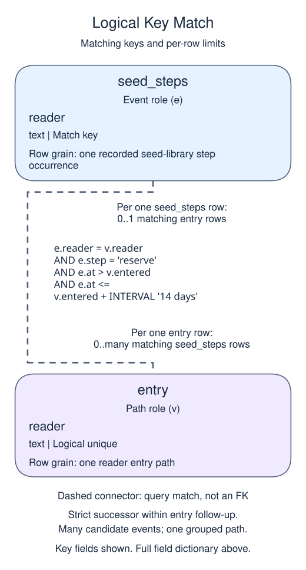
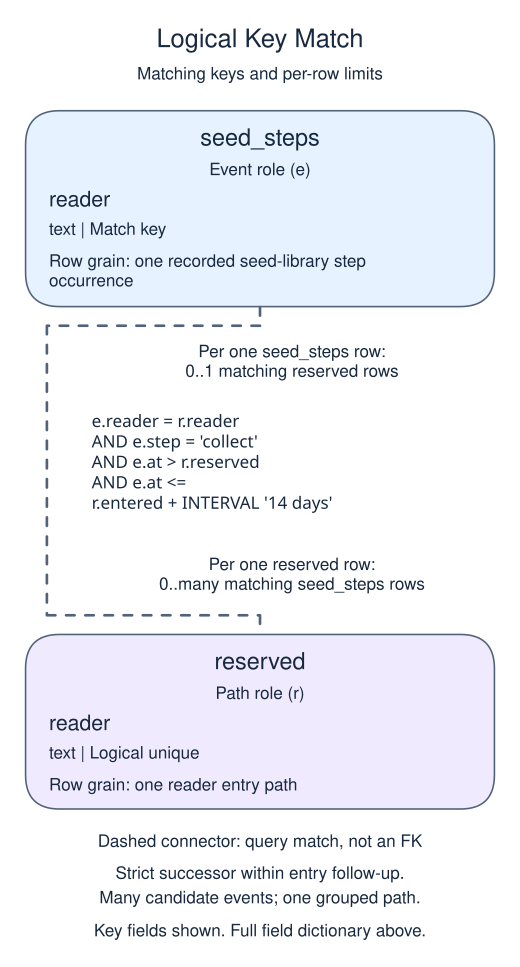

# Require the funnel steps to happen in sequence

## Data model

### Example data

These objects are loaded at the start. Only the query inputs and their required lineage are listed; other tables in a shared seed are not part of this report.

#### `seed_steps`

One row represents one recorded seed-library step occurrence.

| Field / SQL type | Meaning | Rules |
| --- | --- | --- |
| `reader` · `text` | Reader name label shared by this person's steps; not a foreign key. | Nullable; `NULL` means the identifier or reference is unrecorded. |
| `step` · `text` | Step label: browse, reserve or collect in the example; not a constrained list. | Nullable; `NULL` means no step value is recorded. |
| `at` · `timestamp with time zone` | Step occurrence instant in UTC; simultaneous instants do not establish strict sequence. | Nullable; `NULL` means occurrence time is unrecorded. |

No primary or unique key is declared; distinct sample identifiers are not a uniqueness guarantee.

There is no event key or separate receipt time. The aliases select different roles from this one physical table; early collection cannot complete a later reservation path.

### Named intermediate results

These dictionaries describe the columns exposed by the named query steps. They are not extra preloaded tables or a complete answer query.

#### `entry`

One row represents one reader entry path.

| Field / SQL type | Meaning | Rules |
| --- | --- | --- |
| `reader` · `text` | Logical reader identity for this path. | May be `NULL` under its source or expression policy. Unique grouped identity in the supplied path; missing source identities remain possible. |
| `entered` · `timestamp with time zone` | First browsing occurrence in UTC. | May be `NULL` under its source or expression policy. The exercise entry predicate excludes missing occurrence times; the demo source itself permits them. |

This CTE is statement-local; it has no independently declared primary key, foreign key or NOT NULL constraint.

Successive left joins retain failed paths. Timestamp predicates select ordered successors; they are not foreign-key relationships. Grouped path identity is logical, not a physical constraint.

#### `reserved`

One row represents one reader entry path.

| Field / SQL type | Meaning | Rules |
| --- | --- | --- |
| `reader` · `text` | Logical reader identity for this path. | May be `NULL` under its source or expression policy. Unique grouped identity in the supplied path; missing source identities remain possible. |
| `entered` · `timestamp with time zone` | First browsing occurrence in UTC. | May be `NULL` under its source or expression policy. The exercise entry predicate excludes missing occurrence times; the demo source itself permits them. |
| `reserved` · `timestamp with time zone` | First reservation strictly after entry within its allowed follow-up. | May be `NULL` under its source or expression policy. NULL means no qualifying reservation was found; a failed path is retained. |

This CTE is statement-local; it has no independently declared primary key, foreign key or NOT NULL constraint.

Successive left joins retain failed paths. Timestamp predicates select ordered successors; they are not foreign-key relationships. Grouped path identity is logical, not a physical constraint.

### Relationship map

Aliases name query roles, not extra tables: `v` = `entry`, `e` = `seed_steps`, `r` = `reserved`.



Each `seed_steps` row can match zero or one `entry` rows; each `entry` row can match zero or many `seed_steps` rows. The stated keys and grouped or deduplicated grain determine these match limits; a child matching column can repeat unless its constraints or query grain make that value unique. Column names alone do not guarantee uniqueness. This is a logical query match, not a declared foreign key between these inputs. Missing or unmatched references need not have a parent. Sequence/time predicates further restrict eligible successors; pre-entry or simultaneous events do not establish a strict successor. Grouping restores one path row after matching multiple event candidates.



Each `seed_steps` row can match zero or one `reserved` rows; each `reserved` row can match zero or many `seed_steps` rows. The stated keys and grouped or deduplicated grain determine these match limits; a child matching column can repeat unless its constraints or query grain make that value unique. Column names alone do not guarantee uniqueness. This is a logical query match, not a declared foreign key between these inputs. Missing or unmatched references need not have a parent. Sequence/time predicates further restrict eligible successors; pre-entry or simultaneous events do not establish a strict successor. Grouping restores one path row after matching multiple event candidates.

An inner join omits nonmatches. A left join retains its left population and a full join retains both populations, using NULLs only for the missing side. These outer-join NULLs differ from unknown values stored in a real row. A one-to-many detail match repeats the other side's fields; preaggregate before summing parent-level money. An EXISTS test only asks whether a match exists and does not copy all matching child rows.


Seeing visit, book, and pay somewhere in a history does not prove that a member completed that path. A funnel must enforce order and a time limit.

This funnel starts at each member's first visit in the entry window. Find the first booking strictly after that visit, then the first payment strictly after that booking. Each later step must occur no more than 14 days after entry. We allow unrelated events between steps, but simultaneous timestamps do not establish the strict order required here.

Use separate CTEs with `MIN` and conditional join predicates for the successive steps. A booking before the visit cannot be rescued by taking independent minimum timestamps. Retain failed paths with left joins. Count people at each stage, not event rows. Event retries should be deduplicated when they could affect counts; taking a MIN timestamp alone is insensitive to an exact duplicate timestamp, but that does not make raw event counts safe.

## Read and run

A seed library tracks browsing, reserving, and collecting. Jo has an early collection that must not complete a later path.

```sql run
WITH entry AS (
  SELECT reader, MIN(at) AS entered
  FROM seed_steps WHERE step = 'browse' GROUP BY reader
), reserved AS (
  SELECT v.reader, v.entered, MIN(e.at) AS reserved
  FROM entry v
  LEFT JOIN seed_steps e ON e.reader = v.reader
   AND e.step = 'reserve' AND e.at > v.entered
   AND e.at <= v.entered + INTERVAL '14 days'
  GROUP BY v.reader, v.entered
)
SELECT r.reader, r.reserved IS NOT NULL AS reserved,
       MIN(e.at) IS NOT NULL AS collected
FROM reserved r
LEFT JOIN seed_steps e ON e.reader = r.reader
 AND e.step = 'collect' AND e.at > r.reserved
 AND e.at <= r.entered + INTERVAL '14 days'
GROUP BY r.reader, r.reserved ORDER BY r.reader;
```

Both readers reserve, but only Lu completes collection after reservation. Jo has all three event names, yet the only collection happened too early.

If Lu collected before reserving, that collection would not complete this path. Having every event name is insufficient.
