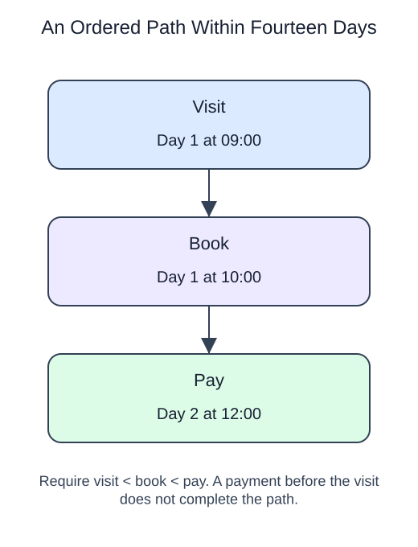

# Require the funnel steps to happen in sequence



Seeing visit, book, and pay somewhere in a history does not prove that a member completed that path. A funnel must enforce order and a time limit.

This funnel starts at each member's first visit in the entry window. Find the first booking strictly after that visit, then the first payment strictly after that booking. Each later step must occur no more than 14 days after entry. We allow unrelated events between steps, but simultaneous timestamps do not establish the strict order required here.

Use separate CTEs with `MIN` and conditional join predicates for the successive steps. A booking before the visit cannot be rescued by taking independent minimum timestamps. Retain failed paths with left joins. Count people at each stage, not event rows. Event retries should be deduplicated when they could affect counts; taking a MIN timestamp alone is insensitive to an exact duplicate timestamp, but that does not make raw event counts safe.

## Read and run

A seed library tracks browsing, reserving, and collecting. Jo has an early collection that must not complete a later path.

```sql run
WITH entry AS (
 SELECT reader, MIN(at) AS entered
 FROM seed_steps WHERE step = 'browse' GROUP BY reader
), reserved AS (
 SELECT v.reader, v.entered, MIN(e.at) AS reserved
 FROM entry v LEFT JOIN seed_steps e ON e.reader = v.reader
  AND e.step = 'reserve' AND e.at > v.entered
  AND e.at <= v.entered + INTERVAL '14 days'
 GROUP BY v.reader, v.entered
)
SELECT r.reader, r.reserved IS NOT NULL AS reserved,
       MIN(e.at) IS NOT NULL AS collected
FROM reserved r LEFT JOIN seed_steps e ON e.reader = r.reader
 AND e.step = 'collect' AND e.at > r.reserved
 AND e.at <= r.entered + INTERVAL '14 days'
GROUP BY r.reader, r.reserved ORDER BY r.reader;
```

Both readers reserve, but only Lu completes collection after reservation. Jo has all three event names, yet the only collection happened too early.

If Lu collected before reserving, that collection would not complete this path. Having every event name is insufficient.
