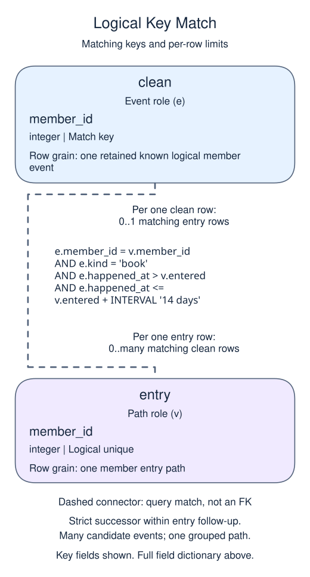
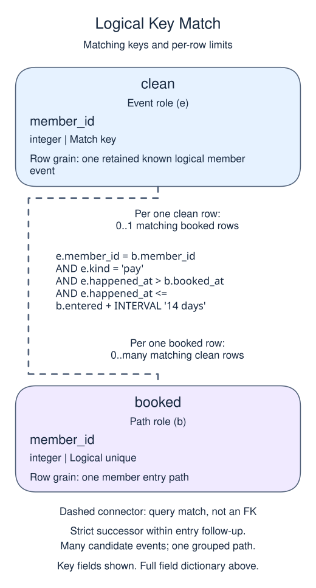

# Exercise: require the funnel steps to happen in sequence

## Data model

### Exercise data

These objects are loaded at the start. Only the query inputs and their required lineage are listed; other tables in a shared seed are not part of this report.

#### `events`

One row represents one received version of a logical member event.

| Field / SQL type | Meaning | Rules |
| --- | --- | --- |
| `ingest_id` · `integer` | Unique receipt identifier; use it to distinguish deliveries and break arrival-time ties. | Primary key; unique. Required; cannot be `NULL`. |
| `event_id` · `text` | Text logical-event identity; several receipts can share it. | Nullable; `NULL` means the logical business identity is unrecorded; this is not a new known identity. |
| `member_id` · `integer` | Logical member identifier; no member foreign key is declared. | Nullable; `NULL` means the identifier or reference is unrecorded. |
| `kind` · `text` | Event label: visit, book or pay in this feed; not a table-enforced vocabulary. | Nullable; `NULL` means no kind value is recorded. |
| `happened_at` · `timestamp with time zone` | Event occurrence instant; use this for behavior order and UTC entry windows. | Nullable; `NULL` means occurrence time is unrecorded. |
| `received_at` · `timestamp with time zone` | Receipt/arrival instant; use this for knowledge cutoffs and version precedence, not occurrence sequence. | Nullable; `NULL` means receipt time is unrecorded. |

Only ingest_id is required by the physical schema. The supplied identities and timestamps are known, but that is not a NOT NULL guarantee. Event pay records and order payments are separate sources, without a declared one-to-one relationship. Apply a knowledge cutoff before choosing the latest known version when the task asks for an as-of funnel.

### Named intermediate results

These dictionaries describe the columns exposed by the named query steps. They are not extra preloaded tables or a complete answer query.

#### `ranked`

One row represents one received member-event version.

| Field / SQL type | Meaning | Rules |
| --- | --- | --- |
| `ingest_id` · `integer` | Unique receipt identifier; use it to distinguish deliveries and break arrival-time ties. | Non-NULL by query lineage, not a declared NOT NULL constraint. Inherited source value; source nullability is unchanged. |
| `event_id` · `text` | Text logical-event identity; several receipts can share it. | May be `NULL` under its source or expression policy. Inherited source value; source nullability is unchanged. |
| `member_id` · `integer` | Logical member identifier; no member foreign key is declared. | May be `NULL` under its source or expression policy. Inherited source value; source nullability is unchanged. |
| `kind` · `text` | Event label: visit, book or pay in this feed; not a table-enforced vocabulary. | May be `NULL` under its source or expression policy. Inherited source value; source nullability is unchanged. |
| `happened_at` · `timestamp with time zone` | Event occurrence instant; use this for behavior order and UTC entry windows. | May be `NULL` under its source or expression policy. Inherited source value; source nullability is unchanged. |
| `received_at` · `timestamp with time zone` | Receipt/arrival instant; use this for knowledge cutoffs and version precedence, not occurrence sequence. | May be `NULL` under its source or expression policy. Inherited source value; source nullability is unchanged. |
| `position` · `bigint` | Computed version position within event identity. | Non-NULL by query lineage, not a declared NOT NULL constraint. Non-NULL window result; no physical key or CHECK is created. |

This CTE is statement-local; it has no independently declared primary key, foreign key or NOT NULL constraint.

All exposed columns are listed, including fields retained by SELECT *. This statement-local result does not create table constraints.

#### `clean`

One row represents one retained known logical member event.

| Field / SQL type | Meaning | Rules |
| --- | --- | --- |
| `ingest_id` · `integer` | Unique receipt identifier; use it to distinguish deliveries and break arrival-time ties. | Non-NULL by query lineage, not a declared NOT NULL constraint. Inherited source value; source nullability is unchanged. |
| `event_id` · `text` | Text logical-event identity; several receipts can share it. | May be `NULL` under its source or expression policy. Logical unique event key after version filtering; the source still permits a NULL identity group. |
| `member_id` · `integer` | Logical member identifier; no member foreign key is declared. | May be `NULL` under its source or expression policy. Inherited source value; source nullability is unchanged. |
| `kind` · `text` | Event label: visit, book or pay in this feed; not a table-enforced vocabulary. | May be `NULL` under its source or expression policy. Inherited source value; source nullability is unchanged. |
| `happened_at` · `timestamp with time zone` | Event occurrence instant; use this for behavior order and UTC entry windows. | May be `NULL` under its source or expression policy. Inherited source value; source nullability is unchanged. |
| `received_at` · `timestamp with time zone` | Receipt/arrival instant; use this for knowledge cutoffs and version precedence, not occurrence sequence. | May be `NULL` under its source or expression policy. Inherited source value; source nullability is unchanged. |
| `position` · `bigint` | Computed version position within event identity. | Non-NULL by query lineage, not a declared NOT NULL constraint. Non-NULL window result; no physical key or CHECK is created. |

This CTE is statement-local; it has no independently declared primary key, foreign key or NOT NULL constraint.

All exposed columns are listed, including fields retained by SELECT *. This statement-local result does not create table constraints.

#### `entry`

One row represents one member entry path.

| Field / SQL type | Meaning | Rules |
| --- | --- | --- |
| `member_id` · `integer` | Logical member identity for this path. | May be `NULL` under its source or expression policy. Unique grouped identity in the supplied path; missing source identities remain possible. |
| `entered` · `timestamp with time zone` | First qualifying visit occurrence in UTC. | Non-NULL by query lineage, not a declared NOT NULL constraint. The exercise entry predicate excludes missing occurrence times; the demo source itself permits them. |

This CTE is statement-local; it has no independently declared primary key, foreign key or NOT NULL constraint.

Successive left joins retain failed paths. Timestamp predicates select ordered successors; they are not foreign-key relationships. Grouped path identity is logical, not a physical constraint.

#### `booked`

One row represents one member entry path.

| Field / SQL type | Meaning | Rules |
| --- | --- | --- |
| `member_id` · `integer` | Logical member identity for this path. | May be `NULL` under its source or expression policy. Unique grouped identity in the supplied path; missing source identities remain possible. |
| `entered` · `timestamp with time zone` | First qualifying visit occurrence in UTC. | Non-NULL by query lineage, not a declared NOT NULL constraint. The exercise entry predicate excludes missing occurrence times; the demo source itself permits them. |
| `booked_at` · `timestamp with time zone` | First booking strictly after entry within the allowed follow-up. | May be `NULL` under its source or expression policy. NULL means no qualifying booking was found. |

This CTE is statement-local; it has no independently declared primary key, foreign key or NOT NULL constraint.

Successive left joins retain failed paths. Timestamp predicates select ordered successors; they are not foreign-key relationships. Grouped path identity is logical, not a physical constraint.

#### `paths`

One row represents one member entry path.

| Field / SQL type | Meaning | Rules |
| --- | --- | --- |
| `member_id` · `integer` | Logical member identity for this path. | May be `NULL` under its source or expression policy. Unique grouped identity in the supplied path; missing source identities remain possible. |
| `booked_at` · `timestamp with time zone` | First booking strictly after entry within the allowed follow-up. | May be `NULL` under its source or expression policy. NULL means no qualifying booking was found. |
| `paid_at` · `timestamp with time zone` | First payment strictly after the chosen booking within entry follow-up. | May be `NULL` under its source or expression policy. NULL means no qualifying successor payment was found. |

This CTE is statement-local; it has no independently declared primary key, foreign key or NOT NULL constraint.

Successive left joins retain failed paths. Timestamp predicates select ordered successors; they are not foreign-key relationships. Grouped path identity is logical, not a physical constraint.

### Relationship map

Aliases name query roles, not extra tables: `v` = `entry`, `e` = `clean`, `b` = `booked`.

Each `clean` row can match zero or one `entry` rows; each `entry` row can match zero or many `clean` rows. The stated keys and grouped or deduplicated grain determine these match limits; a child matching column can repeat unless its constraints or query grain make that value unique. Column names alone do not guarantee uniqueness. This is a logical query match, not a declared foreign key between these inputs. Missing or unmatched references need not have a parent. Sequence/time predicates further restrict eligible successors; pre-entry or simultaneous events do not establish a strict successor. Grouping restores one path row after matching multiple event candidates.

Each `clean` row can match zero or one `booked` rows; each `booked` row can match zero or many `clean` rows. The stated keys and grouped or deduplicated grain determine these match limits; a child matching column can repeat unless its constraints or query grain make that value unique. Column names alone do not guarantee uniqueness. This is a logical query match, not a declared foreign key between these inputs. Missing or unmatched references need not have a parent. Sequence/time predicates further restrict eligible successors; pre-entry or simultaneous events do not establish a strict successor. Grouping restores one path row after matching multiple event candidates.

An inner join omits nonmatches. A left join retains its left population and a full join retains both populations, using NULLs only for the missing side. These outer-join NULLs differ from unknown values stored in a real row. A one-to-many detail match repeats the other side's fields; preaggregate before summing parent-level money. An EXISTS test only asks whether a match exists and does not copy all matching child rows.

Summarize a strictly ordered visit-to-book-to-pay funnel.

Entry is each member's first visit from January 1 through March 17, 2025 UTC (March 18 exclusive), allowing a full 14-day follow-up before April 1. Require visit < book < pay and later steps at most 14 days after entry. Ignore arrivals at or after April 1 and use occurrence timestamps for sequence.

First apply that arrival cutoff, then retain the latest received version per `event_id` using the earlier deduplication rule. Build the member paths from those retained events. The diagram is a separate valid path, not a picture of every member in the exercise.

## Your Task

1. Return one row with `visited`, `booked`, `paid`, and two-decimal `conversion_pct` (paid divided by visited), using one path per member.

Replace the preview in `script.sql`. Run your query, check the returned rows, then Submit.

Member 2 paid before visiting; member 4 booked at the exact visit time. Neither should complete this strict funnel. Member 5 pays after the 14-day window, and member 6 enters after the allowed entry window. The repeated e3 arrival must not create another converting member. A funnel drop-off suggests where to investigate, not why a person stopped.
