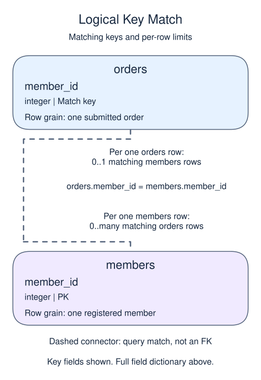

# Exercise: Measure recency at a fixed cutoff

## Data model

### Exercise data

These objects are loaded at the start. Only the query inputs and their required lineage are listed; other tables in a shared seed are not part of this report.

#### `members`

One row represents one registered member.

| Field / SQL type | Meaning | Rules |
| --- | --- | --- |
| `member_id` · `integer` | Registered-member identifier, distinct from an import receipt or text member_key. | Primary key; unique. Required; cannot be `NULL`. |
| `region` · `text` | Current member region, not the region at the date of a past purchase. | Nullable; `NULL` means the current region is unrecorded. |
| `joined_on` · `date` | Registration calendar date, without a time of day or time zone. | Required; cannot be `NULL`. |
| `channel` · `text` | Recorded acquisition channel, such as search or referral; not a causal explanation of behavior. | Nullable; `NULL` means acquisition attribution is unknown. |

Region and channel labels are not enforced enumerations. This current-member dimension has no region-change history.

#### `orders`

One row represents one submitted order.

| Field / SQL type | Meaning | Rules |
| --- | --- | --- |
| `order_id` · `integer` | Order identifier; equal order totals still belong to separate orders. | Primary key; unique. Required; cannot be `NULL`. |
| `member_id` · `integer` | Member key used to look up a registered member; no foreign key is declared. | Nullable; `NULL` means the identifier or reference is unrecorded. |
| `placed_at` · `timestamp with time zone` | Order occurrence instant, interpreted in UTC unless the query explicitly chooses a local reporting zone. | Required; cannot be `NULL`. |
| `status` · `text` | Order status: paid, pending and cancelled occur in the snapshot; paid defines revenue eligibility. | Required; cannot be `NULL`. |
| `amount` · `numeric(10,2)` | Whole-order gross amount in USD before refunds, not a unit price or an order-line amount. | Nullable; `NULL` means the order gross amount is unknown, not zero. |
| `coupon` · `text` | Optional coupon code recorded on the order. | Nullable; `NULL` means no coupon code is recorded. |

The status labels are observed values, not a CHECK constraint. Paid amounts are known in this supplied snapshot; the nullable column also contains an unknown pending amount. No nonnegative-amount rule or member foreign key is declared. An orphan member key is a real order, not a member registration. The supplied orphan key is 99.

### Relationship map

Aliases name query roles, not extra tables: `m` = `members`, `o` = `orders`.

Each `orders` row can match zero or one `members` rows; each `members` row can match zero or many `orders` rows. The stated keys and grouped or deduplicated grain determine these match limits; a child matching column can repeat unless its constraints or query grain make that value unique. Column names alone do not guarantee uniqueness. This is a logical query match, not a declared foreign key between these inputs. Missing or unmatched references need not have a parent.

An inner join omits nonmatches. A left join retains its left population and a full join retains both populations, using NULLs only for the missing side. These outer-join NULLs differ from unknown values stored in a real row. A one-to-many detail match repeats the other side's fields; preaggregate before summing parent-level money. An EXISTS test only asks whether a match exists and does not copy all matching child rows.

Keep every registered member. A member without a paid purchase before April 1 has unknown purchase recency.

## Your Task

1. Return member_id and recency_days as April 1, 2025 minus the latest UTC paid purchase date before that cutoff. Use a left join and order by member_id.

Write your query in `script.sql`. Use Run to inspect it, then Submit.
