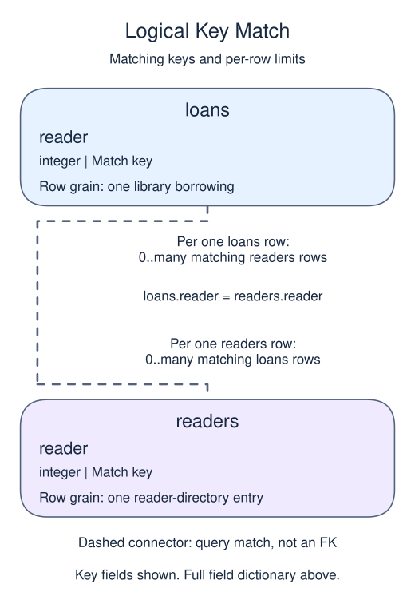

# Measure purchase frequency at order grain

## Data model

### Example data

These objects are loaded at the start. Only the query inputs and their required lineage are listed; other tables in a shared seed are not part of this report.

#### `loans`

One row represents one library borrowing.

| Field / SQL type | Meaning | Rules |
| --- | --- | --- |
| `loan` · `integer` | Borrowing record identifier; distinct in the sample but not declared unique. | Nullable; `NULL` means no loan value is recorded. |
| `reader` · `integer` | Logical borrower reference; no foreign key is declared. | Nullable; `NULL` means the identifier or reference is unrecorded. |

No primary or unique key is declared; distinct sample identifiers are not a uniqueness guarantee.

#### `readers`

One row represents one reader-directory entry.

| Field / SQL type | Meaning | Rules |
| --- | --- | --- |
| `reader` · `integer` | Reader identifier used to match borrowing, return or purchase records. | Nullable; `NULL` means the identifier or reference is unrecorded. |

No primary or unique key is declared; distinct sample identifiers are not a uniqueness guarantee.

The small frequency and monetary examples do not declare reader uniqueness; their sample directory contains one row per reader. The existence example separately declares this column a primary key.

### Relationship map

Aliases name query roles, not extra tables: `r` = `readers`, `l` = `loans`.



Each `loans` row can match zero or many `readers` rows; each `readers` row can match zero or many `loans` rows. Neither single match column is declared unique; the sample may be narrower than the permitted many-to-many fanout. This is a logical query match, not a declared foreign key between these inputs. Missing or unmatched references need not have a parent.

An inner join omits nonmatches. A left join retains its left population and a full join retains both populations, using NULLs only for the missing side. These outer-join NULLs differ from unknown values stored in a real row. A one-to-many detail match repeats the other side's fields; preaggregate before summing parent-level money. An EXISTS test only asks whether a match exists and does not copy all matching child rows.

Frequency counts eligible purchases, not order lines or event arrivals. Start with members and left join eligible orders when never-buyers must remain. Count the order key rather than COUNT(*): a left join still gives an unmatched member one null-extended row.

The library example keeps a reader with no loans and assigns a genuine frequency of zero. Several loans by one reader are separate actions, so this measure deliberately does not use COUNT(DISTINCT reader).

```sql run
SELECT r.reader,COUNT(l.loan) AS loans
FROM readers r
LEFT JOIN loans l ON l.reader=r.reader
GROUP BY r.reader
ORDER BY r.reader;
```
