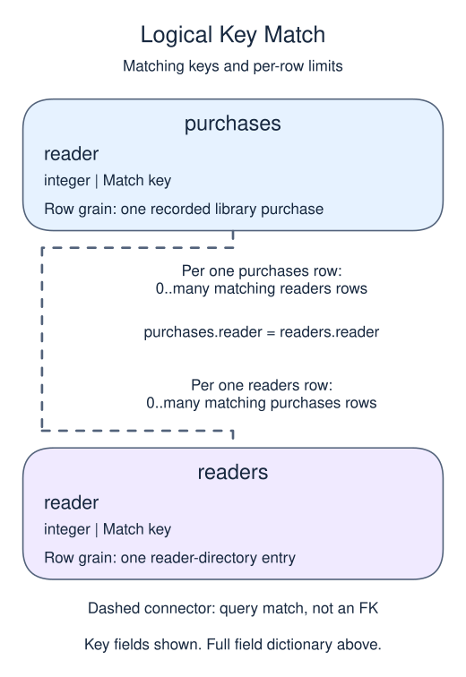

# State the monetary measure in a member report

## Data model

### Example data

These objects are loaded at the start. Only the query inputs and their required lineage are listed; other tables in a shared seed are not part of this report.

#### `purchases`

One row represents one recorded library purchase.

| Field / SQL type | Meaning | Rules |
| --- | --- | --- |
| `reader` · `integer` | Logical buyer reference; no foreign key is declared. | Nullable; `NULL` means the identifier or reference is unrecorded. |
| `amount` · `numeric` | Gross purchase amount in USD before refunds, not a count or net amount. | Nullable; `NULL` means the amount measure is unrecorded, not zero. |

No primary or unique key is declared; distinct sample identifiers are not a uniqueness guarantee.

#### `readers`

One row represents one reader-directory entry.

| Field / SQL type | Meaning | Rules |
| --- | --- | --- |
| `reader` · `integer` | Reader identifier used to match borrowing, return or purchase records. | Nullable; `NULL` means the identifier or reference is unrecorded. |

No primary or unique key is declared; distinct sample identifiers are not a uniqueness guarantee.

The small frequency and monetary examples do not declare reader uniqueness; their sample directory contains one row per reader. The existence example separately declares this column a primary key.

### Relationship map

Aliases name query roles, not extra tables: `r` = `readers`, `p` = `purchases`.



Each `purchases` row can match zero or many `readers` rows; each `readers` row can match zero or many `purchases` rows. Neither single match column is declared unique; the sample may be narrower than the permitted many-to-many fanout. This is a logical query match, not a declared foreign key between these inputs. Missing or unmatched references need not have a parent.

An inner join omits nonmatches. A left join retains its left population and a full join retains both populations, using NULLs only for the missing side. These outer-join NULLs differ from unknown values stored in a real row. A one-to-many detail match repeats the other side's fields; preaggregate before summing parent-level money. An EXISTS test only asks whether a match exists and does not copy all matching child rows.

Monetary value needs a defined measure and window. Here it is gross paid amount in USD, before refunds. Net revenue would be a different segmentation policy. Include only eligible purchases and keep never-buyers in the member population.

A member with no eligible orders has zero known gross in this complete toy snapshot. Do not generalize that fill rule to orders whose amounts are missing. The fixture has known amounts for paid orders.

```sql run
SELECT r.reader,COALESCE(SUM(p.amount),0) AS gross
FROM readers r
LEFT JOIN purchases p ON p.reader=r.reader
GROUP BY r.reader
ORDER BY r.reader;
```
