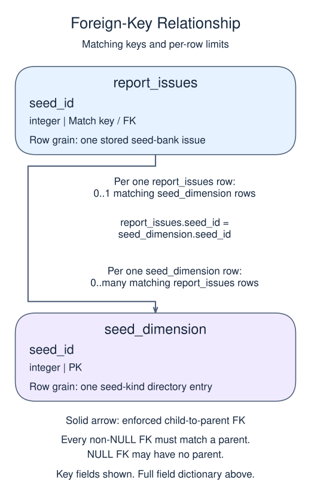

# Protect a reporting relationship with REFERENCES

## Data model

### Example data

These objects are loaded at the start. Only the query inputs and their required lineage are listed; other tables in a shared seed are not part of this report.

#### `seed_dimension`

One row represents one seed-kind directory entry.

| Field / SQL type | Meaning | Rules |
| --- | --- | --- |
| `seed_id` · `integer` | Unique seed-kind identifier. | Primary key; unique. Required; cannot be `NULL`. |

### Tables and views to define

These objects do not exist in the starting database. Their fields describe the target definition, not additional columns already available to the starter.

#### `report_issues`

One row represents one stored seed-bank issue.

| Field / SQL type | Meaning | Rules |
| --- | --- | --- |
| `issue_id` · `integer` | Issue record identifier; key enforcement depends on this lesson's declaration. | Primary key; unique. Required; cannot be `NULL`. |
| `seed_id` · `integer` | Reference to a seed kind; this reporting design declares the foreign key when this field is present. | Nullable; `NULL` means the identifier or reference is unrecorded. Declared FOREIGN KEY (seed_id) REFERENCES seed_dimension(seed_id). |

### Relationship map



Each `report_issues` row can match zero or one `seed_dimension` rows; each `seed_dimension` row can match zero or many `report_issues` rows. The stated keys and grouped or deduplicated grain determine these match limits; a child matching column can repeat unless its constraints or query grain make that value unique. Column names alone do not guarantee uniqueness. This is an enforced foreign key: every non-NULL child reference must match exactly one existing parent, while a NULL child reference may have no parent.

An inner join omits nonmatches. A left join retains its left population and a full join retains both populations, using NULLs only for the missing side. These outer-join NULLs differ from unknown values stored in a real row. A one-to-many detail match repeats the other side's fields; preaggregate before summing parent-level money. An EXISTS test only asks whether a match exists and does not copy all matching child rows.

REFERENCES parent(key) requires a non-NULL child key to match an existing parent row. It does not automatically populate the child or join the tables when selected. A nullable child key still permits NULL; NOT NULL is needed when the relationship must always be present.

Create the parent first. The seed-bank child references its supplied seed dimension. Review the declaration: an empty result cannot prove that unmatched future inserts would be rejected.

```sql run
CREATE TABLE IF NOT EXISTS report_issues (
  issue_id integer PRIMARY KEY,
  seed_id integer REFERENCES seed_dimension(seed_id)
);
SELECT issue_id, seed_id
FROM report_issues;
```
