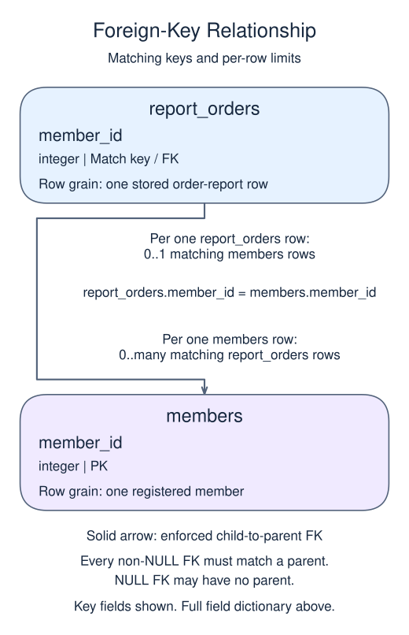

# Exercise: Protect a reporting relationship with REFERENCES

## Data model

### Exercise data

These objects are loaded at the start. Only the query inputs and their required lineage are listed; other tables in a shared seed are not part of this report.

#### `members`

One row represents one registered member.

| Field / SQL type | Meaning | Rules |
| --- | --- | --- |
| `member_id` · `integer` | Registered-member identifier, distinct from an import receipt or text member_key. | Primary key; unique. Required; cannot be `NULL`. |
| `region` · `text` | Current member region, not the region at the date of a past purchase. | Nullable; `NULL` means the current region is unrecorded. |
| `joined_on` · `date` | Registration calendar date, without a time of day or time zone. | Required; cannot be `NULL`. |
| `channel` · `text` | Recorded acquisition channel, such as search or referral; not a causal explanation of behavior. | Nullable; `NULL` means acquisition attribution is unknown. |

Region and channel labels are not enforced enumerations. This current-member dimension has no region-change history.

### Tables and views to define

These objects do not exist in the starting database. Their fields describe the target definition, not additional columns already available to the starter.

#### `report_orders`

One row represents one stored order-report row.

| Field / SQL type | Meaning | Rules |
| --- | --- | --- |
| `order_id` · `integer` | Order identifier; key enforcement depends on this lesson's declaration. | Primary key; unique. Required; cannot be `NULL`. |
| `member_id` · `integer` | Registered-member reference; this reporting design declares a foreign key to members. | Nullable; `NULL` means the identifier or reference is unrecorded. Declared FOREIGN KEY (member_id) REFERENCES members(member_id). |

A report table stores rows; creating it does not load them. This target is independent of the unconstrained source orders.member_id logical link.

### Relationship map

Each `report_orders` row can match zero or one `members` rows; each `members` row can match zero or many `report_orders` rows. The stated keys and grouped or deduplicated grain determine these match limits; a child matching column can repeat unless its constraints or query grain make that value unique. Column names alone do not guarantee uniqueness. This is an enforced foreign key: every non-NULL child reference must match exactly one existing parent, while a NULL child reference may have no parent.

An inner join omits nonmatches. A left join retains its left population and a full join retains both populations, using NULLs only for the missing side. These outer-join NULLs differ from unknown values stored in a real row. A one-to-many detail match repeats the other side's fields; preaggregate before summing parent-level money. An EXISTS test only asks whether a match exists and does not copy all matching child rows.

The members table is the supplied parent. An order row should reference a known member when its member_id is present.

## Your Task

1. Create report_orders(order_id integer PRIMARY KEY,member_id integer REFERENCES members(member_id)). Select order_id, member_id.

Write your query in `script.sql`. Use Run to inspect it, then Submit.
