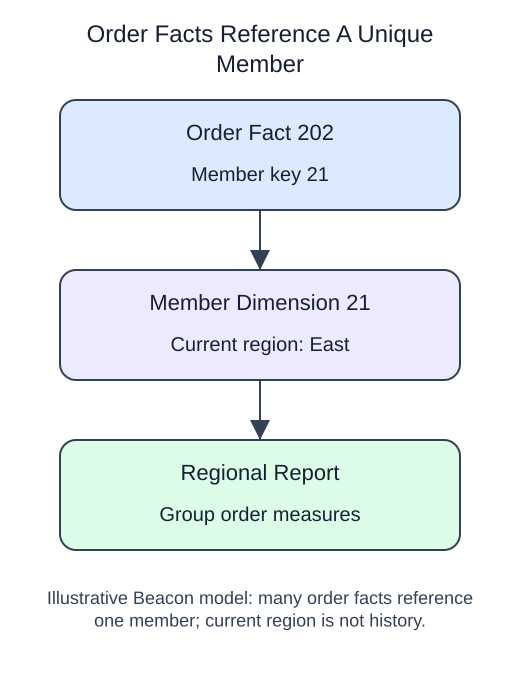

# Model a report with facts and dimensions



A reporting model should make its grain hard to misunderstand. Separate measured transactions from descriptive attributes.

A fact table stores measurements at one declared grain, such as one paid order. Dimension tables describe the member, date, or other context. A dimension key must be unique at the version the fact references, or a join can multiply facts. A simple current-member dimension does not preserve historical region changes; historical reporting needs a stated snapshot or versioning policy.

Use the table definition, primary key, foreign key and INSERT ... SELECT techniques from the preceding pairs. Load dimensions before facts in a transaction. The new decision is the reporting model: which facts belong on one order row, and which descriptive attributes belong to its dimension? This small model excludes orphan orders and reports that exclusion rather than forcing them into a valid member key.

## Read and run

A seed bank separates issue measurements from seed descriptions.

```sql run
BEGIN;
CREATE TABLE IF NOT EXISTS fact_issues (
 issue_id integer PRIMARY KEY,
 seed_id integer REFERENCES seed_dimension(seed_id),
 packets integer
);
DELETE FROM fact_issues;
INSERT INTO fact_issues (issue_id, seed_id, packets)
SELECT issue_id, seed_id, packets FROM source_issues;
COMMIT;
SELECT d.variety, SUM(f.packets) AS packets
FROM fact_issues f JOIN seed_dimension d ON d.seed_id = f.seed_id
GROUP BY d.variety ORDER BY d.variety;
```

The fact table has one row per issue, while the final report has one row per variety. `CREATE TABLE IF NOT EXISTS` creates the table only when it is absent; it does not check an existing table's design. `DELETE FROM fact_issues` removes all its rows but keeps the table and constraints. The following INSERT reloads the supplied records, so rerunning this demonstration does not duplicate them. Do not copy that full-table deletion into a production load without an explicit replacement policy.

The dimension primary key would reject a second row with the same seed_id. Without that constraint, a join could duplicate fact rows. Keep that risk in mind when building the next model.
