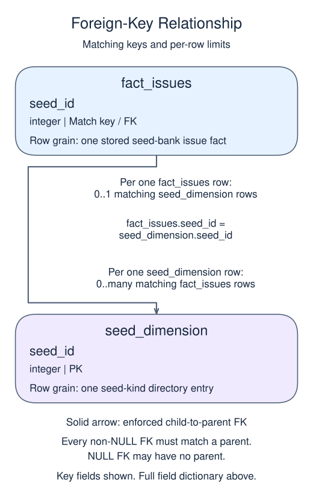

# Model a report with facts and dimensions

## Data model

### Example data

These objects are loaded at the start. Only the query inputs and their required lineage are listed; other tables in a shared seed are not part of this report.

#### `seed_dimension`

One row represents one seed-kind directory entry.

| Field / SQL type | Meaning | Rules |
| --- | --- | --- |
| `seed_id` · `integer` | Unique seed-kind identifier. | Primary key; unique. Required; cannot be `NULL`. |
| `variety` · `text` | Readable seed variety label; different seed IDs may have equal labels. | Nullable; `NULL` means no variety value is recorded. |

#### `source_issues`

One row represents one source seed-bank issue.

| Field / SQL type | Meaning | Rules |
| --- | --- | --- |
| `issue_id` · `integer` | Source issue identifier, not constrained as a key in this fixture. | Nullable; `NULL` means the identifier or reference is unrecorded. |
| `seed_id` · `integer` | Logical seed-kind reference; the source declares no foreign key. | Nullable; `NULL` means the identifier or reference is unrecorded. |
| `packets` · `integer` | Whole-number count of packets in this issue. | Nullable; `NULL` means the packets measure is unrecorded, not zero. |

No primary or unique key is declared; distinct sample identifiers are not a uniqueness guarantee.

### Tables and views to define

These objects do not exist in the starting database. Their fields describe the target definition, not additional columns already available to the starter.

#### `fact_issues`

One row represents one stored seed-bank issue fact.

| Field / SQL type | Meaning | Rules |
| --- | --- | --- |
| `issue_id` · `integer` | Unique issue identifier at issue grain. | Primary key; unique. Required; cannot be `NULL`. |
| `seed_id` · `integer` | Nullable enforced reference to a seed kind. | Nullable; `NULL` means the identifier or reference is unrecorded. Declared FOREIGN KEY (seed_id) REFERENCES seed_dimension(seed_id). |
| `packets` · `integer` | Whole-number count of packets on this issue, not a count of issue rows. | Nullable; `NULL` means the packets measure is unrecorded, not zero. |

### Relationship map

Aliases name query roles, not extra tables: `f` = `fact_issues`, `d` = `seed_dimension`.



Each `fact_issues` row can match zero or one `seed_dimension` rows; each `seed_dimension` row can match zero or many `fact_issues` rows. The stated keys and grouped or deduplicated grain determine these match limits; a child matching column can repeat unless its constraints or query grain make that value unique. Column names alone do not guarantee uniqueness. This is an enforced foreign key: every non-NULL child reference must match exactly one existing parent, while a NULL child reference may have no parent.

An inner join omits nonmatches. A left join retains its left population and a full join retains both populations, using NULLs only for the missing side. These outer-join NULLs differ from unknown values stored in a real row. A one-to-many detail match repeats the other side's fields; preaggregate before summing parent-level money. An EXISTS test only asks whether a match exists and does not copy all matching child rows.


A reporting model should make its grain hard to misunderstand. Separate measured transactions from descriptive attributes.

A fact table stores measurements at one declared grain, such as one paid order. Dimension tables describe the member, date, or other context. A dimension key must be unique at the version the fact references, or a join can multiply facts. A simple current-member dimension does not preserve historical region changes; historical reporting needs a stated snapshot or versioning policy.

Use the table definition, primary key, foreign key and INSERT ... SELECT techniques from the preceding pairs. Load dimensions before facts in a transaction. The new decision is the reporting model: which facts belong on one order row, and which descriptive attributes belong to its dimension? This small model excludes orphan orders and reports that exclusion rather than forcing them into a valid member key.

## Read and run

A seed bank separates issue measurements from seed descriptions.

```sql run
BEGIN;
CREATE TABLE IF NOT EXISTS fact_issues (
  issue_id integer PRIMARY KEY,
  seed_id integer REFERENCES seed_dimension(seed_id),
  packets integer
);
DELETE FROM fact_issues;
INSERT INTO fact_issues (issue_id, seed_id, packets)
SELECT issue_id, seed_id, packets FROM source_issues;
COMMIT;
SELECT d.variety, SUM(f.packets) AS packets
FROM fact_issues f
JOIN seed_dimension d ON d.seed_id = f.seed_id
GROUP BY d.variety ORDER BY d.variety;
```

The fact table has one row per issue, while the final report has one row per variety. `CREATE TABLE IF NOT EXISTS` creates the table only when it is absent; it does not check an existing table's design. `DELETE FROM fact_issues` removes all its rows but keeps the table and constraints. The following INSERT reloads the supplied records, so rerunning this demonstration does not duplicate them. Do not copy that full-table deletion into a production load without an explicit replacement policy.

The dimension primary key would reject a second row with the same seed_id. Without that constraint, a join could duplicate fact rows. Keep that risk in mind when building the next model.
