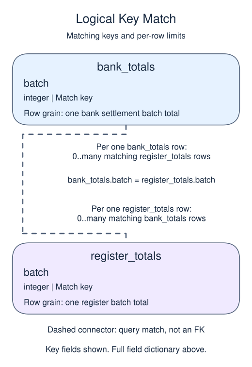

# Reconcile independent sources and name the limits

## Data model

### Example data

These objects are loaded at the start. Only the query inputs and their required lineage are listed; other tables in a shared seed are not part of this report.

#### `bank_totals`

One row represents one bank settlement batch total.

| Field / SQL type | Meaning | Rules |
| --- | --- | --- |
| `batch` · `integer` | Batch reconciliation key; distinct in this sample but not a declared unique key. | Nullable; `NULL` means no batch value is recorded. |
| `amount` · `numeric` | Batch amount from the bank settlement export, in the common comparison currency; no currency code is declared. | Nullable; `NULL` means the amount measure is unrecorded, not zero. |

No primary or unique key is declared; distinct sample identifiers are not a uniqueness guarantee.

Missing-side NULL after a full join differs from a stored unknown amount. Without a unique batch constraint, repeated keys could multiply the comparison rows.

#### `register_totals`

One row represents one register batch total.

| Field / SQL type | Meaning | Rules |
| --- | --- | --- |
| `batch` · `integer` | Batch reconciliation key; distinct in this sample but not a declared unique key. | Nullable; `NULL` means no batch value is recorded. |
| `amount` · `numeric` | Batch amount from the register export, in the common comparison currency; no currency code is declared. | Nullable; `NULL` means the amount measure is unrecorded, not zero. |

No primary or unique key is declared; distinct sample identifiers are not a uniqueness guarantee.

Missing-side NULL after a full join differs from a stored unknown amount. Without a unique batch constraint, repeated keys could multiply the comparison rows.

### Relationship map

Aliases name query roles, not extra tables: `r` = `register_totals`, `b` = `bank_totals`.



Each `bank_totals` row can match zero or many `register_totals` rows; each `register_totals` row can match zero or many `bank_totals` rows. Neither single match column is declared unique; the sample may be narrower than the permitted many-to-many fanout. This is a logical query match, not a declared foreign key between these inputs. Missing or unmatched references need not have a parent.

An inner join omits nonmatches. A left join retains its left population and a full join retains both populations, using NULLs only for the missing side. These outer-join NULLs differ from unknown values stored in a real row. A one-to-many detail match repeats the other side's fields; preaggregate before summing parent-level money. An EXISTS test only asks whether a match exists and does not copy all matching child rows.

A total that agrees with itself is not an audit. Compare independently derived measures at the same grain, units, and cutoff.

A `FULL JOIN` keeps unmatched rows from both inputs. It is useful for reconciliation because either source may contain a record the other lacks. Aggregate detailed lines before joining them to order totals, then report a difference. Null source amounts and genuinely absent sources require an explicit policy; this example compares known paid amounts with complete supplied lines.

A zero difference establishes agreement under this check, not universal correctness. Both sources could share an upstream mistake. In a written finding, name the population, units, observed difference, and caveat. A regional or channel difference is an association; it does not establish that region or channel caused spending. Small sample sizes and unmatched records should accompany the conclusion.

## Read and run

A local kiosk compares a register summary with a bank settlement export.

```sql run
SELECT COALESCE(r.batch, b.batch) AS batch,
       r.amount AS register_amount,
       b.amount AS bank_amount,
       COALESCE(r.amount, 0) - COALESCE(b.amount, 0)
         AS difference
FROM register_totals r
FULL JOIN bank_totals b ON b.batch = r.batch
ORDER BY batch;
```

Batches 2 and 3 remain visible because each exists on only one side. An inner join would report only the matching batch and make the reconciliation look complete.

An inner join would hide the one-sided batches. A matching total on the remaining row would not make the two sources complete.
