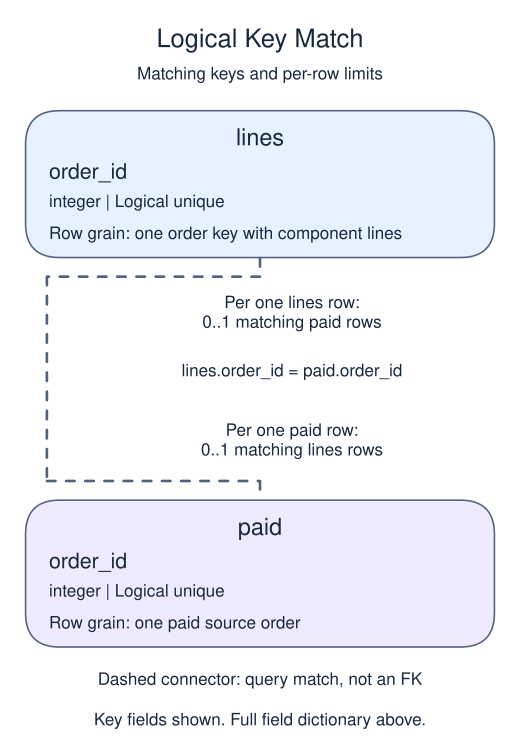
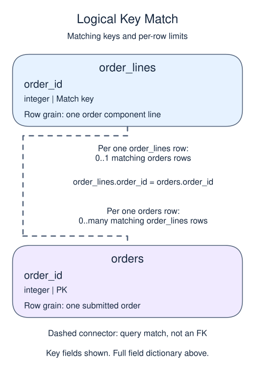

# Exercise: reconcile independent sources and name the limits

## Data model

### Exercise data

These objects are loaded at the start. Only the query inputs and their required lineage are listed; other tables in a shared seed are not part of this report.

#### `order_lines`

One row represents one order component line.

| Field / SQL type | Meaning | Rules |
| --- | --- | --- |
| `line_id` · `integer` | Line record identifier, not the order identity. | Primary key; unique. Required; cannot be `NULL`. |
| `order_id` · `integer` | Logical parent order identifier; several lines can refer to one order, without an enforced foreign key. | Nullable; `NULL` means the identifier or reference is unrecorded. |
| `units` · `integer` | Number of components represented by this line. | Nullable; `NULL` means the units measure is unrecorded, not zero. |
| `category` · `text` | Component grouping label, such as parts or labor; not an enforced vocabulary. | Nullable; `NULL` means no category value is recorded. |
| `line_amount` · `numeric(10,2)` | USD amount for the whole line, already covering its units; do not multiply it by units. | Nullable; `NULL` means the line amount measure is unrecorded, not zero. |

The line total is an independent reconciliation source. A line can disagree with its order total; neither uniqueness nor a foreign key reconciles the money.

#### `orders`

One row represents one submitted order.

| Field / SQL type | Meaning | Rules |
| --- | --- | --- |
| `order_id` · `integer` | Order identifier; equal order totals still belong to separate orders. | Primary key; unique. Required; cannot be `NULL`. |
| `member_id` · `integer` | Member key used to look up a registered member; no foreign key is declared. | Nullable; `NULL` means the identifier or reference is unrecorded. |
| `placed_at` · `timestamp with time zone` | Order occurrence instant, interpreted in UTC unless the query explicitly chooses a local reporting zone. | Required; cannot be `NULL`. |
| `status` · `text` | Order status: paid, pending and cancelled occur in the snapshot; paid defines revenue eligibility. | Required; cannot be `NULL`. |
| `amount` · `numeric(10,2)` | Whole-order gross amount in USD before refunds, not a unit price or an order-line amount. | Nullable; `NULL` means the order gross amount is unknown, not zero. |
| `coupon` · `text` | Optional coupon code recorded on the order. | Nullable; `NULL` means no coupon code is recorded. |

The status labels are observed values, not a CHECK constraint. Paid amounts are known in this supplied snapshot; the nullable column also contains an unknown pending amount. No nonnegative-amount rule or member foreign key is declared. An orphan member key is a real order, not a member registration. The supplied orphan key is 99.

### Named intermediate results

These dictionaries describe the columns exposed by the named query steps. They are not extra preloaded tables or a complete answer query.

#### `paid`

One row represents one paid source order.

| Field / SQL type | Meaning | Rules |
| --- | --- | --- |
| `order_id` · `integer` | Order identity inherited unchanged from orders.order_id. | Non-NULL by query lineage, not a declared NOT NULL constraint. Logical unique non-NULL key inherited from the base primary key; no view primary key is declared. |
| `order_gross` · `numeric(10,2)` | Whole-order gross USD before refunds, inherited from orders.amount. | May be `NULL` under its source or expression policy. The base amount is nullable; known paid sample values do not make the view enforce NOT NULL. |

This CTE is statement-local; it has no independently declared primary key, foreign key or NOT NULL constraint.

All dates in the supplied snapshot; paid rows retain their source identity and nullable amount.

#### `lines`

One row represents one order key with component lines.

| Field / SQL type | Meaning | Rules |
| --- | --- | --- |
| `order_id` · `integer` | Line-source order reference used as the group key. | May be `NULL` under its source or expression policy. Logical unique group key including at most one NULL group. |
| `line_gross` · `numeric` | Sum of whole-line USD amounts for this order key, without multiplying by units. | May be `NULL` under its source or expression policy. SUM ignores unknown line amounts; an all-unknown group is NULL. |

This CTE is statement-local; it has no independently declared primary key, foreign key or NOT NULL constraint.

This independent line summary is not the order amount and does not require a matching paid order.

### Relationship map

Aliases name query roles, not extra tables: `p` = `paid`, `l` = `lines`.

Each `lines` row can match zero or one `paid` rows; each `paid` row can match zero or one `lines` rows. The stated keys and grouped or deduplicated grain determine these match limits; a child matching column can repeat unless its constraints or query grain make that value unique. Column names alone do not guarantee uniqueness. This is a logical query match, not a declared foreign key between these inputs. Missing or unmatched references need not have a parent.

Each `order_lines` row can match zero or one `orders` rows; each `orders` row can match zero or many `order_lines` rows. The stated keys and grouped or deduplicated grain determine these match limits; a child matching column can repeat unless its constraints or query grain make that value unique. Column names alone do not guarantee uniqueness. This is a logical query match, not a declared foreign key between these inputs. Missing or unmatched references need not have a parent.

An inner join omits nonmatches. A left join retains its left population and a full join retains both populations, using NULLs only for the missing side. These outer-join NULLs differ from unknown values stored in a real row. A one-to-many detail match repeats the other side's fields; preaggregate before summing parent-level money. An EXISTS test only asks whether a match exists and does not copy all matching child rows.

Check paid order amounts against independently summed order lines.

Use the full paid-order snapshot and all line totals. Do not multiply `line_amount` by `units`. Keep the original source totals NULL when a side is absent; only the difference calculation substitutes zero. In the supplied rows every comparison key is present on both sides, but order 108 differs by USD 2. A full join also preserves one-sided keys if they occur in another extract.

## Your Task

1. Return `order_id`, `order_gross`, `line_gross`, and `difference` (order minus lines), keeping all keys present in either paid orders or the line summary; order by `order_id`.

Replace the preview in `script.sql`. Run your query, check the returned rows, then Submit.

A row with zero difference passes this arithmetic check only. Inspect missing-side nulls separately before calling the data complete, and do not claim that a reconciliation proves every business rule.
