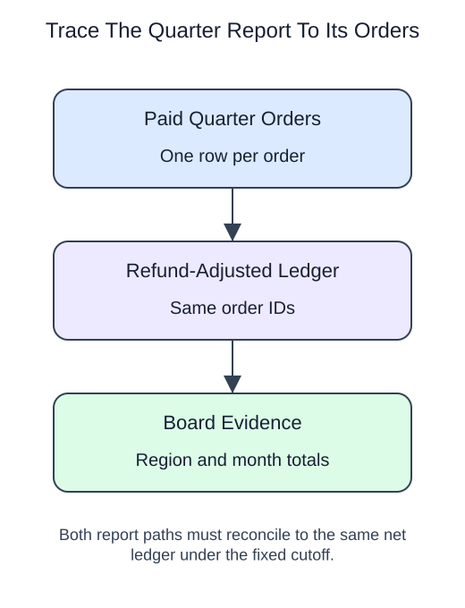

# Quarter review 1: freeze the report population

## Data model

### Exercise data

These objects are loaded at the start. Only the query inputs and their required lineage are listed; other tables in a shared seed are not part of this report.

#### `orders`

One row represents one submitted order.

| Field / SQL type | Meaning | Rules |
| --- | --- | --- |
| `order_id` · `integer` | Order identifier; equal order totals still belong to separate orders. | Primary key; unique. Required; cannot be `NULL`. |
| `member_id` · `integer` | Member key used to look up a registered member; no foreign key is declared. | Nullable; `NULL` means the identifier or reference is unrecorded. |
| `placed_at` · `timestamp with time zone` | Order occurrence instant, interpreted in UTC unless the query explicitly chooses a local reporting zone. | Nullable; `NULL` means occurrence time is unrecorded. |
| `status` · `text` | Order status: paid, pending and cancelled occur in the snapshot; paid defines revenue eligibility. | Nullable; `NULL` means no status value is recorded. |
| `amount` · `numeric(10,2)` | Whole-order gross amount in USD before refunds, not a unit price or an order-line amount. | Nullable; `NULL` means the order gross amount is unknown, not zero. |
| `coupon` · `text` | Optional coupon code recorded on the order. | Nullable; `NULL` means no coupon code is recorded. |

The status labels are observed values, not a CHECK constraint. Paid amounts are known in this supplied snapshot; the nullable column also contains an unknown pending amount. No nonnegative-amount rule or member foreign key is declared. An orphan member key is a real order, not a member registration. The supplied orphan key is 999.

### Tables and views to define

These objects do not exist in the starting database. Their fields describe the target definition, not additional columns already available to the starter.

#### `quarter_paid`

One row represents one paid order in the fixed January–March 2025 UTC quarter.

| Field / SQL type | Meaning | Rules |
| --- | --- | --- |
| `order_id` · `integer` | Order identity inherited unchanged from orders.order_id. | Non-NULL by query lineage, not a declared NOT NULL constraint. Logical unique non-NULL key inherited from the base primary key; no view primary key is declared. |
| `member_id` · `integer` | Member key inherited from the order; it may be missing or unmatched. | May be `NULL` under its source or expression policy. |
| `placed_at` · `timestamp with time zone` | Original order occurrence instant, retained for UTC order-month bucketing. | Non-NULL by query lineage, not a declared NOT NULL constraint. The quarter predicate excludes NULL instants even though the capstone source permits them. |
| `gross` · `numeric(10,2)` | Whole-order gross USD before refunds, inherited from orders.amount. | May be `NULL` under its source or expression policy. The base amount is nullable; known paid sample values do not make the view enforce NOT NULL. |

This ordinary view stores a query definition, not frozen rows; it has no independently declared primary key, foreign key or NOT NULL constraint.

Target or restored view over a supplied fixed snapshot, not a materialized or historically frozen table. Member matching is not part of this population; orphan money remains.

Prepare the January–March 2025 board report for the Beacon tool library, using a new independently seeded snapshot.

## Project continuity

This starts a new report. The seed contains the source snapshot only.

Prerequisites: paid-population definitions, timestamp boundaries, views and transactions.

The board needs net paid-order revenue by order month and current member region. The as-of cutoff is April 1, 2025 00:00 UTC. This is an order-cohort revenue report, not a cash-flow statement: refunds known before the cutoff are assigned back to the original order.

This capstone uses its own Beacon snapshot; the in-lesson model above describes the actual inputs at this stage.

The seed includes an order just before the quarter, another exactly at its end, a pending unknown amount, an orphan member key 999, and a refund after the cutoff. Keep these counterexamples visible during your checks.

For this fixed snapshot, assume order status and amount reflect the cutoff, and that each refund was recorded when it occurred. There is no receipt timestamp or revision history in these tables. Filtering dates on a changing live source would not reconstruct what was known on April 1: a late refund or a later status correction could change the answer. A historical report needs a preserved snapshot or enough change history to apply its knowledge cutoff.

## Your Task

1. Create or replace `quarter_paid` with `order_id`, `member_id`, `placed_at`, and `gross` for paid orders in the half-open UTC quarter. Return `order_id`, `member_id`, and `gross` ordered by order ID.

Edit `script.sql`, Run to inspect the final table, then Submit. The result checks cover column names, row count, and complete rows. They do not prove a particular view definition or transaction was used.

Write down the population before proceeding: order grain, paid status, UTC quarter, and no member-match exclusion. The next stage must preserve exactly these order IDs.
