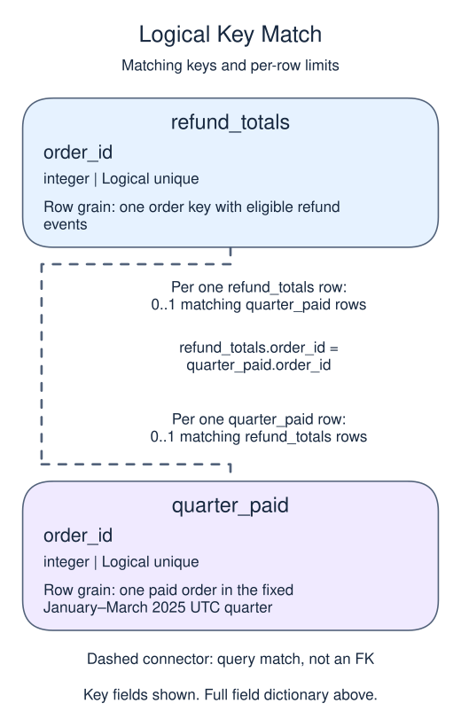
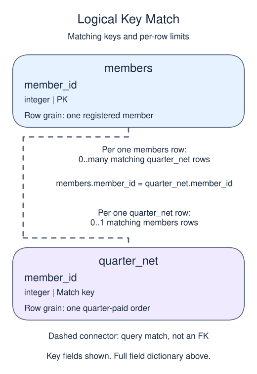
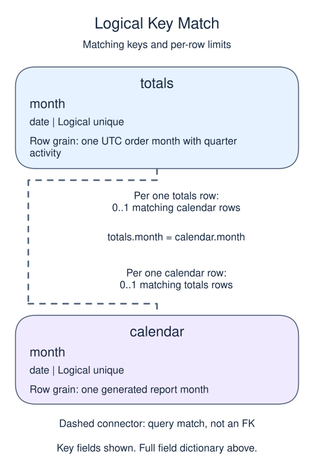
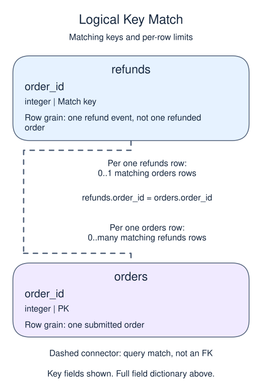

# Quarter review 4: a monthly trend with a stable definition

## Data model

### Exercise data

These objects are loaded at the start. Only the query inputs and their required lineage are listed; other tables in a shared seed are not part of this report.

#### `members`

One row represents one registered member.

| Field / SQL type | Meaning | Rules |
| --- | --- | --- |
| `member_id` · `integer` | Registered-member identifier, distinct from an import receipt or text member_key. | Primary key; unique. Required; cannot be `NULL`. |
| `region` · `text` | Current member region, not the region at the date of a past purchase. | Nullable; `NULL` means the current region is unrecorded. |
| `joined_on` · `date` | Registration calendar date, without a time of day or time zone. | Nullable; `NULL` means the calendar date is unrecorded. |
| `channel` · `text` | Recorded acquisition channel, such as search or referral; not a causal explanation of behavior. | Nullable; `NULL` means acquisition attribution is unknown. |

Region and channel labels are not enforced enumerations. This current-member dimension has no region-change history.

#### `orders`

One row represents one submitted order.

| Field / SQL type | Meaning | Rules |
| --- | --- | --- |
| `order_id` · `integer` | Order identifier; equal order totals still belong to separate orders. | Primary key; unique. Required; cannot be `NULL`. |
| `member_id` · `integer` | Member key used to look up a registered member; no foreign key is declared. | Nullable; `NULL` means the identifier or reference is unrecorded. |
| `placed_at` · `timestamp with time zone` | Order occurrence instant, interpreted in UTC unless the query explicitly chooses a local reporting zone. | Nullable; `NULL` means occurrence time is unrecorded. |
| `status` · `text` | Order status: paid, pending and cancelled occur in the snapshot; paid defines revenue eligibility. | Nullable; `NULL` means no status value is recorded. |
| `amount` · `numeric(10,2)` | Whole-order gross amount in USD before refunds, not a unit price or an order-line amount. | Nullable; `NULL` means the order gross amount is unknown, not zero. |
| `coupon` · `text` | Optional coupon code recorded on the order. | Nullable; `NULL` means no coupon code is recorded. |

The status labels are observed values, not a CHECK constraint. Paid amounts are known in this supplied snapshot; the nullable column also contains an unknown pending amount. No nonnegative-amount rule or member foreign key is declared. An orphan member key is a real order, not a member registration. The supplied orphan key is 999.

#### `quarter_net`

One row represents one quarter-paid order.

| Field / SQL type | Meaning | Rules |
| --- | --- | --- |
| `order_id` · `integer` | Order identity inherited unchanged from orders.order_id. | Non-NULL by query lineage, not a declared NOT NULL constraint. Logical unique non-NULL key inherited from the base primary key; no view primary key is declared. |
| `member_id` · `integer` | Member key inherited from the order; it may be missing or unmatched. | May be `NULL` under its source or expression policy. |
| `placed_at` · `timestamp with time zone` | Original order occurrence instant, retained for UTC order-month bucketing. | Non-NULL by query lineage, not a declared NOT NULL constraint. The quarter predicate excludes NULL instants even though the capstone source permits them. |
| `gross` · `numeric(10,2)` | Whole-order gross USD before refunds, inherited from orders.amount. | May be `NULL` under its source or expression policy. The base amount is nullable; known paid sample values do not make the view enforce NOT NULL. |
| `refunded` · `numeric` | Total recorded refund USD for this order after any stated cutoff, with absent summaries displayed as zero. | Non-NULL by query lineage, not a declared NOT NULL constraint. COALESCE makes the output non-NULL; it does not impose a physical constraint or prove source completeness. |
| `net` · `numeric` | Order gross USD minus its aggregated refunded USD. | May be `NULL` under its source or expression policy. A missing gross amount propagates to net; known sample net amounts do not create a NOT NULL constraint. |

This ordinary view stores a query definition, not frozen rows; it has no independently declared primary key, foreign key or NOT NULL constraint.

Refunds before the April 1, 2025 UTC cutoff are assigned back to the original order. This is order-cohort net revenue, not refund-month cash flow. Historical knowledge relies on a preserved snapshot and the stated recording assumptions, not on the view freezing history.

#### `quarter_paid`

One row represents one paid order in the fixed January–March 2025 UTC quarter.

| Field / SQL type | Meaning | Rules |
| --- | --- | --- |
| `order_id` · `integer` | Order identity inherited unchanged from orders.order_id. | Non-NULL by query lineage, not a declared NOT NULL constraint. Logical unique non-NULL key inherited from the base primary key; no view primary key is declared. |
| `member_id` · `integer` | Member key inherited from the order; it may be missing or unmatched. | May be `NULL` under its source or expression policy. |
| `placed_at` · `timestamp with time zone` | Original order occurrence instant, retained for UTC order-month bucketing. | Non-NULL by query lineage, not a declared NOT NULL constraint. The quarter predicate excludes NULL instants even though the capstone source permits them. |
| `gross` · `numeric(10,2)` | Whole-order gross USD before refunds, inherited from orders.amount. | May be `NULL` under its source or expression policy. The base amount is nullable; known paid sample values do not make the view enforce NOT NULL. |

This ordinary view stores a query definition, not frozen rows; it has no independently declared primary key, foreign key or NOT NULL constraint.

Target or restored view over a supplied fixed snapshot, not a materialized or historically frozen table. Member matching is not part of this population; orphan money remains.

#### `quarter_regions`

One row represents one displayed current-member-region group.

| Field / SQL type | Meaning | Rules |
| --- | --- | --- |
| `region` · `text` | Current member region, with missing member matches or missing region values displayed as unmatched. | Non-NULL by query lineage, not a declared NOT NULL constraint. Logical unique group label, not a historical region key. The supplied matched regions are known. |
| `paid_orders` · `bigint` | Number of quarter-net order rows in this region bucket. | Non-NULL by query lineage, not a declared NOT NULL constraint. Non-NULL COUNT; repeated orders by a buyer remain separate. |
| `registered_buyers` · `bigint` | Distinct known registered-member identities in this region bucket. | Non-NULL by query lineage, not a declared NOT NULL constraint. COUNT(DISTINCT member key) ignores the NULL key on an unmatched order. |
| `gross` · `numeric` | Sum of quarter-order gross USD in the region bucket. | May be `NULL` under its source or expression policy. SUM can be NULL for a group with no known gross amounts. |
| `refunded` · `numeric` | Sum of cutoff-eligible refunded USD in the region bucket. | Non-NULL by query lineage, not a declared NOT NULL constraint. The nonempty group sums non-NULL zero-filled ledger values. |
| `net` · `numeric` | Sum of quarter-order net USD in the region bucket. | May be `NULL` under its source or expression policy. Nullable gross can propagate through the ledger; the sample paid amounts are known. |

This ordinary view stores a query definition, not frozen rows; it has no independently declared primary key, foreign key or NOT NULL constraint.

All counts and money use the same order population, including unmatched members. Region is the current attribute; no move history exists.

#### `refunds`

One row represents one refund event, not one refunded order.

| Field / SQL type | Meaning | Rules |
| --- | --- | --- |
| `refund_id` · `integer` | Refund-event identifier; an order can have several different refund IDs. | Primary key; unique. Required; cannot be `NULL`. |
| `order_id` · `integer` | Logical parent order identifier; not a declared foreign key. | Nullable; `NULL` means the identifier or reference is unrecorded. |
| `refunded_at` · `timestamp with time zone` | Refund occurrence instant, interpreted in UTC for cutoff tests; no separate receipt time is stored. | Nullable; `NULL` means refund occurrence time is unrecorded. |
| `amount` · `numeric(10,2)` | USD amount returned by this one refund event, not the original order gross amount. | Nullable; `NULL` means the event refund amount is unknown, not zero. |

Supplied refund amounts are known and positive, but the schema permits NULL and does not enforce positivity. Sum events to order grain before attaching them to an order total. No receipt/version history exists to reconstruct late knowledge on a changing source.

### Tables and views to define

These objects do not exist in the starting database. Their fields describe the target definition, not additional columns already available to the starter.

#### `quarter_months`

One row represents one UTC order month in the January–March 2025 report.

| Field / SQL type | Meaning | Rules |
| --- | --- | --- |
| `month` · `date` | UTC first-of-month calendar date, retaining both year and month. | Non-NULL by query lineage, not a declared NOT NULL constraint. Logical unique generated month key, not a physical primary key. |
| `paid_orders` · `bigint` | Number of quarter-paid orders assigned to this UTC occurrence month, including orphan member keys. | Non-NULL by query lineage, not a declared NOT NULL constraint. Absent monthly summaries become zero; output is bigint. |
| `net` · `numeric` | Net USD assigned to original order month under the fixed refund cutoff. | Non-NULL by query lineage, not a declared NOT NULL constraint. The monthly left join COALESCE makes the output non-NULL; it does not validate unknown source money. |

This ordinary view stores a query definition, not frozen rows; it has no independently declared primary key, foreign key or NOT NULL constraint.

The calendar preserves all three months. This is a live ordinary view over the supplied fixed snapshot, not frozen historical storage.

### Named intermediate results

These dictionaries describe the columns exposed by the named query steps. They are not extra preloaded tables or a complete answer query.

#### `refund_totals`

One row represents one order key with eligible refund events.

| Field / SQL type | Meaning | Rules |
| --- | --- | --- |
| `order_id` · `integer` | Refund-source order key used for grouping. | May be `NULL` under its source or expression policy. Logical unique group key, including at most one NULL group; not a physical primary key. |
| `refunded` · `numeric` | Sum of refund-event amounts in USD for this order key. | May be `NULL` under its source or expression policy. SUM ignores unknown amounts and is NULL if all amounts in a group are unknown. No declared precision or scale. |

This CTE is statement-local; it has no independently declared primary key, foreign key or NOT NULL constraint.

Only refund occurrences before April 1, 2025 UTC enter this summary. Grouped keys are logically unique, not physical primary keys; NULL grouping remains possible.

#### `calendar`

One row represents one generated report month.

| Field / SQL type | Meaning | Rules |
| --- | --- | --- |
| `month` · `date` | UTC first-of-month calendar date, retaining both year and month. | Non-NULL by query lineage, not a declared NOT NULL constraint. Logical unique generated month key, not a physical primary key. |

This CTE is statement-local; it has no independently declared primary key, foreign key or NOT NULL constraint.

GENERATE_SERIES supplies each stated boundary once, including its end. These are generated dates, not rows loaded from a calendar table.

#### `totals`

One row represents one UTC order month with quarter activity.

| Field / SQL type | Meaning | Rules |
| --- | --- | --- |
| `month` · `date` | UTC first-of-month occurrence date inherited from quarter_net.placed_at. | Non-NULL by query lineage, not a declared NOT NULL constraint. Logical unique GROUP BY month, not a generated date or declared key. |
| `paid_orders` · `bigint` | Number of quarter-net orders in this activity month. | Non-NULL by query lineage, not a declared NOT NULL constraint. Non-NULL COUNT; missing months have no summary row here. |
| `net` · `numeric` | Sum of quarter-net USD assigned to this order-occurrence month. | May be `NULL` under its source or expression policy. SUM ignores unknown net values and is NULL if the group has no known net amounts. |

This CTE is statement-local; it has no independently declared primary key, foreign key or NOT NULL constraint.

Grouped quarter_net before calendar completion: months without activity have no row. Calendar zero-fill happens afterward.

### Relationship map

Aliases name query roles, not extra tables: `p` = `quarter_paid`, `r` = `refund_totals`, `n` = `quarter_net`, `m` = `members`, `c` = `calendar`, `t` = `totals`.

Each `refund_totals` row can match zero or one `quarter_paid` rows; each `quarter_paid` row can match zero or one `refund_totals` rows. The stated keys and grouped or deduplicated grain determine these match limits; a child matching column can repeat unless its constraints or query grain make that value unique. Column names alone do not guarantee uniqueness. This is a logical query match, not a declared foreign key between these inputs. Missing or unmatched references need not have a parent.

Each `members` row can match zero or many `quarter_net` rows; each `quarter_net` row can match zero or one `members` rows. The stated keys and grouped or deduplicated grain determine these match limits; a child matching column can repeat unless its constraints or query grain make that value unique. Column names alone do not guarantee uniqueness. This is a logical query match, not a declared foreign key between these inputs. Missing or unmatched references need not have a parent.

Each `totals` row can match zero or one `calendar` rows; each `calendar` row can match zero or one `totals` rows. The stated keys and grouped or deduplicated grain determine these match limits; a child matching column can repeat unless its constraints or query grain make that value unique. Column names alone do not guarantee uniqueness. This is a logical query match, not a declared foreign key between these inputs. Missing or unmatched references need not have a parent.

Each `refunds` row can match zero or one `orders` rows; each `orders` row can match zero or many `refunds` rows. The stated keys and grouped or deduplicated grain determine these match limits; a child matching column can repeat unless its constraints or query grain make that value unique. Column names alone do not guarantee uniqueness. This is a logical query match, not a declared foreign key between these inputs. Missing or unmatched references need not have a parent.

An inner join omits nonmatches. A left join retains its left population and a full join retains both populations, using NULLs only for the missing side. These outer-join NULLs differ from unknown values stored in a real row. A one-to-many detail match repeats the other side's fields; preaggregate before summing parent-level money. An EXISTS test only asks whether a match exists and does not copy all matching child rows.

Add a complete monthly net-revenue trend using the same order population and refund policy as the regional table.

## Project continuity

This is stage 4 of the same report. The seed restores every earlier completed view, and the starter includes the previous stage's complete script. Keep that prefix and replace only the final preview query with this stage's work. You do not need a previous Run to make this lesson work.

Prerequisites: Quarter review 1–3; monthly date spines, views, LAG and explicit window frames.

Group by the UTC order month, not the refund month. Fill the three-month calendar and preserve month as a date in quarter_months. Display a running quarter total and an absolute change from the previous month. The first month has no previous month inside this report, so its change is null.

## Your Task

1. Create or replace `quarter_months` with date `month`, `paid_orders`, and `net`. Return `month` as ISO text, `paid_orders`, `net`, `running_net`, and `change_net`, ordered by month.

Edit `script.sql`, Run to inspect the final table, then Submit. The result checks cover column names, row count, and complete rows. They do not prove a particular view definition or transaction was used.

The last running total should equal the sum of regional net amounts. A monthly increase is observed activity, not evidence that a campaign caused growth; the snapshot contains no controlled comparison.
