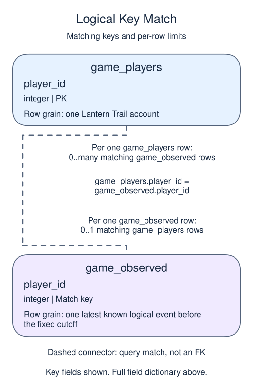
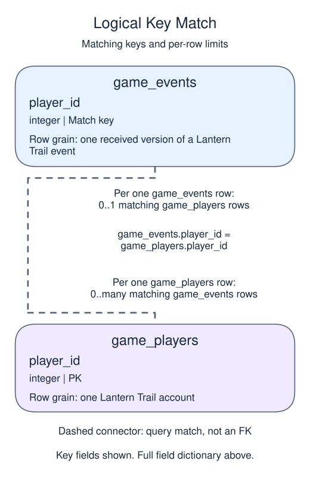

# Stage 1: establish the observed play stream

## Data model

### Exercise data

These objects are loaded at the start. Only the query inputs and their required lineage are listed; other tables in a shared seed are not part of this report.

#### `game_events`

One row represents one received version of a Lantern Trail event.

| Field / SQL type | Meaning | Rules |
| --- | --- | --- |
| `ingest_id` · `integer` | Unique receipt identifier, also the tie-breaker for equal receipt timestamps. | Primary key; unique. Required; cannot be `NULL`. |
| `event_id` · `text` | Logical event identity; repeated IDs represent versions or deliveries, not additional plays. | Required; cannot be `NULL`. |
| `player_id` · `integer` | Logical account reference; no foreign key excludes orphan or missing player IDs. | Nullable; `NULL` means no account reference is recorded. |
| `kind` · `text` | Event type; play means a completed puzzle attempt, while heartbeat is not play. | Required; cannot be `NULL`. |
| `happened_at` · `timestamp with time zone` | Event occurrence instant in UTC; used for play sequence, signup validity and activity windows. | Required; cannot be `NULL`. |
| `received_at` · `timestamp with time zone` | Arrival instant in UTC; used to restrict knowledge and rank known event versions. | Required; cannot be `NULL`. |

Kind labels are not CHECK-enforced. Restrict both occurrence and receipt to before the fixed cutoff, then retain the latest remaining version per event_id. Valid activity also needs a matching account and occurrence on or after signup. A logical-event ID has no physical UNIQUE constraint.

#### `game_players`

One row represents one Lantern Trail account.

| Field / SQL type | Meaning | Rules |
| --- | --- | --- |
| `player_id` · `integer` | Unique account identifier, not an event or receipt identifier. | Primary key; unique. Required; cannot be `NULL`. |
| `signed_up_at` · `timestamp with time zone` | Account signup instant; UTC defines signup-month and maturity boundaries. | Required; cannot be `NULL`. |
| `channel` · `text` | Recorded acquisition channel; NULL means attribution is unknown, not a new channel called unknown. | Nullable; `NULL` means acquisition attribution is unknown. |

Channels are descriptive sample labels, not an enforced vocabulary or a causal explanation of inactivity.

### Tables and views to define

These objects do not exist in the starting database. Their fields describe the target definition, not additional columns already available to the starter.

#### `game_activity`

One row represents one valid matched logical play.

| Field / SQL type | Meaning | Rules |
| --- | --- | --- |
| `event_id` · `text` | Retained logical event identity of a completed puzzle attempt. | Non-NULL by query lineage, not a declared NOT NULL constraint. Logical unique event key inherited from game_observed; not a physical primary key. |
| `player_id` · `integer` | Matched account identity for this play. | Non-NULL by query lineage, not a declared NOT NULL constraint. Equality with the account primary key excludes missing and orphan references; many plays can match one account. |
| `happened_at` · `timestamp with time zone` | Play occurrence instant in UTC, on or after account signup and before the fixed cutoff. | Non-NULL by query lineage, not a declared NOT NULL constraint. |

This ordinary view stores a query definition, not frozen rows; it has no independently declared primary key, foreign key or NOT NULL constraint.

The inner join adds validity, not another version choice. Heartbeats do not count as play; receipt time determined knowledge upstream, while occurrence time determines activity windows.

#### `game_observed`

One row represents one latest known logical event before the fixed cutoff.

| Field / SQL type | Meaning | Rules |
| --- | --- | --- |
| `event_id` · `text` | Logical event identity after retaining one known version. | Non-NULL by query lineage, not a declared NOT NULL constraint. Logically unique from the version rule; no physical UNIQUE constraint on this view. |
| `player_id` · `integer` | Nullable logical account reference; an orphan can survive this version layer. | May be `NULL` under its source or expression policy. |
| `kind` · `text` | Event type from the retained version, including non-play events. | Non-NULL by query lineage, not a declared NOT NULL constraint. |
| `happened_at` · `timestamp with time zone` | Retained event occurrence instant in UTC before April 1, 2025. | Non-NULL by query lineage, not a declared NOT NULL constraint. |
| `received_at` · `timestamp with time zone` | Retained event receipt instant in UTC before April 1, 2025. | Non-NULL by query lineage, not a declared NOT NULL constraint. |

This ordinary view stores a query definition, not frozen rows; it has no independently declared primary key, foreign key or NOT NULL constraint.

Apply occurrence and receipt cutoffs before choosing the latest remaining received version. This layer still contains orphans, non-plays and pre-signup events; it is not the valid play stream.

### Named intermediate results

These dictionaries describe the columns exposed by the named query steps. They are not extra preloaded tables or a complete answer query.

#### `versions`

One row represents one cutoff-eligible received event version with a version position.

| Field / SQL type | Meaning | Rules |
| --- | --- | --- |
| `ingest_id` · `integer` | Unique receipt identifier, also the tie-breaker for equal receipt timestamps. | Non-NULL by query lineage, not a declared NOT NULL constraint. Inherited source value; this step ranks receipts without removing older versions. |
| `event_id` · `text` | Required logical event identity inherited from game_events; it can repeat across these cutoff-eligible versions. | Non-NULL by query lineage, not a declared NOT NULL constraint. Not unique at received-version grain; ranking alone does not remove receipts. |
| `player_id` · `integer` | Logical account reference; no foreign key excludes orphan or missing player IDs. | May be `NULL` under its source or expression policy. Inherited source value; this step ranks receipts without removing older versions. |
| `kind` · `text` | Event type; play means a completed puzzle attempt, while heartbeat is not play. | Non-NULL by query lineage, not a declared NOT NULL constraint. Inherited source value; this step ranks receipts without removing older versions. |
| `happened_at` · `timestamp with time zone` | Event occurrence instant in UTC; used for play sequence, signup validity and activity windows. | Non-NULL by query lineage, not a declared NOT NULL constraint. Inherited source value; this step ranks receipts without removing older versions. |
| `received_at` · `timestamp with time zone` | Arrival instant in UTC; used to restrict knowledge and rank known event versions. | Non-NULL by query lineage, not a declared NOT NULL constraint. Inherited source value; this step ranks receipts without removing older versions. |
| `version_rank` · `bigint` | Position within this logical event ordered by latest receipt and then receipt ID. | Non-NULL by query lineage, not a declared NOT NULL constraint. ROW_NUMBER is non-NULL; event_id is not unique until one version is retained. |

This CTE is statement-local; it has no independently declared primary key, foreign key or NOT NULL constraint.

All source fields remain exposed. The CTE lasts only for this statement; cutoffs restrict knowledge before ranking.

### Relationship map

Aliases name query roles, not extra tables: `e` = `game_observed`, `p` = `game_players`.

Each `game_players` row can match zero or many `game_observed` rows; each `game_observed` row can match zero or one `game_players` rows. The stated keys and grouped or deduplicated grain determine these match limits; a child matching column can repeat unless its constraints or query grain make that value unique. Column names alone do not guarantee uniqueness. This is a logical query match, not a declared foreign key between these inputs. Missing or unmatched references need not have a parent.

Each `game_events` row can match zero or one `game_players` rows; each `game_players` row can match zero or many `game_events` rows. The stated keys and grouped or deduplicated grain determine these match limits; a child matching column can repeat unless its constraints or query grain make that value unique. Column names alone do not guarantee uniqueness. This is a logical query match, not a declared foreign key between these inputs. Missing or unmatched references need not have a parent.

An inner join omits nonmatches. A left join retains its left population and a full join retains both populations, using NULLs only for the missing side. These outer-join NULLs differ from unknown values stored in a real row. A one-to-many detail match repeats the other side's fields; preaggregate before summing parent-level money. An EXISTS test only asks whether a match exists and does not copy all matching child rows.

The snapshot uses UTC, an exclusive April 1, 2025 00:00 cutoff, baseline March 4 inclusive to March 18 exclusive, and follow-up March 18 inclusive to April 1 exclusive. Only accounts with full follow-up opportunity and valid baseline play enter the inactivity denominator. An absent play in an incomplete feed would be unknown observation, not demonstrated inactivity.

The export contains duplicate deliveries, an orphan player, a heartbeat, a play before signup, a cutoff event, and a late arrival. Begin with a source-quality checkpoint instead of treating every row as a session. Filtering arrival time before deduplication prevents a later version from rewriting what the team could know at the cutoff. Both event timestamps must be earlier than the cutoff. Do not discard older valid history: the later never-played check needs it.

## The game snapshot

Use the fixed cutoff **April 1, 2025 at 00:00 UTC**, exclusively. Keep only events that both happened and arrived before that instant, retain the latest known version per event ID (arrival descending, then ingest ID descending), then keep plays matched to an account and occurring on or after signup. Assume this toy export covers all accounts from signup onward; in a real export verify tracking coverage and identity quality before interpreting silence.

The baseline is **March 4 inclusive to March 18 exclusive**. Follow-up is **March 18 inclusive to April 1 exclusive**. The eligible denominator contains accounts signed up by March 18 at 00:00 UTC with at least one valid baseline play. A member of that baseline cohort with no follow-up play is **activity-churned for this report**; any follow-up play means retained. This is an observed transition into a 14-day inactive window, not subscription cancellation, permanent departure, or a prediction. New accounts, never-players, and accounts absent from the baseline are reported separately, not added to that denominator.

The full follow-up window is observed for the eligible baseline cohort. Recent signups are right-censored for a comparable account-age follow-up: the export ends before they receive the same opportunity. Excluding them avoids labeling incomplete observation as churn. Signup-month cohorts below are descriptive strata of the fixed baseline population, not day-N retention curves. Retention and inactivity sum to 100% only because this report uses the same eligible cohort and complementary follow-up conditions.

## Your Task

1. Create `game_observed` with the latest known event version, then `game_activity` with only valid matched plays. Return one row containing `raw_receipts` (the whole input table), `known_events` (game_observed), `valid_plays` (game_activity), and `playing_accounts` (distinct valid player IDs). Keep these column names and order.

Edit `script.sql`, Run to inspect the result, then Submit. Grading checks the complete ordered result, not whether a view was created or which equivalent SQL you used. Run and Submit reset the supplied snapshot.
