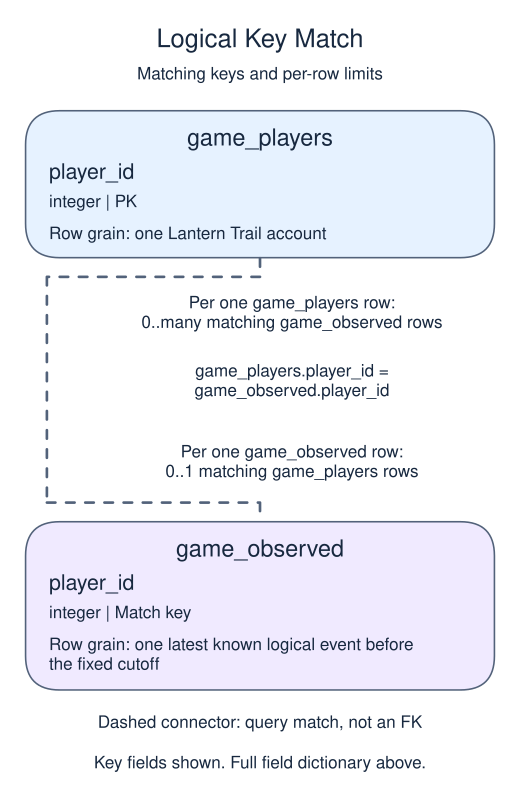
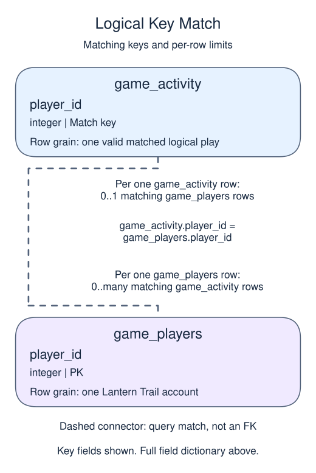
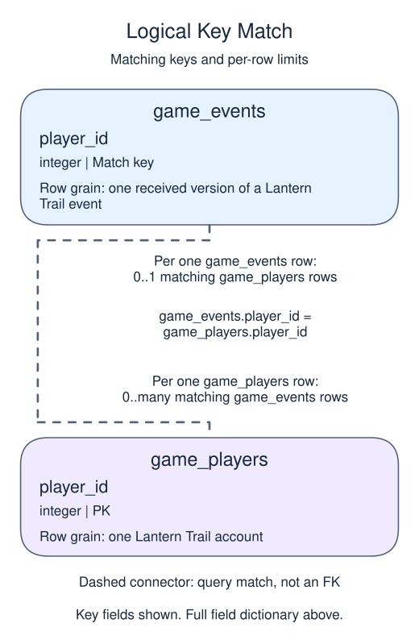

# Stage 4: compare cohort and channel denominators

## Data model

### Exercise data

These objects are loaded at the start. Only the query inputs and their required lineage are listed; other tables in a shared seed are not part of this report.

#### `game_activity`

One row represents one valid matched logical play.

| Field / SQL type | Meaning | Rules |
| --- | --- | --- |
| `event_id` · `text` | Retained logical event identity of a completed puzzle attempt. | Non-NULL by query lineage, not a declared NOT NULL constraint. Logical unique event key inherited from game_observed; not a physical primary key. |
| `player_id` · `integer` | Matched account identity for this play. | Non-NULL by query lineage, not a declared NOT NULL constraint. Equality with the account primary key excludes missing and orphan references; many plays can match one account. |
| `happened_at` · `timestamp with time zone` | Play occurrence instant in UTC, on or after account signup and before the fixed cutoff. | Non-NULL by query lineage, not a declared NOT NULL constraint. |

This ordinary view stores a query definition, not frozen rows; it has no independently declared primary key, foreign key or NOT NULL constraint.

The inner join adds validity, not another version choice. Heartbeats do not count as play; receipt time determined knowledge upstream, while occurrence time determines activity windows.

#### `game_events`

One row represents one received version of a Lantern Trail event.

| Field / SQL type | Meaning | Rules |
| --- | --- | --- |
| `ingest_id` · `integer` | Unique receipt identifier, also the tie-breaker for equal receipt timestamps. | Primary key; unique. Required; cannot be `NULL`. |
| `event_id` · `text` | Logical event identity; repeated IDs represent versions or deliveries, not additional plays. | Required; cannot be `NULL`. |
| `player_id` · `integer` | Logical account reference; no foreign key excludes orphan or missing player IDs. | Nullable; `NULL` means no account reference is recorded. |
| `kind` · `text` | Event type; play means a completed puzzle attempt, while heartbeat is not play. | Required; cannot be `NULL`. |
| `happened_at` · `timestamp with time zone` | Event occurrence instant in UTC; used for play sequence, signup validity and activity windows. | Required; cannot be `NULL`. |
| `received_at` · `timestamp with time zone` | Arrival instant in UTC; used to restrict knowledge and rank known event versions. | Required; cannot be `NULL`. |

Kind labels are not CHECK-enforced. Restrict both occurrence and receipt to before the fixed cutoff, then retain the latest remaining version per event_id. Valid activity also needs a matching account and occurrence on or after signup. A logical-event ID has no physical UNIQUE constraint.

#### `game_observed`

One row represents one latest known logical event before the fixed cutoff.

| Field / SQL type | Meaning | Rules |
| --- | --- | --- |
| `event_id` · `text` | Logical event identity after retaining one known version. | Non-NULL by query lineage, not a declared NOT NULL constraint. Logically unique from the version rule; no physical UNIQUE constraint on this view. |
| `player_id` · `integer` | Nullable logical account reference; an orphan can survive this version layer. | May be `NULL` under its source or expression policy. |
| `kind` · `text` | Event type from the retained version, including non-play events. | Non-NULL by query lineage, not a declared NOT NULL constraint. |
| `happened_at` · `timestamp with time zone` | Retained event occurrence instant in UTC before April 1, 2025. | Non-NULL by query lineage, not a declared NOT NULL constraint. |
| `received_at` · `timestamp with time zone` | Retained event receipt instant in UTC before April 1, 2025. | Non-NULL by query lineage, not a declared NOT NULL constraint. |

This ordinary view stores a query definition, not frozen rows; it has no independently declared primary key, foreign key or NOT NULL constraint.

Apply occurrence and receipt cutoffs before choosing the latest remaining received version. This layer still contains orphans, non-plays and pre-signup events; it is not the valid play stream.

#### `game_player_history`

One row represents one account registered before the fixed cutoff.

| Field / SQL type | Meaning | Rules |
| --- | --- | --- |
| `player_id` · `integer` | Account identity inherited from game_players.player_id. | Non-NULL by query lineage, not a declared NOT NULL constraint. Logical unique non-NULL account key; the view has no separately declared primary key. |
| `signed_up_at` · `timestamp with time zone` | Account signup instant inherited from the account directory, interpreted in UTC. | Non-NULL by query lineage, not a declared NOT NULL constraint. |
| `channel` · `text` | Acquisition-channel label inherited from the account directory; NULL means unknown attribution. | May be `NULL` under its source or expression policy. |
| `last_seen` · `timestamp with time zone` | Latest known valid play occurrence instant in UTC across all prior valid history. | May be `NULL` under its source or expression policy. NULL means no valid play was observed; it is not signup time or a latest-arrival time. |
| `baseline_plays` · `bigint` | Valid plays during March 4 inclusive to March 18 exclusive, 2025 UTC. | Non-NULL by query lineage, not a declared NOT NULL constraint. COUNT returns zero for no matching baseline plays; not a count of receipts. |
| `recent_plays` · `bigint` | Valid plays during March 18 inclusive to April 1 exclusive, 2025 UTC. | Non-NULL by query lineage, not a declared NOT NULL constraint. COUNT returns zero for no matching follow-up plays. |
| `account_mature` · `integer` | Computed integer flag: 1 for signup at or before March 18, 2025 00:00 UTC, else 0. | Non-NULL by query lineage, not a declared NOT NULL constraint. A maturity flag alone does not establish positive baseline activity; no CHECK constraint is created. |

This ordinary view stores a query definition, not frozen rows; it has no independently declared primary key, foreign key or NOT NULL constraint.

A left join preserves accounts with no valid play. The logical account key remains unique after aggregation; never-played history stays unknown rather than zero time.

#### `game_players`

One row represents one Lantern Trail account.

| Field / SQL type | Meaning | Rules |
| --- | --- | --- |
| `player_id` · `integer` | Unique account identifier, not an event or receipt identifier. | Primary key; unique. Required; cannot be `NULL`. |
| `signed_up_at` · `timestamp with time zone` | Account signup instant; UTC defines signup-month and maturity boundaries. | Required; cannot be `NULL`. |
| `channel` · `text` | Recorded acquisition channel; NULL means attribution is unknown, not a new channel called unknown. | Nullable; `NULL` means acquisition attribution is unknown. |

Channels are descriptive sample labels, not an enforced vocabulary or a causal explanation of inactivity.

#### `game_status`

One row represents one observed account with its activity classification.

| Field / SQL type | Meaning | Rules |
| --- | --- | --- |
| `player_id` · `integer` | Account identity inherited from game_players.player_id. | Non-NULL by query lineage, not a declared NOT NULL constraint. Logical unique non-NULL account key; the view has no separately declared primary key. |
| `signed_up_at` · `timestamp with time zone` | Account signup instant inherited from the account directory, interpreted in UTC. | Non-NULL by query lineage, not a declared NOT NULL constraint. |
| `channel` · `text` | Acquisition-channel label inherited from the account directory; NULL means unknown attribution. | May be `NULL` under its source or expression policy. |
| `last_seen` · `timestamp with time zone` | Latest known valid play occurrence instant in UTC across all prior valid history. | May be `NULL` under its source or expression policy. NULL means no valid play was observed; it is not signup time or a latest-arrival time. |
| `baseline_plays` · `bigint` | Valid plays during March 4 inclusive to March 18 exclusive, 2025 UTC. | Non-NULL by query lineage, not a declared NOT NULL constraint. COUNT returns zero for no matching baseline plays; not a count of receipts. |
| `recent_plays` · `bigint` | Valid plays during March 18 inclusive to April 1 exclusive, 2025 UTC. | Non-NULL by query lineage, not a declared NOT NULL constraint. COUNT returns zero for no matching follow-up plays. |
| `account_mature` · `integer` | Computed integer flag: 1 for signup at or before March 18, 2025 00:00 UTC, else 0. | Non-NULL by query lineage, not a declared NOT NULL constraint. A maturity flag alone does not establish positive baseline activity; no CHECK constraint is created. |
| `activity_status` · `text` | Reporting label: new_unobserved, never_played, outside_baseline, inactive or retained. | Non-NULL by query lineage, not a declared NOT NULL constraint. Computed exhaustive CASE label, not an enforced status vocabulary. Only inactive and retained enter the common eligible denominator. |

This ordinary view stores a query definition, not frozen rows; it has no independently declared primary key, foreign key or NOT NULL constraint.

All history fields pass through unchanged. Inactive means no follow-up activity in this fixed report, not cancellation or permanent loss.

### Tables and views to define

These objects do not exist in the starting database. Their fields describe the target definition, not additional columns already available to the starter.

#### `game_cohorts`

One row represents one eligible signup-month/channel cell.

| Field / SQL type | Meaning | Rules |
| --- | --- | --- |
| `signup_month` · `date` | UTC first-of-month signup date for these accounts, not a first-play acquisition month. | Non-NULL by query lineage, not a declared NOT NULL constraint. The supplied session time zone is UTC; part of the logical composite group key. |
| `channel` · `text` | Acquisition-channel group, with missing attribution displayed as unknown. | Non-NULL by query lineage, not a declared NOT NULL constraint. Other half of the logical composite key; not a physical UNIQUE constraint. |
| `eligible_players` · `bigint` | Accounts classified inactive or retained in this same cell. | Non-NULL by query lineage, not a declared NOT NULL constraint. Non-NULL COUNT; excludes new, never-played and outside-baseline accounts. |
| `inactive_players` · `bigint` | Eligible accounts in this cell with zero valid follow-up plays. | Non-NULL by query lineage, not a declared NOT NULL constraint. Non-NULL filtered COUNT; a count of players, not plays. |
| `retained_players` · `bigint` | Eligible accounts in this cell with at least one valid follow-up play. | Non-NULL by query lineage, not a declared NOT NULL constraint. Non-NULL filtered COUNT; complementary to inactive for this denominator. |
| `inactivity_pct` · `numeric` | Inactive accounts as a percentage of eligible accounts in this same cell. | Non-NULL by query lineage, not a declared NOT NULL constraint. Computed numeric percentage rounded to two decimals; groups are nonempty, so the guarded denominator is positive. |

This ordinary view stores a query definition, not frozen rows; it has no independently declared primary key, foreign key or NOT NULL constraint.

These are descriptive signup strata of a fixed baseline population, not age-standardized retention curves. A small cell can produce an extreme rate.

### Named intermediate results

These dictionaries describe the columns exposed by the named query steps. They are not extra preloaded tables or a complete answer query.

#### `versions`

One row represents one cutoff-eligible received event version with a version position.

| Field / SQL type | Meaning | Rules |
| --- | --- | --- |
| `ingest_id` · `integer` | Unique receipt identifier, also the tie-breaker for equal receipt timestamps. | Non-NULL by query lineage, not a declared NOT NULL constraint. Inherited source value; this step ranks receipts without removing older versions. |
| `event_id` · `text` | Required logical event identity inherited from game_events; it can repeat across these cutoff-eligible versions. | Non-NULL by query lineage, not a declared NOT NULL constraint. Not unique at received-version grain; ranking alone does not remove receipts. |
| `player_id` · `integer` | Logical account reference; no foreign key excludes orphan or missing player IDs. | May be `NULL` under its source or expression policy. Inherited source value; this step ranks receipts without removing older versions. |
| `kind` · `text` | Event type; play means a completed puzzle attempt, while heartbeat is not play. | Non-NULL by query lineage, not a declared NOT NULL constraint. Inherited source value; this step ranks receipts without removing older versions. |
| `happened_at` · `timestamp with time zone` | Event occurrence instant in UTC; used for play sequence, signup validity and activity windows. | Non-NULL by query lineage, not a declared NOT NULL constraint. Inherited source value; this step ranks receipts without removing older versions. |
| `received_at` · `timestamp with time zone` | Arrival instant in UTC; used to restrict knowledge and rank known event versions. | Non-NULL by query lineage, not a declared NOT NULL constraint. Inherited source value; this step ranks receipts without removing older versions. |
| `version_rank` · `bigint` | Position within this logical event ordered by latest receipt and then receipt ID. | Non-NULL by query lineage, not a declared NOT NULL constraint. ROW_NUMBER is non-NULL; event_id is not unique until one version is retained. |

This CTE is statement-local; it has no independently declared primary key, foreign key or NOT NULL constraint.

All source fields remain exposed. The CTE lasts only for this statement; cutoffs restrict knowledge before ranking.

### Relationship map

Aliases name query roles, not extra tables: `e` = `game_observed`, `p` = `game_players`, `a` = `game_activity`, `h` = `game_player_history`.

Each `game_players` row can match zero or many `game_observed` rows; each `game_observed` row can match zero or one `game_players` rows. The stated keys and grouped or deduplicated grain determine these match limits; a child matching column can repeat unless its constraints or query grain make that value unique. Column names alone do not guarantee uniqueness. This is a logical query match, not a declared foreign key between these inputs. Missing or unmatched references need not have a parent.

Each `game_activity` row can match zero or one `game_players` rows; each `game_players` row can match zero or many `game_activity` rows. The stated keys and grouped or deduplicated grain determine these match limits; a child matching column can repeat unless its constraints or query grain make that value unique. Column names alone do not guarantee uniqueness. This is a logical query match, not a declared foreign key between these inputs. Missing or unmatched references need not have a parent.

Each `game_events` row can match zero or one `game_players` rows; each `game_players` row can match zero or many `game_events` rows. The stated keys and grouped or deduplicated grain determine these match limits; a child matching column can repeat unless its constraints or query grain make that value unique. Column names alone do not guarantee uniqueness. This is a logical query match, not a declared foreign key between these inputs. Missing or unmatched references need not have a parent.

An inner join omits nonmatches. A left join retains its left population and a full join retains both populations, using NULLs only for the missing side. These outer-join NULLs differ from unknown values stored in a real row. A one-to-many detail match repeats the other side's fields; preaggregate before summing parent-level money. An EXISTS test only asks whether a match exists and does not copy all matching child rows.

The snapshot uses UTC, an exclusive April 1, 2025 00:00 cutoff, baseline March 4 inclusive to March 18 exclusive, and follow-up March 18 inclusive to April 1 exclusive. Only accounts with full follow-up opportunity and valid baseline play enter the inactivity denominator. An absent play in an incomplete feed would be unknown observation, not demonstrated inactivity.

The team wants to know where the observed losses occur. Group eligible accounts by signup month and acquisition channel, preserving unknown channel as its own labeled bucket. The denominator is eligible accounts in that same cell, not all signups in the month and not event rows. These cohorts differ in account age; they are not an age-standardized comparison. A cell with one player can show 100% without supporting a broad conclusion. Always publish counts beside percentages.

Continue Lantern Trail with the same April 1, 2025 UTC exclusive cutoff, March 4–18 baseline, and March 18–April 1 follow-up. The first stage defines every field and validity rule. This lesson independently restores all earlier views; its starter includes the complete previous-stage script. Keep those definitions and add the new checkpoint after the previous final SELECT. The final SELECT is the result that Submit grades.

## Your Task

1. Create `game_cohorts` at signup-month/channel grain for inactive and retained accounts only. Use COALESCE(channel, 'unknown'). Return `signup_month` formatted as YYYY-MM-DD text (cast the date to text in the final SELECT), `channel`, `eligible_players`, `inactive_players`, `retained_players`, and `inactivity_pct` rounded to two decimals. Order by signup_month, then channel. The percentage is 100.0 times inactive divided by eligible, guarded with NULLIF.

Edit `script.sql`, Run to inspect the result, then Submit. Grading checks the complete ordered result, not whether a view was created or which equivalent SQL you used. Run and Submit reset the supplied snapshot.
