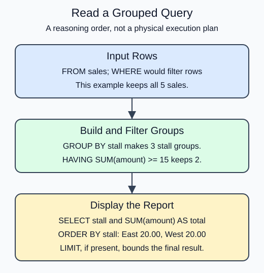

# Filter groups with HAVING

A market organizer wants only stalls whose combined sales reach 15. That condition belongs in `HAVING`, because the total does not exist until after grouping. WHERE tests individual source rows; HAVING tests groups.

In the demo, all five sales enter their groups. HAVING removes North's group because its sum is 7. East and West remain. Moving `amount >= 15` into WHERE would answer a different question: it would discard smaller individual sales before computing totals.

The useful mental order is FROM, WHERE, GROUP BY, HAVING, SELECT, ORDER BY, LIMIT. This is a reasoning model, not a promise about physical execution. The database can choose a different execution plan while preserving the query's meaning.

PostgreSQL does not let a SELECT alias stand in for an aggregate in HAVING. Write `HAVING SUM(amount) >= 15`, even though the result calls it `total`.




```sql run
SELECT stall, SUM(amount) AS total
FROM sales
GROUP BY stall
HAVING SUM(amount) >= 15
ORDER BY stall;
```
