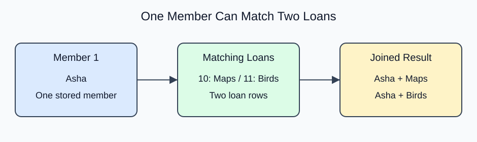

# Match related rows with INNER JOIN

A library stores member names once in `members`, while `loans` holds one row per loan. The shared member_id connects the facts. `JOIN ... ON` combines rows for which the matching condition is true; plain JOIN means INNER JOIN.

The aliases `m` and `l` are short names for tables within this query. A qualified name such as `m.name` says which table supplies a column. Qualifying identifiers is especially helpful when both tables contain member_id.

Asha appears twice because she has two loans. That is the correct one-to-many relationship, not a duplicate to erase. The joined result's grain is one row per loan. Members without loans disappear in an inner join.

Before running, predict the output row count from the matching keys. A unique member_id on the member side prevents each loan from matching several member rows. Joining on a nonunique display name could multiply rows incorrectly. The database will not infer the intended relationship just because two columns have similar names.




```sql run
SELECT m.name, l.title
FROM members AS m
JOIN loans AS l ON l.member_id = m.member_id
ORDER BY l.loan_id;
```
