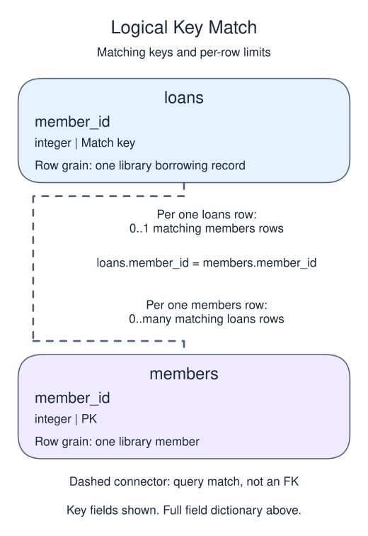

# Keep unmatched rows with LEFT JOIN

The library needs a list of members who have never borrowed. Starting from members and using LEFT JOIN preserves every member. A matching loan supplies its values; an unmatched member receives NULL in the loan columns.

## Data model

### Example data

These tables are already loaded at the start of this lesson.

#### `loans`

One row represents one library borrowing record.

| Field / SQL type | Meaning | Rules |
| --- | --- | --- |
| `loan_id` · `integer` | Identifier of the loan. | Primary key. Required; cannot be `NULL`. |
| `member_id` · `integer` | Member identifier used to match the borrower in `members`. | Nullable; `NULL` means the identifier is unrecorded. |
| `title` · `text` | Title recorded for the borrowed book; not a separate book identifier. | Nullable; `NULL` means no title value is recorded. |

#### `members`

One row represents one library member.

| Field / SQL type | Meaning | Rules |
| --- | --- | --- |
| `member_id` · `integer` | Identifier of the member. | Primary key. Required; cannot be `NULL`. |
| `name` · `text` | Member display name; different members may share a name. | Nullable; `NULL` means no name value is recorded. |

### Relationship map



`loans.member_id` matches `members.member_id`. One `members` row can have zero or many matching `loans` rows; each `loans` row can match zero or one parent because the parent key is unique. This is a logical match, not a declared foreign key; a NULL or unmatched child identifier is allowed.

Joining child detail repeats the parent fields once per matching child. An inner join omits unmatched rows; a left join keeps unmatched rows from its left input with NULLs for the missing side. Those result NULLs are separate from missing values stored in a real row.

The example retains Cleo with a missing title. Asha still appears twice: an outer join preserves unmatched rows but does not collapse multiple matches. A RIGHT JOIN preserves the right side instead; swapping table order and using LEFT JOIN often makes the question easier to read.

To find only unmatched members, test `l.loan_id IS NULL` after the join. Use a column that cannot be NULL on a real matched row, such as a primary key. Testing an optional title would confuse a missing title with a missing loan.

Be careful with filters on the optional side. `WHERE l.title = 'Maps'` removes NULL-extended rows and loses unmatched members. Put that condition in ON when you mean 'keep all members, but attach only matching Maps loans'.

```sql run
SELECT m.name, l.title
FROM members AS m
LEFT JOIN loans AS l ON l.member_id = m.member_id
ORDER BY m.member_id, l.loan_id;
```
