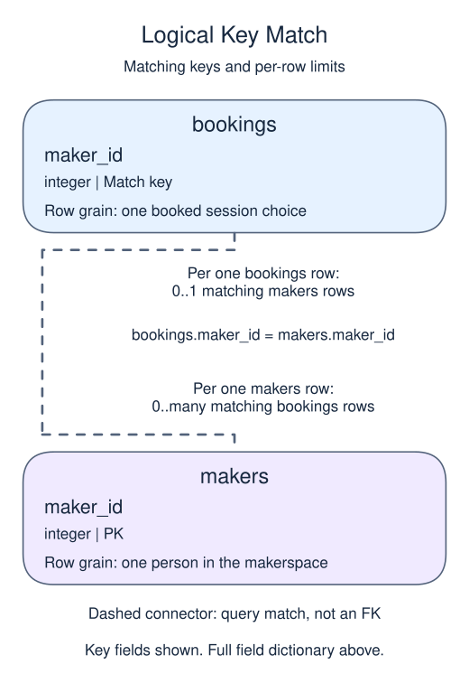

# Exercise: makers with no bookings

The makerspace wants to contact people who have not booked anything. Begin with all makers and preserve those without a partner row. Test the booking primary key, not a nullable descriptive field, to identify the missing partner.

## Data model

### Exercise data

These tables are already loaded at the start of this lesson.

#### `bookings`

One row represents one booked session choice.

| Field / SQL type | Meaning | Rules |
| --- | --- | --- |
| `booking_id` · `integer` | Identifier of this booking, not of a person. | Primary key. Required; cannot be `NULL`. |
| `maker_id` · `integer` | Person identifier used to match this booking to `makers`. | Nullable; `NULL` means the identifier is unrecorded. |
| `session` · `text` | Booked session label; not a separate session identifier. | Nullable; `NULL` means no session value is recorded. |

#### `makers`

One row represents one person in the makerspace.

| Field / SQL type | Meaning | Rules |
| --- | --- | --- |
| `maker_id` · `integer` | Identifier of the person. | Primary key. Required; cannot be `NULL`. |
| `name` · `text` | Person display name; different people may share a name. | Nullable; `NULL` means no name value is recorded. |

### Relationship map



`bookings.maker_id` matches `makers.maker_id`. One `makers` row can have zero or many matching `bookings` rows; each `bookings` row can match zero or one parent because the parent key is unique. This is a logical match, not a declared foreign key; a NULL or unmatched child identifier is allowed.

Joining child detail repeats the parent fields once per matching child. An inner join omits unmatched rows; a left join keeps unmatched rows from its left input with NULLs for the missing side. Those result NULLs are separate from missing values stored in a real row.

## Supplied data

The setup below is already loaded before each attempt. It is reference material, not code to paste into `script.sql`.

```sql
CREATE TABLE makers (maker_id integer PRIMARY KEY, name text);
CREATE TABLE bookings (booking_id integer PRIMARY KEY, maker_id integer, session text);
INSERT INTO makers VALUES (1,'Inez'),(2,'Jules'),(3,'Kai');
INSERT INTO bookings VALUES (21,1,'Woodwork'),(22,1,'Repair'),(23,2,'Printing');
```

Edit `script.sql`, use Run to inspect the result, then Submit.

## Your Task

1. Return maker `name` only for makers with no matching booking. Use a LEFT JOIN and a NULL test on booking_id. Order by maker_id.

## Result to aim for

| name |
| --- |
| Kai |
