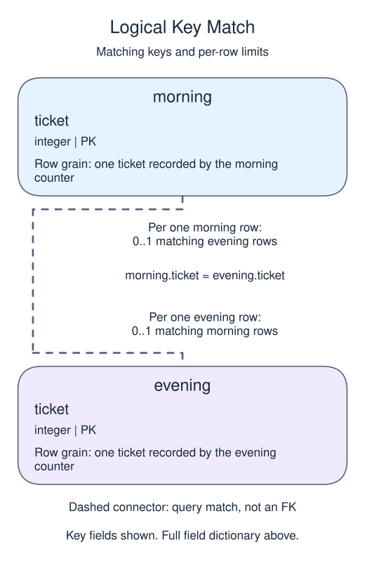

# Reconcile two lists with FULL JOIN

Sometimes neither side is the complete list. A FULL JOIN preserves matches plus unmatched rows from both inputs. This is useful for reconciling two independently collected lists.

## Data model

### Example data

These tables are already loaded at the start of this lesson.

#### `evening`

One row represents one ticket recorded by the evening counter.

| Field / SQL type | Meaning | Rules |
| --- | --- | --- |
| `ticket` · `integer` | Ticket identifier on the evening list. | Primary key. Required; cannot be `NULL`. |

#### `morning`

One row represents one ticket recorded by the morning counter.

| Field / SQL type | Meaning | Rules |
| --- | --- | --- |
| `ticket` · `integer` | Ticket identifier on the morning list. | Primary key. Required; cannot be `NULL`. |

### Relationship map



Match `morning.ticket` to `evening.ticket`. Both columns are primary keys, so a row has zero or one match in the other list. Neither list references the other with a foreign key. A full join keeps unmatched rows from both sides and fills only the missing side with NULL.

The morning counter recorded tickets 1 and 2. The evening counter recorded 2 and 3. Matching on ticket makes one shared row for 2 and separate unmatched rows for 1 and 3. Each side gets a distinct output alias so missing values reveal which list lacks the ticket.

Run the comparison. NULL here describes a missing partner row, not a ticket whose identifier is unknown. `NULLS LAST` explicitly places the unmatched right-side row after rows with a left identifier.

Some databases lack FULL JOIN syntax. PostgreSQL supports it directly; elsewhere you may need a carefully designed union of matched and unmatched results. Do not replace it with CROSS JOIN, which generates all combinations rather than reconciling keys.

```sql run
SELECT a.ticket AS morning_ticket,
       b.ticket AS evening_ticket
FROM morning AS a
FULL JOIN evening AS b ON a.ticket = b.ticket
ORDER BY a.ticket NULLS LAST, b.ticket;
```
