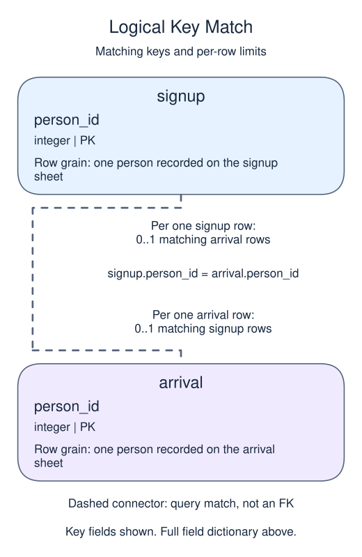

# Exercise: two attendance sheets

A signup sheet and an arrival sheet disagree. Keep identifiers from both sides so the coordinator can see signups that did not arrive and arrivals that never signed up. Do not discard those differences with an inner join.

## Data model

### Exercise data

These tables are already loaded at the start of this lesson.

#### `arrival`

One row represents one person recorded on the arrival sheet.

| Field / SQL type | Meaning | Rules |
| --- | --- | --- |
| `person_id` · `integer` | Person identifier on the arrival sheet. | Primary key. Required; cannot be `NULL`. |

#### `signup`

One row represents one person recorded on the signup sheet.

| Field / SQL type | Meaning | Rules |
| --- | --- | --- |
| `person_id` · `integer` | Person identifier on the signup sheet. | Primary key. Required; cannot be `NULL`. |

### Relationship map



Match `signup.person_id` to `arrival.person_id`. Both columns are primary keys, so a row has zero or one match in the other list. Neither list references the other with a foreign key. A full join keeps unmatched rows from both sides and fills only the missing side with NULL.

## Supplied data

The setup below is already loaded before each attempt. It is reference material, not code to paste into `script.sql`.

```sql
CREATE TABLE signup (person_id integer PRIMARY KEY);
CREATE TABLE arrival (person_id integer PRIMARY KEY);
INSERT INTO signup VALUES (10),(20);
INSERT INTO arrival VALUES (20),(30);
```

Edit `script.sql`, use Run to inspect the result, then Submit.

## Your Task

1. Reconcile signup and arrival with FULL JOIN on person_id. Return `signed_id` and `arrived_id`; sort by signup person_id NULLS LAST, then arrival person_id.

## Result to aim for

| signed_id | arrived_id |
| --- | --- |
| 10 | NULL |
| 20 | 20 |
| NULL | 30 |
