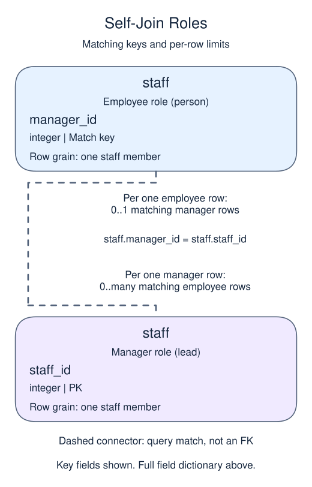

# Read one table in two roles with a self join

A self join reads the same table in two roles. Here `person` is the employee and `lead` is that person's manager. These are query aliases, not separate stored copies. The relationship still needs an ON condition.

## Data model

### Example data

These tables are already loaded at the start of this lesson.

#### `staff`

One row represents one staff member.

| Field / SQL type | Meaning | Rules |
| --- | --- | --- |
| `staff_id` · `integer` | Identifier of the staff member. | Primary key. Required; cannot be `NULL`. |
| `name` · `text` | Staff display name. | Nullable; `NULL` means no name value is recorded. |
| `manager_id` · `integer` | Staff identifier of this person's manager, matched to another `staff.staff_id`. | Nullable; `NULL` means no manager identifier is recorded. |

`manager_id` is a logical self-link, not a declared foreign key. In the sample, Eda has no manager recorded. A missing manager identifier does not remove the staff row.

### Relationship map



`staff.manager_id` on the employee row matches `staff.staff_id` on the manager row. One manager can have zero or many reporting employees; each employee can match zero or one manager because `staff_id` is unique. This is a logical match, not a declared foreign key; a NULL or unmatched child identifier is allowed.

### Tables to create

The database does not contain these tables yet. The definitions below describe the new tables for this lesson, not tables inherited from an earlier attempt.

#### `rooms`

One row represents one room.

| Field / SQL type | Meaning | Rules |
| --- | --- | --- |
| `room` · `text` | Room label, such as Blue or Green. | Nullable; `NULL` means no room value is recorded. |

This table has no declared primary or unique key; distinct sample values are not a uniqueness guarantee.

#### `slots`

One row represents one candidate schedule slot.

| Field / SQL type | Meaning | Rules |
| --- | --- | --- |
| `slot` · `text` | Time label such as 10:00, stored as text, not a SQL time or timestamp. | Nullable; `NULL` means no slot value is recorded. |

Slot labels contain no date or time-zone information. This is a list of candidate times, not a bookings table.

This table has no declared primary or unique key; distinct sample values are not a uniqueness guarantee.

### Relationship map


`staff.manager_id` matches `staff.staff_id`. One `staff` row can have zero or many matching `staff` rows; each `staff` row can match zero or one parent because the parent key is unique. This is a logical match, not a declared foreign key; a NULL or unmatched child identifier is allowed.

The top-level manager has no manager_id. LEFT JOIN, which you have already practiced, keeps that person with a NULL manager name. The manager-side staff_id is unique, so every employee can match at most one manager row. Run the directory and follow one employee's manager_id to the matching key.

```sql run
SELECT person.name, lead.name AS manager
FROM staff AS person
LEFT JOIN staff AS lead
  ON person.manager_id = lead.staff_id
ORDER BY person.staff_id;
```
