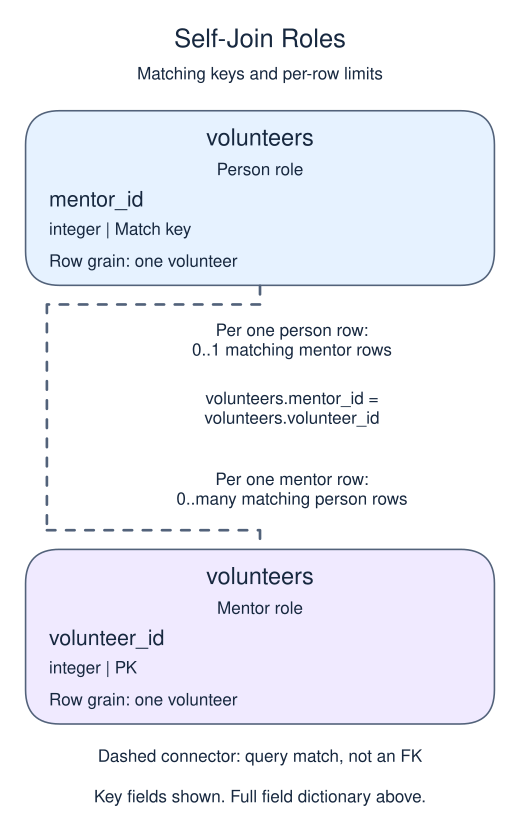

# Exercise: a mentor directory

A volunteer can mentor another volunteer, so both roles come from the same table. Use distinct aliases for the person and the mentor. Leena has no mentor and must still appear in the directory.

## Data model

### Exercise data

These tables are already loaded at the start of this lesson.

#### `volunteers`

One row represents one volunteer.

| Field / SQL type | Meaning | Rules |
| --- | --- | --- |
| `volunteer_id` · `integer` | Identifier of the volunteer. | Primary key. Required; cannot be `NULL`. |
| `name` · `text` | Volunteer display name. | Nullable; `NULL` means no name value is recorded. |
| `mentor_id` · `integer` | Volunteer identifier of this person's mentor, matched to another `volunteers.volunteer_id`. | Nullable; `NULL` means no mentor identifier is recorded. |

`mentor_id` is a logical self-link, not a declared foreign key. In the sample, Leena has no mentor recorded.

### Relationship map



`volunteers.mentor_id` on the person row matches `volunteers.volunteer_id` on the mentor row. One mentor can have zero or many mentees; each person can match zero or one mentor because `volunteer_id` is unique. This is a logical match, not a declared foreign key; a NULL or unmatched child identifier is allowed.

## Supplied data

The setup below is already loaded before each attempt. It is reference material, not code to paste into `script.sql`.

```sql
CREATE TABLE volunteers (volunteer_id integer PRIMARY KEY, name text, mentor_id integer);
INSERT INTO volunteers VALUES (1,'Leena',NULL),(2,'Moss',1),(3,'Nuri',1);
```

Edit `script.sql`, use Run to inspect the result, then Submit.

## Your Task

1. Return every volunteer `name` and their mentor name as `mentor`, preserving volunteers without mentors. Order by the volunteer_id of the person being listed.

## Result to aim for

| name | mentor |
| --- | --- |
| Leena | NULL |
| Moss | Leena |
| Nuri | Leena |
