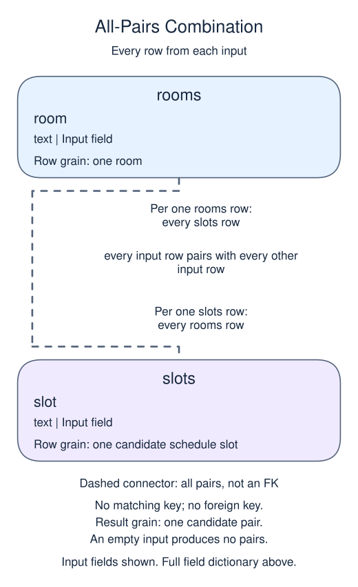

# Generate a small schedule with CROSS JOIN

A booking system sometimes needs rows that do not exist yet: every possible combination of a location and a time. CROSS JOIN builds those combinations. Each row on the left pairs with every row on the right, regardless of value.

## Data model

### Example data

These tables are already loaded at the start of this lesson.

#### `rooms`

One row represents one room.

| Field / SQL type | Meaning | Rules |
| --- | --- | --- |
| `room` · `text` | Room label, such as Blue or Green. | Nullable; `NULL` means no room value is recorded. |

This table has no declared primary or unique key; distinct sample values are not a uniqueness guarantee.

#### `slots`

One row represents one candidate schedule slot.

| Field / SQL type | Meaning | Rules |
| --- | --- | --- |
| `slot` · `text` | Time label such as 10:00, stored as text, not a SQL time or timestamp. | Nullable; `NULL` means no slot value is recorded. |

Slot labels contain no date or time-zone information. This is a list of candidate times, not a bookings table.

This table has no declared primary or unique key; distinct sample values are not a uniqueness guarantee.

### Relationship map



There is no matching key or foreign-key relationship between these lists. Each `rooms` row pairs with every `slots` row. The result grain is one candidate pair, not an existing booking; the row count is the product of the input row counts, and an empty input produces no pairs.

The demo has two rooms and two slots, so it returns four rows. The result's grain is one room-slot combination. If one input were empty, the result would be empty too. Adding a WHERE after CROSS JOIN can reject impossible combinations, but the underlying question is still about pairs.

Run the schedule and read each room's two slots. Ordinary matching joins should state their relationship in ON; use CROSS JOIN when you deliberately want this multiplication. Before cross joining large inputs, estimate the size. A hundred rooms and a thousand slots already make a hundred thousand rows.

```sql run
SELECT r.room, s.slot
FROM rooms AS r
CROSS JOIN slots AS s
ORDER BY r.room, s.slot;
```
