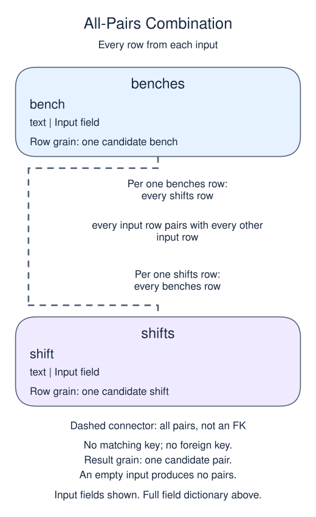

# Exercise: bench and shift combinations

A workshop is planning every bench-and-shift combination before bookings begin. No key matching is involved: each bench can be used in each shift. Generate the combinations instead of typing out a fixed schedule.

## Data model

### Exercise data

These tables are already loaded at the start of this lesson.

#### `benches`

One row represents one candidate bench.

| Field / SQL type | Meaning | Rules |
| --- | --- | --- |
| `bench` · `text` | Bench label, such as A, B or C. | Nullable; `NULL` means no bench value is recorded. |

This table has no declared primary or unique key; distinct sample values are not a uniqueness guarantee.

#### `shifts`

One row represents one candidate shift.

| Field / SQL type | Meaning | Rules |
| --- | --- | --- |
| `shift` · `text` | Shift label, such as early or late; not a timestamp. | Nullable; `NULL` means no shift value is recorded. |

The labels are sample choices, not a constrained list of statuses or time boundaries.

This table has no declared primary or unique key; distinct sample values are not a uniqueness guarantee.

### Relationship map



There is no matching key or foreign-key relationship between these lists. Each `benches` row pairs with every `shifts` row. The result grain is one candidate pair, not an existing booking; the row count is the product of the input row counts, and an empty input produces no pairs.

## Supplied data

The setup below is already loaded before each attempt. It is reference material, not code to paste into `script.sql`.

```sql
CREATE TABLE benches (bench text);
CREATE TABLE shifts (shift text);
INSERT INTO benches VALUES ('A'),('B'),('C');
INSERT INTO shifts VALUES ('early'),('late');
```

Edit `script.sql`, use Run to inspect the result, then Submit.

## Your Task

1. Return every bench and shift combination as `bench, shift`, ordered alphabetically by bench and then shift.

## Result to aim for

| bench | shift |
| --- | --- |
| A | early |
| A | late |
| B | early |
| B | late |
| C | early |
| C | late |
