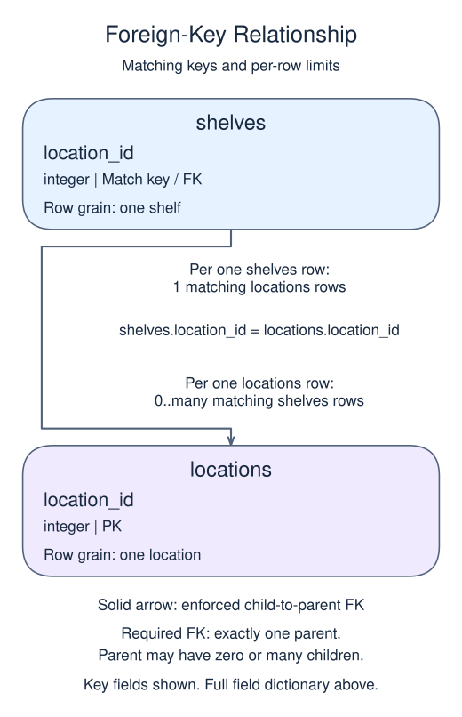

# Require a matching parent with a foreign key

A foreign key protects a relationship when data changes. REFERENCES locations(location_id) requires a non-NULL child value to match an existing parent key. Create the parent before its child.

## Data model

### Example data

This example starts without tables. The following dictionaries describe the tables to create, not preloaded tables.

#### `locations`

One row represents one location.

| Field / SQL type | Meaning | Rules |
| --- | --- | --- |
| `location_id` · `integer` | Identifier of the location. | Primary key. Required; cannot be `NULL`. |

#### `shelves`

One row represents one shelf.

| Field / SQL type | Meaning | Rules |
| --- | --- | --- |
| `shelf_id` · `integer` | Identifier of the shelf. | Primary key. Required; cannot be `NULL`. |
| `location_id` · `integer` | Identifier of the shelf's required parent location. | Required; cannot be `NULL`. Foreign key to `locations.location_id`; parent deletion is restricted. |

### Relationship map



`shelves.location_id` matches `locations.location_id`. One `locations` row can have zero or many matching `shelves` rows; each `shelves` row must reference exactly one existing parent. This is a declared foreign key.

Joining child detail repeats the parent fields once per matching child. An inner join omits unmatched rows; a left join keeps unmatched rows from its left input with NULLs for the missing side. Those result NULLs are separate from missing values stored in a real row.

Here one location can contain many shelves. Each `shelves` row identifies one shelf and stores the identifier of its location, rather than another copy of the location's facts. Unlike the earlier join-only fixtures, this definition asks the database to reject an invented location identifier. `REFERENCES` names the parent table, and its parentheses name the referenced key column.

NOT NULL is a separate rule: it makes that relationship mandatory. ON DELETE RESTRICT prevents removing a referenced parent. The empty SELECT below is only a display checkpoint, not proof of enforcement; review the declaration even when the output matches. A join reads related rows but does not create this protection.

```sql run
CREATE TABLE IF NOT EXISTS locations (location_id integer PRIMARY KEY);
CREATE TABLE IF NOT EXISTS shelves (shelf_id integer PRIMARY KEY,
       location_id integer NOT NULL REFERENCES locations(location_id) ON DELETE RESTRICT);
SELECT shelf_id,location_id
FROM shelves;
```
