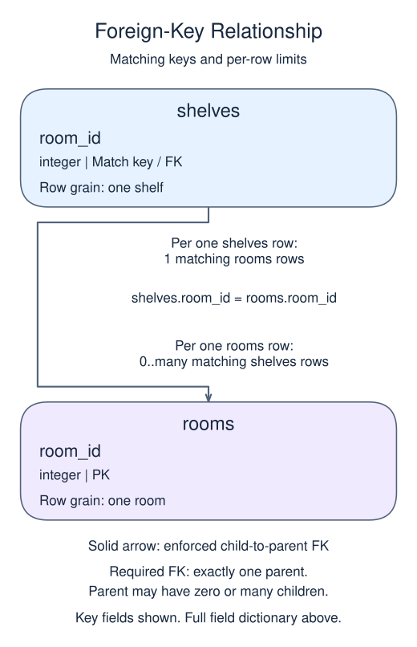

# Exercise: Require a matching parent with a foreign key

Every shelf must belong to an existing room. The rooms table is supplied; create only its child.

## Data model

### Exercise data

These tables are already loaded at the start of this lesson.

#### `rooms`

One row represents one room.

| Field / SQL type | Meaning | Rules |
| --- | --- | --- |
| `room_id` · `integer` | Identifier of the room. | Primary key. Required; cannot be `NULL`. |
| `name` · `text` | Room display name. | Nullable; `NULL` means no name value is recorded. |

### Tables to create

The database does not contain these tables yet. The definitions below describe the new tables for this lesson, not tables inherited from an earlier attempt.

#### `shelves`

One row represents one shelf.

| Field / SQL type | Meaning | Rules |
| --- | --- | --- |
| `shelf_id` · `integer` | Identifier of the shelf. | Primary key. Required; cannot be `NULL`. |
| `room_id` · `integer` | Identifier of the shelf's required parent room. | Required; cannot be `NULL`. Foreign key to `rooms.room_id`; parent deletion is restricted. |

### Relationship map

`shelves.room_id` matches `rooms.room_id`. One `rooms` row can have zero or many matching `shelves` rows; each `shelves` row must reference exactly one existing parent. This is a declared foreign key.

Joining child detail repeats the parent fields once per matching child. An inner join omits unmatched rows; a left join keeps unmatched rows from its left input with NULLs for the missing side. Those result NULLs are separate from missing values stored in a real row.

## Your Task

1. Create shelves with shelf_id integer PRIMARY KEY and room_id integer NOT NULL REFERENCES rooms(room_id) ON DELETE RESTRICT. Select shelf_id and room_id.

Write your query in `script.sql`. Use Run to inspect it, then Submit.
