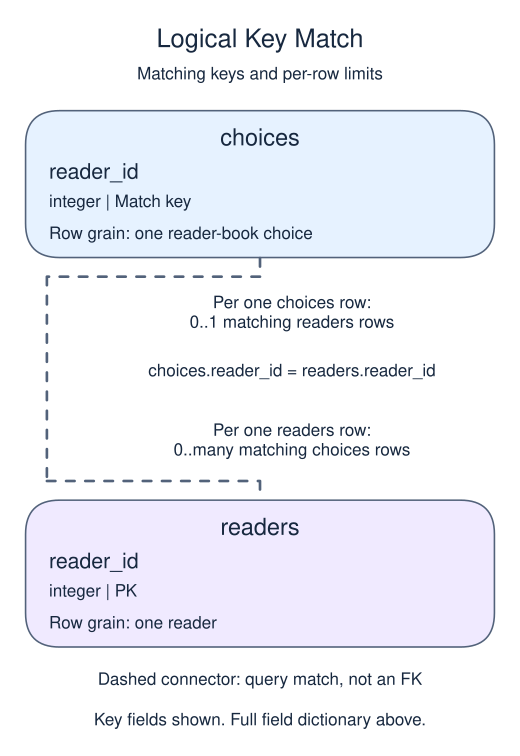

# Separate facts that depend on part of a key

Second normal form removes non-key facts that depend on only part of a composite key. In a reader-book choice, the reader name depends on reader_id, not on the reader-book pair. Store that name once in the reader table and use a join for the display.

## Data model

### Example data

These tables are already loaded at the start of this lesson.

#### `choices`

One row represents one reader-book choice.

| Field / SQL type | Meaning | Rules |
| --- | --- | --- |
| `reader_id` · `integer` | Reader identifier used to match the choice to `readers`. | Nullable; `NULL` means the identifier is unrecorded. |
| `book` · `text` | Title of one selected book. | Nullable; `NULL` means no book value is recorded. |

No key or foreign key is declared on `choices`; a reader-book pair is the intended grain, not an enforced unique pair.

This table has no declared primary or unique key; distinct sample values are not a uniqueness guarantee.

#### `readers`

One row represents one reader.

| Field / SQL type | Meaning | Rules |
| --- | --- | --- |
| `reader_id` · `integer` | Identifier of the reader. | Primary key. Required; cannot be `NULL`. |
| `name` · `text` | Reader display name. | Nullable; `NULL` means no name value is recorded. |

### Relationship map



`choices.reader_id` matches `readers.reader_id`. One `readers` row can have zero or many matching `choices` rows; each `choices` row can match zero or one parent because the parent key is unique. This is a logical match, not a declared foreign key; a NULL or unmatched child identifier is allowed.

Joining child detail repeats the parent fields once per matching child. An inner join omits unmatched rows; a left join keeps unmatched rows from its left input with NULLs for the missing side. Those result NULLs are separate from missing values stored in a real row.

Start from first normal form and imagine a choice table with `(reader_id, book)` as its intended key plus a `reader_name` column. Ana's two choices would store her name twice. Correcting one copy but not the other would give one identifier two conflicting names. The dependency `reader_id → reader_name` means that one reader identifier determines one name; it does not need the book half of the choice key. Moving the name into `readers` removes that partial dependency.

In the supplied model, one `readers` row is one reader, while one `choices` row is one reader-book choice. The compact demo declares the reader primary key, but not a key or foreign key on `choices`. It illustrates separating facts; it is not a complete constraint-enforced registration schema.

The reader name can appear on several report rows even though it is stored once. If the name changes, the choices do not need separate corrections. The query reconstructs a display from those separate facts.

```sql run
SELECT r.name,c.book
FROM readers r
JOIN choices c ON c.reader_id=r.reader_id
ORDER BY r.reader_id,c.book;
```
