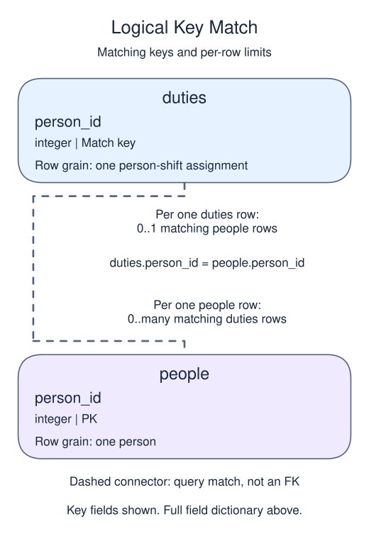

# Exercise: Separate facts that depend on part of a key

A person can work several shifts, but their name is stored once. Join that name onto the duties rather than copying it into every assignment.

## Data model

### Exercise data

These tables are already loaded at the start of this lesson.

#### `duties`

One row represents one person-shift assignment.

| Field / SQL type | Meaning | Rules |
| --- | --- | --- |
| `person_id` · `integer` | Person identifier used to match the assignment to `people`. | Nullable; `NULL` means the identifier is unrecorded. |
| `shift` · `text` | Assigned shift label, such as early or late. | Nullable; `NULL` means no shift value is recorded. |

No key or foreign key is declared on `duties`. The intended person-shift grain does not prevent duplicate assignment rows.

This table has no declared primary or unique key; distinct sample values are not a uniqueness guarantee.

#### `people`

One row represents one person.

| Field / SQL type | Meaning | Rules |
| --- | --- | --- |
| `person_id` · `integer` | Identifier of the person. | Primary key. Required; cannot be `NULL`. |
| `name` · `text` | Person display name; not necessarily unique. | Nullable; `NULL` means no name value is recorded. |

### Relationship map

`duties.person_id` matches `people.person_id`. One `people` row can have zero or many matching `duties` rows; each `duties` row can match zero or one parent because the parent key is unique. This is a logical match, not a declared foreign key; a NULL or unmatched child identifier is allowed.

Joining child detail repeats the parent fields once per matching child. An inner join omits unmatched rows; a left join keeps unmatched rows from its left input with NULLs for the missing side. Those result NULLs are separate from missing values stored in a real row.

## Your Task

1. Return name and shift by joining people to duties on person_id; order by person_id then shift.

Write your query in `script.sql`. Use Run to inspect it, then Submit.
