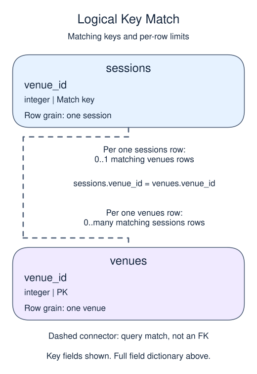

# Separate indirectly dependent facts

Third normal form removes non-key facts that depend on another non-key fact rather than directly on the row identity. A workshop venue determines its address. Repeating that address on every workshop invites contradictory copies when the venue moves. Keep the venue facts together and join them for a report.

## Data model

### Example data

These tables are already loaded at the start of this lesson.

#### `sessions`

One row represents one session.

| Field / SQL type | Meaning | Rules |
| --- | --- | --- |
| `session_id` · `integer` | Identifier intended for the session. | Nullable; `NULL` means the identifier is unrecorded. |
| `title` · `text` | Session title. | Nullable; `NULL` means no title value is recorded. |
| `venue_id` · `integer` | Venue identifier used to match the session to `venues`. | Nullable; `NULL` means the identifier is unrecorded. |

This table has no declared primary or unique key; distinct sample values are not a uniqueness guarantee.

#### `venues`

One row represents one venue.

| Field / SQL type | Meaning | Rules |
| --- | --- | --- |
| `venue_id` · `integer` | Identifier of the venue. | Primary key. Required; cannot be `NULL`. |
| `address` · `text` | Current address recorded for the venue. | Nullable; `NULL` means no address value is recorded. |

### Relationship map



`sessions.venue_id` matches `venues.venue_id`. One `venues` row can have zero or many matching `sessions` rows; each `sessions` row can match zero or one parent because the parent key is unique. This is a logical match, not a declared foreign key; a NULL or unmatched child identifier is allowed.

Joining child detail repeats the parent fields once per matching child. An inner join omits unmatched rows; a left join keeps unmatched rows from its left input with NULLs for the missing side. Those result NULLs are separate from missing values stored in a real row.

The previous lesson separated a fact tied to only part of a composite key. Here the problem can occur even with a single session identifier. In a table containing `session_id`, `venue_id`, and `address`, the dependencies would be `session_id → venue_id → address`: the address is reached indirectly through the venue. Assuming each venue has one current address, keep that address on one `venues` row and store only `venue_id` on each session. Two sessions at the same venue then share one stored address. This is the next normalization step after first and second normal form, not a rule to split every descriptive column into its own table.

The query joins each session to its venue. A new venue address would then reach every affected session report through that one relationship. These dependencies come from the business model, not just from column names.

```sql run
SELECT s.title,v.address
FROM sessions s
JOIN venues v ON v.venue_id=s.venue_id
ORDER BY s.session_id;
```
