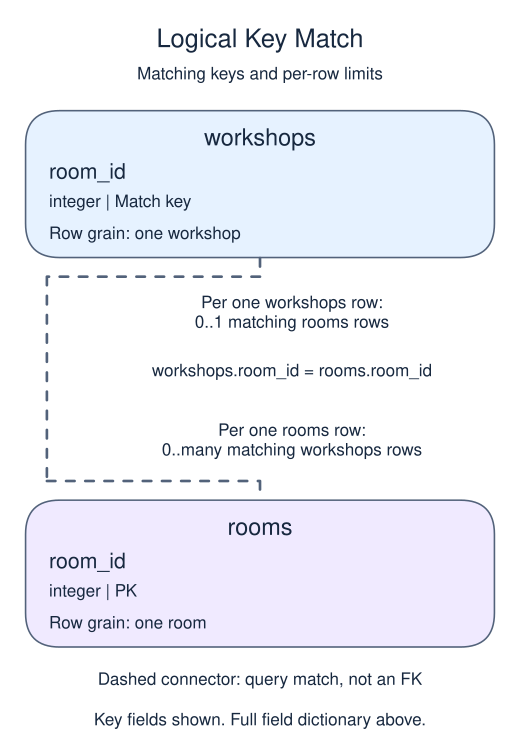

# Exercise: Separate indirectly dependent facts

Several workshops use the same room. Read each room's building through its key so a building correction needs only one stored change.

## Data model

### Exercise data

These tables are already loaded at the start of this lesson.

#### `rooms`

One row represents one room.

| Field / SQL type | Meaning | Rules |
| --- | --- | --- |
| `room_id` · `integer` | Identifier of the room. | Primary key. Required; cannot be `NULL`. |
| `building` · `text` | Building in which the room is located. | Nullable; `NULL` means no building value is recorded. |

#### `workshops`

One row represents one workshop.

| Field / SQL type | Meaning | Rules |
| --- | --- | --- |
| `workshop_id` · `integer` | Identifier of the workshop. | Nullable; `NULL` means the identifier is unrecorded. |
| `title` · `text` | Workshop title. | Nullable; `NULL` means no title value is recorded. |
| `room_id` · `integer` | Room identifier used to match the workshop to `rooms`. | Nullable; `NULL` means the identifier is unrecorded. |

This table has no declared primary or unique key; distinct sample values are not a uniqueness guarantee.

### Relationship map

`workshops.room_id` matches `rooms.room_id`. One `rooms` row can have zero or many matching `workshops` rows; each `workshops` row can match zero or one parent because the parent key is unique. This is a logical match, not a declared foreign key; a NULL or unmatched child identifier is allowed.

Joining child detail repeats the parent fields once per matching child. An inner join omits unmatched rows; a left join keeps unmatched rows from its left input with NULLs for the missing side. Those result NULLs are separate from missing values stored in a real row.

## Your Task

1. Return title and building by joining workshops to rooms on room_id, ordered by workshop_id.

Write your query in `script.sql`. Use Run to inspect it, then Submit.
