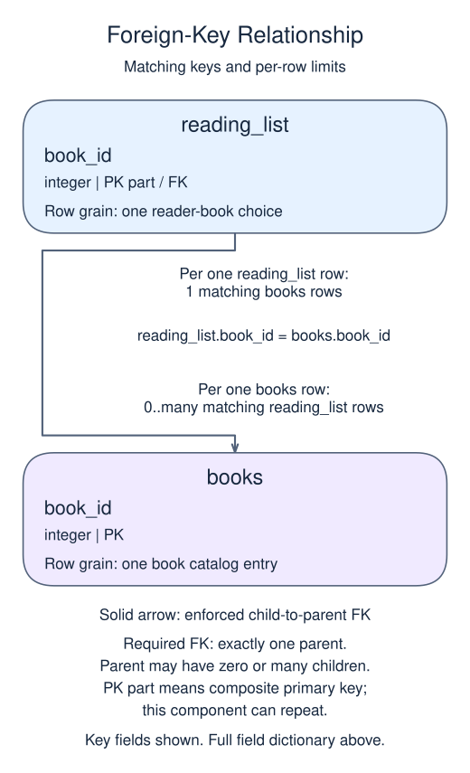
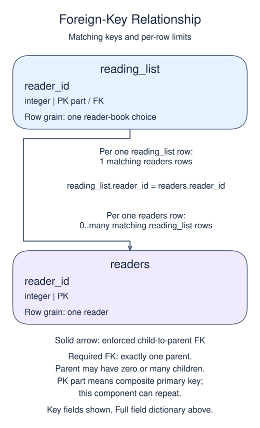

# Report a many-to-many relationship

A link table stores one row per relationship. To display both sides, join the first catalog to the link and then the link to the second catalog. Each ON condition names one key relationship.

## Data model

### Example data

These tables are already loaded at the start of this lesson.

#### `books`

One row represents one book catalog entry.

| Field / SQL type | Meaning | Rules |
| --- | --- | --- |
| `book_id` · `integer` | Identifier of the book. | Primary key. Required; cannot be `NULL`. |
| `title` · `text` | Book title; not a unique book identifier. | Nullable; `NULL` means no title value is recorded. |

#### `readers`

One row represents one reader.

| Field / SQL type | Meaning | Rules |
| --- | --- | --- |
| `reader_id` · `integer` | Identifier of the reader. | Primary key. Required; cannot be `NULL`. |
| `name` · `text` | Reader display name. | Nullable; `NULL` means no name value is recorded. |

#### `reading_list`

One row represents one reader-book choice.

| Field / SQL type | Meaning | Rules |
| --- | --- | --- |
| `reader_id` · `integer` | Required reference to the reader making the choice. | Part of the composite primary key. Required; cannot be `NULL`. Foreign key to `readers.reader_id`. |
| `book_id` · `integer` | Required reference to the chosen book. | Part of the composite primary key. Required; cannot be `NULL`. Foreign key to `books.book_id`. |

The combined primary key prevents duplicate choices. Neither identifier is unique on its own.

### Relationship map



`reading_list.book_id` matches `books.book_id`. One `books` row can have zero or many matching `reading_list` rows; each `reading_list` row must reference exactly one existing parent. This is a declared foreign key.



`reading_list.reader_id` matches `readers.reader_id`. One `readers` row can have zero or many matching `reading_list` rows; each `reading_list` row must reference exactly one existing parent. This is a declared foreign key.

The two parents have a many-to-many relationship through the link table. Each parent can have zero or many links, but each link has exactly one parent on each side. The pair key prevents duplicate links, not repeated parent names in the report. Inner joins omit parents with no links; do not sum parent-level facts after expanding them into link rows.

Here `readers` has one row per reader and `books` has one row per book. `reading_list` stores only reader-book choices: Luz chooses Orchards; Omar chooses Orchards and Seashores. Both identifiers are foreign keys, and their combined primary key prevents the same choice being stored twice. A reader can have zero or many choices, and a book can be chosen by zero or many readers. Each link row, however, must refer to exactly one existing reader and one existing book. Neither identifier is unique by itself.

Readers may choose several books, so a repeated reader name can be correct. The new reporting pattern is a three-table path; primary and foreign keys and normalization are already familiar. Follow the identifiers through the query before running it.

```sql run
SELECT r.name,b.title
FROM readers r
JOIN reading_list x ON x.reader_id=r.reader_id
JOIN books b ON b.book_id=x.book_id
ORDER BY r.reader_id,b.book_id;
```

The workshop project uses the same link-table pattern with people and workshops, shown here. Its data is separate from the reader example above.


