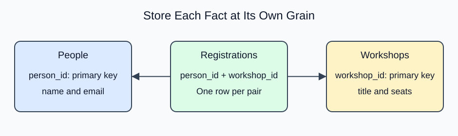

# Report a many-to-many relationship

A link table stores one row per relationship. To display both sides, join the first catalog to the link and then the link to the second catalog. Each ON condition names one key relationship.

Readers may choose several books, so a repeated reader name can be correct. The new reporting pattern is a three-table path; primary and foreign keys and normalization are already familiar. Follow the identifiers through the query before running it.

```sql run
SELECT r.name,b.title
FROM readers r
JOIN reading_list x ON x.reader_id=r.reader_id
JOIN books b ON b.book_id=x.book_id
ORDER BY r.reader_id,b.book_id;
```

The workshop project uses the same link-table pattern with people and workshops, shown here. Its data is separate from the reader example above.


