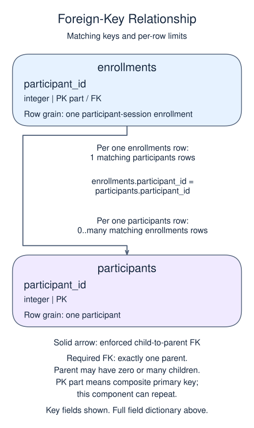
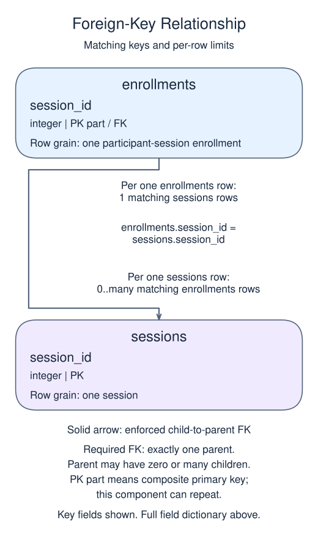

# Exercise: Report a many-to-many relationship

The workshop keeps participants, sessions and enrollments separately. Assemble the attendance list from that link table.

## Data model

### Exercise data

These tables are already loaded at the start of this lesson.

#### `enrollments`

One row represents one participant-session enrollment.

| Field / SQL type | Meaning | Rules |
| --- | --- | --- |
| `participant_id` · `integer` | Required reference to the participant. | Part of the composite primary key. Required; cannot be `NULL`. Foreign key to `participants.participant_id`. |
| `session_id` · `integer` | Required reference to the chosen session. | Part of the composite primary key. Required; cannot be `NULL`. Foreign key to `sessions.session_id`. |

The combined primary key prevents duplicate enrollments for the same pair; each identifier can recur in other pairs.

#### `participants`

One row represents one participant.

| Field / SQL type | Meaning | Rules |
| --- | --- | --- |
| `participant_id` · `integer` | Identifier of the participant. | Primary key. Required; cannot be `NULL`. |
| `name` · `text` | Participant display name. | Nullable; `NULL` means no name value is recorded. |

#### `sessions`

One row represents one session.

| Field / SQL type | Meaning | Rules |
| --- | --- | --- |
| `session_id` · `integer` | Identifier intended for the session. | Primary key. Required; cannot be `NULL`. |
| `title` · `text` | Session title. | Nullable; `NULL` means no title value is recorded. |

### Relationship map

`enrollments.participant_id` matches `participants.participant_id`. One `participants` row can have zero or many matching `enrollments` rows; each `enrollments` row must reference exactly one existing parent. This is a declared foreign key.

`enrollments.session_id` matches `sessions.session_id`. One `sessions` row can have zero or many matching `enrollments` rows; each `enrollments` row must reference exactly one existing parent. This is a declared foreign key.

The two parents have a many-to-many relationship through the link table. Each parent can have zero or many links, but each link has exactly one parent on each side. The pair key prevents duplicate links, not repeated parent names in the report. Inner joins omit parents with no links; do not sum parent-level facts after expanding them into link rows.

## Your Task

1. Return participant name and session title by joining participants, enrollments and sessions. Order by participant_id then session_id.

Write your query in `script.sql`. Use Run to inspect it, then Submit.
