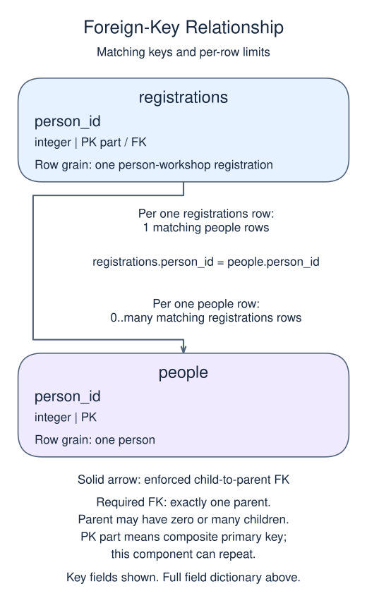
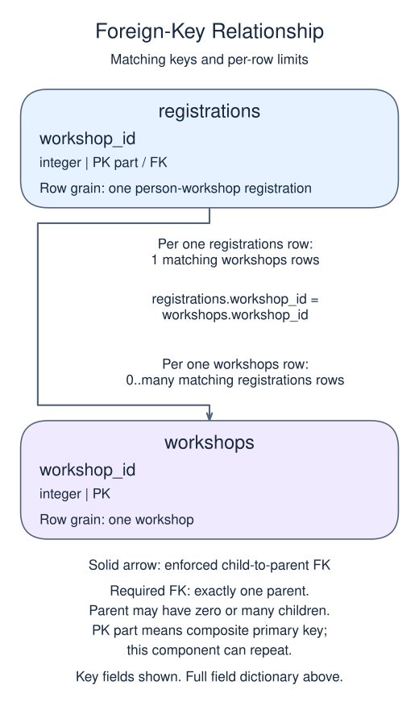

# Project: connect people to workshops

Both completed catalogs are restored. Sana will register for both workshops, while Tomas will register for Bike repair. A person can choose several workshops and a workshop can have several people, so this is a many-to-many relationship.

## Data model

### Exercise data

These tables are already loaded at the start of this lesson.

#### `people`

One row represents one person.

| Field / SQL type | Meaning | Rules |
| --- | --- | --- |
| `person_id` · `integer` | Identifier of the person. | Primary key. Required; cannot be `NULL`. |
| `name` · `text` | Person display name; not necessarily unique. | Required; cannot be `NULL`. |
| `email` · `text` | Email address for this project's one-person-per-email rule. | Unique. Required; cannot be `NULL`. |

#### `workshops`

One row represents one workshop.

| Field / SQL type | Meaning | Rules |
| --- | --- | --- |
| `workshop_id` · `integer` | Identifier of the workshop. | Primary key. Required; cannot be `NULL`. |
| `title` · `text` | Workshop title. | Required; cannot be `NULL`. |
| `seats` · `integer` | Whole-number seat capacity of this workshop. | Required; cannot be `NULL`. Check: `seats > 0`. |

### Tables to create

The database does not contain these tables yet. The definitions below describe the new tables for this lesson, not tables inherited from an earlier attempt.

#### `registrations`

One row represents one person-workshop registration.

| Field / SQL type | Meaning | Rules |
| --- | --- | --- |
| `person_id` · `integer` | Required reference to the registered person. | Part of the composite primary key. Required; cannot be `NULL`. Foreign key to `people.person_id`. |
| `workshop_id` · `integer` | Required reference to the selected workshop. | Part of the composite primary key. Required; cannot be `NULL`. Foreign key to `workshops.workshop_id`. |

The combined primary key prevents duplicate registrations for the same pair. It does not enforce workshop seat capacity.

### Relationship map



`registrations.person_id` matches `people.person_id`. One `people` row can have zero or many matching `registrations` rows; each `registrations` row must reference exactly one existing parent. This is a declared foreign key.



`registrations.workshop_id` matches `workshops.workshop_id`. One `workshops` row can have zero or many matching `registrations` rows; each `registrations` row must reference exactly one existing parent. This is a declared foreign key.

The two parents have a many-to-many relationship through the link table. Each parent can have zero or many links, but each link has exactly one parent on each side. The pair key prevents duplicate links, not repeated parent names in the report. Inner joins omit parents with no links; do not sum parent-level facts after expanding them into link rows.

### State for this lesson

Both parent catalogs are restored. Only `registrations` is new in this stage; its relationship map describes the intended completed design, not a preloaded link table.

Create a registrations link table instead of repeating names and titles. The pair `(person_id, workshop_id)` is its primary key, which makes both values mandatory and prevents duplicate registrations for the same pair. Each key also references its parent table.

Finish by joining the three tables into an attendance list. This is the same reporting pattern you practiced in the link-table exercise, now applied to a schema you have built yourself. Keep the final ordering by person identifier and then workshop identifier so a report reader can follow one person's choices.

The result comparison does not enforce the schema for you. Check both REFERENCES clauses and the composite primary key before finishing. You now have a register that can add a person, a workshop, or a registration without copying unrelated facts.

## Restored starting state

This read-only setup runs before your SQL. Add only the new stage in `script.sql`.

```sql
CREATE TABLE people (
  person_id integer PRIMARY KEY,
  name text NOT NULL,
  email text NOT NULL UNIQUE
);
INSERT INTO people (person_id, name, email)
VALUES (1, 'Sana', 'sana@example.test'),
       (2, 'Tomas', 'tomas@example.test');
CREATE TABLE workshops (
  workshop_id integer PRIMARY KEY,
  title text NOT NULL,
  seats integer NOT NULL CHECK (seats > 0)
);
INSERT INTO workshops (workshop_id, title, seats)
VALUES (10, 'Bike repair', 3), (20, 'Seed saving', 2);
```

Edit `script.sql`, use Run to inspect the result, then Submit.

## Your Task

1. Create registrations with person_id referencing people(person_id), workshop_id referencing workshops(workshop_id), and PRIMARY KEY (person_id, workshop_id). Insert pairs (1,10), (1,20), (2,10). Return person name as `person` and workshop title as `workshop`, ordered by person_id and workshop_id.

## Result to aim for

| person | workshop |
| --- | --- |
| Sana | Bike repair |
| Sana | Seed saving |
| Tomas | Bike repair |
